# Manufacturing rule checker

A later STEP.bench level asks for a part that can actually be made. The
task brief names the process ("filament printed, 20 pieces", "injection
moulded, 10,000 pieces"), and the checker applies that process's rules to
the submitted solid. A situation can have different correct answers for
different processes: a C-shaped bracket prints well lying on its back but
cannot come out of a two-part mould.

The checker is part of STEP.bench and depends on no outside DFM tool. The
FreeCAD DFM Workbench (LGPL) was read for its list of rule ideas; no code
was taken from it.

```
uv run python -m jointbench.dfm part.step --process fdm
uv run python -m jointbench.dfm part.step --process moulding --direction 0,0,1 --json
uv run python -m jointbench.dfm part.step --process fdm --fields out/ --images out/
uv run python -m jointbench.dfm --selftest
uv run python -m jointbench.dfm --selftest --images docs/dfm --level1 tasks/L1-s*
```

From Python: `from jointbench.dfm import check; rep = check("part.step", "fdm")`.

## What a report says

For each rule of the process: pass or fail, a one-line reason, the
measured number with its limit and unit, and **where** on the part it fails
(a point in world coordinates and the index of the face it lies on, so a 3D
viewer can mark it). The report also gives the direction used and how it
was chosen. The exit code is 0 when every rule passes, 1 when one fails.

The same file and process always give the same report, down to the last
digit.

## Where the rules live

Each process is one plain file in `src/jointbench/dfm/processes/`:
`fdm.toml`, `moulding.toml`, `pbf.toml`, `milling.toml`. Every limit has a value, a
unit and a one-line source note. To change a rule, change the number
there; no code needs reading. The same files hold the measuring settings
(sample spacing, the hole size exempt from overhang, and so on), each also
with a unit and an explanation.

## Exact and sampled measurement

Most rules read their number straight off the solid's own faces and edges:
the tilt of a flat face, the radius of a cylinder, the angle between two
faces at an edge, the number of closed skins. These are **exact**. They
cannot miss anything.

Some properties belong to every point of a surface rather than to a face:
how thick the wall is here, how far it is to the next face, whether a mould
half can see this spot. For those, the part is covered with a fine
triangle mesh, **no triangle side longer than 1.5 mm**, and each triangle
is judged at its centre (taken on the true surface, not the flat
triangle). At that point the measurement itself is exact (a ray against the
true surfaces, a true distance). The only approximation is which points are
looked at. The mesh comes from the geometry alone, so it is the same every
run. It is also the mesh the pictures and the field file show, so the
colours are exactly the points the rules judged, nothing interpolated.

**What sampling can miss:** a fault narrower than about 1.5 mm that lies
between triangle centres, in the middle of a face that is otherwise fine.
For example, a thin spot under a small dimple, or a 1 mm sliver of
undercut on a large face. A fault that is a whole face (a thin fin, a
narrow slot, an undercut groove) is always seen, because every face gets
triangles. The spacing can be made finer in the process file, at the cost
of time; a full level 1 bracket (about 50,000 triangles) takes 15-30
seconds per process.

## The direction

Printing depends on the **build direction** (which way is up from the
bed). Moulding depends on the **pull direction** (the line along which the
two mould halves separate). The direction is chosen like this:

1. If the task, the caller or the agent (see below) declares it, that
   direction is used, and the report says "as declared".
2. Otherwise a fixed list of candidates is tried: the six axis directions
   (three lines for moulding, since a mould pulls both ways), then the
   largest flat faces of the part, each turned to lie on the bed or the
   parting plane. The candidate passing the most rules wins; a tie goes
   to the one with the smaller failing area, then to the earlier one in
   the list. The report names the winner and lists every candidate with
   the rules it failed.

So "can this be printed at all, in a sensible orientation" is answered by
default, and a level that wants to fix the orientation can state it.

**Declared by the agent.** When the same challenge is issued per process,
the agent declares the direction in a `build.json` beside `output.step`:

```
{"process": "fdm",      "build_direction": [x, y, z]}   from the bed up into the part
{"process": "moulding", "pull_direction":  [x, y, z]}   the line the mould halves part along
{"process": "pbf"}                                      no direction: the powder holds the part
```

`jointbench.dfm.declaration(path)` reads it (folder or file) and returns
(process, direction or None). A malformed direction (not three finite
numbers, or all zero) raises ValueError. A declared direction is used as
given, and the report says **"as declared"**. Without one, the checker
chooses as above, and the report says **"chosen by the checker (best of N
candidates: ...)"**. On the command line: `--declared build.json`, or
`--direction x,y,z`.

For filament, the declared bottom must be something to stand on. The
first-layer rule `FDM_BED_CONTACT` needs flat faces within 1° of the bed,
at the lowest point, totalling at least 50 mm² (about a 7 × 7 mm
footprint). A direction that puts only a line or a point on the bed fails
it. A round bar declared on its curved side is a self-test row (0 mm² on
the bed).

## Pictures and fields

Every rule that measures something across the part also leaves its
measurement on the mesh, so it can be seen, not only read as one worst
number.

**Pictures** (`--images DIR`): one PNG per rule, named
`<part>.<process>.<RULE>.png`. The part is shown in an isometric view,
coloured by the rule's measurement, with a legend on the right.

* Colour scale: viridis, dark purple to yellow. Its lightness rises
  steadily, so it reads for colour-blind viewers and prints in grey.
  Angles use a fixed scale (overhang 0-90°, draft 0-10°) so pictures can be
  compared. Thickness and gap scales stop at a few times the limit (the top
  label then reads ">="), because a straight ray along a plate reads its
  length and would wash out the colours.
* The limit is a thick black line on the colour bar, and the failing side
  of the bar is hatched.
* Failing regions on the part are hatched black and white over their
  colour, so they stand out in colour and in grey.
* Plain light grey: the rule does not measure there (an overhang rule on an
  upward face, a hole rule away from holes). Orange marks a region for rules
  about regions (bed contact, undercut, sealed hollow).
* The worst point is ringed and labelled. Bridges are drawn as lines with
  their length; sharp inner corners as heavy lines along the edge.
* The view is chosen from the eight isometric corners: the one showing the
  most failing area, or, if nothing fails, the most measured area. A sealed
  hollow is shown with the part cut open through it.

The pictures below come from the self-test parts, one per rule, each the
part that must fail that rule (`--selftest --images docs/dfm` makes them).

**Field file** (`--fields DIR`): one JSON per part and process,
`<part>.<process>.fields.json`, for a 3D viewer. It does not assume any
particular viewer.

```
{
  "format": "jointbench-dfm-fields", "version": 2,
  "file": "part.step", "process": "fdm", "process_name": "...", "passed": false,
  "direction": {"name": "build direction", "vector": [0, 0, 1],
                "chosen": "as declared" | "chosen by the checker (best of N candidates: ...)"},
  "units": {"length": "mm", "angle": "deg", "area": "mm2"},
  "sampling": {"verdict_spacing_mm": 1.5, "display_spacing_mm": 1.5, "note": "..."},
  "mesh": {
    "vertices": [[x, y, z], ...],           world coordinates, mm
    "triangles": [[i, j, k], ...],          0-based, counter-clockwise seen from outside
    "triangle_face": [f, ...],              which face of the solid each triangle is on
    "edges": [[[x, y, z], ...], ...]        the solid's true edges as polylines
  },
  "fields": [                               one per rule, in the order of the process file
    {
      "id": "wall_thickness", "rule": "FDM_WALL_MIN", "title": "...",
      "type": "scalar" | "flag",            flag: 1 = in the region, 0 = not
      "unit": "mm", "kind": "min" | "max",  which side of the limit is good
      "limit": 0.8, "status": "pass" | "fail", "reason": "...",
      "on": "triangle",
      "values": [v | null, ...],            one per triangle; null = not measured there
      "corner_values": [[a, b, c] | ..., ...]   (scalar fields) per triangle, a value at each corner,
                                            for smooth shading: see below
      "fail": [t, ...],                     indices of failing triangles
      "range": [min, max],                  of the non-null values
      "probes": [{"label": "worst" | "lowest" | "25 %" | "median" | "75 %" | "highest",
                  "point": [x,y,z], "value": v, "face": f, "triangle": t}, ...]
      "note": "what the value means and what null means",
      "marks": [                            extra things to draw
        {"type": "segment", "points": [[x,y,z], [x,y,z]], "label": "12.0 mm", "value": 12.0, "fail": true},
        {"type": "polyline", "points": [...], "label": "sharp", "fail": true},
        {"type": "point", "point": [x,y,z], "label": "lowest point", "fail": true}
      ],
      "cut": [x, y, z] | null,              show the part cut open here (inner faces)
      "where": [{"point": [x,y,z], "face": f}]   the worst place, as in the report
    }
  ]
}
```

**Version 2** (additive: every version 1 key is unchanged) adds
`sampling`, `corner_values` and `probes`, for a viewer that draws a
smooth gradient with a legend and value tags, like the DFM Workbench's
thickness map:

* **`corner_values`**: for every triangle, a value at each of its three
  corners. Each is the area-weighted mean of the measured triangles of the
  same face that share that corner. A viewer that interpolates them gets
  a smooth map within each face and a sharp change at the solid's real
  edges: values are never blended across two faces.
* **`sampling`**: the display mesh is the mesh the rules judged (1.5 mm).
  With corner interpolation a level 3 part does not look blocky at that
  size. A finer display mesh would cost measuring time in proportion to
  its sample count (the section ball is about 0.5 ms a sample), so it is
  not the default.
* **`probes`**: labelled points for value tags. They are the worst place
  (as in the report), the lowest and highest measured values, and the
  quartiles.
* **The section-thickness field** (largest inscribed ball, the measure the
  Workbench shows) is complete over the whole surface, passing regions
  included. For the verdict only the largest balls are measured; the full
  map is computed when a field file or picture is asked for.

**Click-to-probe:** `jointbench.dfm.probe(step, (x, y, z))`, or
`python -m jointbench.dfm part.step --probe x,y,z`. It moves the point to
the nearest spot on the surface and measures, exactly, the wall thickness
(straight through), the gap (straight out) and the section thickness
(largest ball) there. It returns the surface point, the face, the normal,
how far the point was moved, and the three values in mm. One probe costs
a few milliseconds once the part is loaded.

The `values` array is still per triangle, because each triangle is
judged at its centre.
Vertices are shared between the triangles of one face and across
neighbouring faces, so the mesh is closed apart from occasional hairline
slits where fillets meet. A viewer colours `values` with any scale, hatches
or outlines the `fail` triangles, and draws the legend from `unit`, `limit`
and `kind`. A level 1 bracket gives about 50,000 triangles, roughly 5 MB of
JSON.

## Filament printing (FDM)

Limits are for a 0.4 mm nozzle, 0.2 mm layers, PLA or PETG, no support
material and no brim. They are the middle of published guidance, not the
best a tuned printer can do.

| Rule | Limit | Measured | Source |
|---|---|---|---|
| `FDM_WALL_MIN` | at least 0.8 mm | sampled | two lines of a 0.4 mm nozzle; Hubs and Prusa guides |
| `FDM_OVERHANG` | at most 45° | sampled | the 45° rule (Hubs, Prusa, Ultimaker) |
| `FDM_BRIDGE` | at most 10 mm | sampled | Hubs: bridges to about 10 mm without sag |
| `FDM_HOLE_MIN` | at least 2 mm | exact | Hubs: smaller holes close up |
| `FDM_PIN_MIN` | at least 3 mm | exact | Hubs: thinner pins print poorly and snap |
| `FDM_GAP_MIN` | at least 0.5 mm | sampled | Hubs: closer features fuse |
| `FDM_BED_CONTACT` | at least 50 mm² | exact | judgement: about a 7 x 7 mm footprint |
| `FDM_SEALED_HOLLOW` | none | exact | a closed cavity traps air or support |

**Wall thickness.** From each sample a ray goes straight into the
material until it comes out again. That length is the wall there. A ray can
over-estimate a wall (along a plate rather than across it) but never
under-estimate one, so the smallest value is a safe minimum.

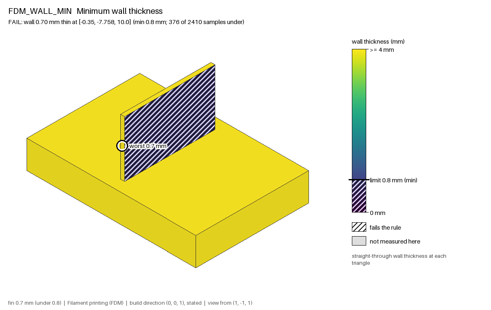

**Overhang.** The angle of each downward-facing surface from vertical: a
vertical wall is 0°, a flat ceiling 90°. Exempt: faces lying on the bed,
the bores of round holes up to 10 mm across (they print with a slight sag
at the top; the size is a setting), and flat ceilings that are bridges
(next rule). A flat ceiling with nothing below one of its ends is a
cantilever and counts as a 90° overhang.

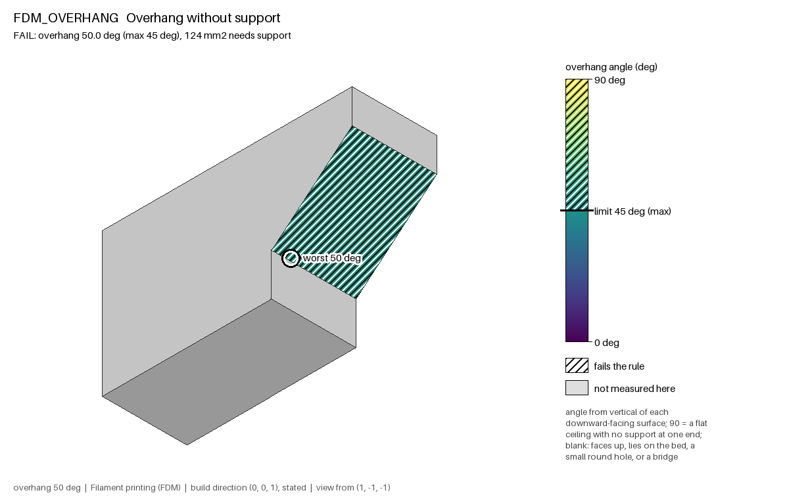

**Bridge.** For each sample on a flat ceiling, straight lines are drawn
through it in 8 directions. A line is a bridge if both its ends land on
material below. The shortest such line is the span the printer must cross
there. The longest of those spans over the whole part is compared with the
limit. The ends are found exactly on the face outline.

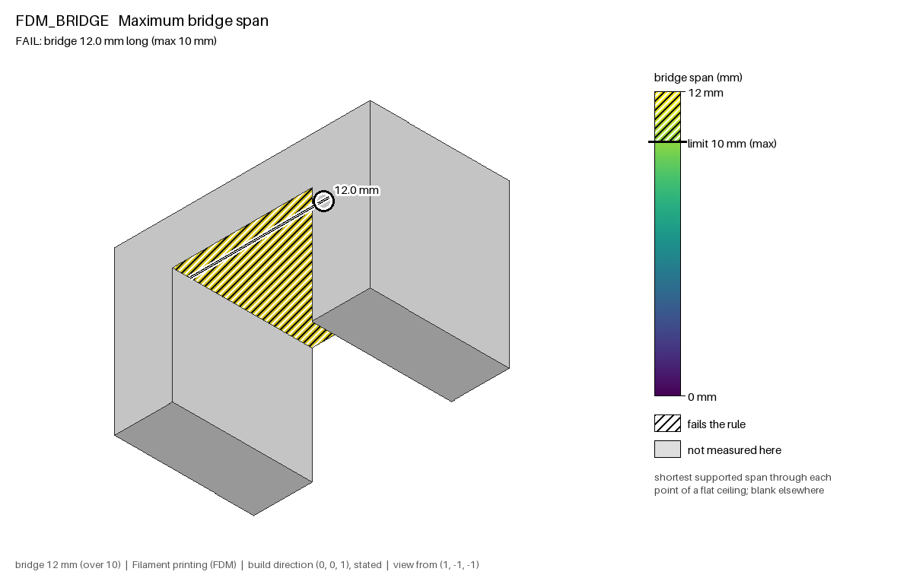

**Holes and pins.** Every cylindrical face is read exactly. Faces on the
same axis and radius are put together. Those covering at least half a
circle are holes (material outside) or pins (material inside). Smaller arcs
are fillets and do not count.

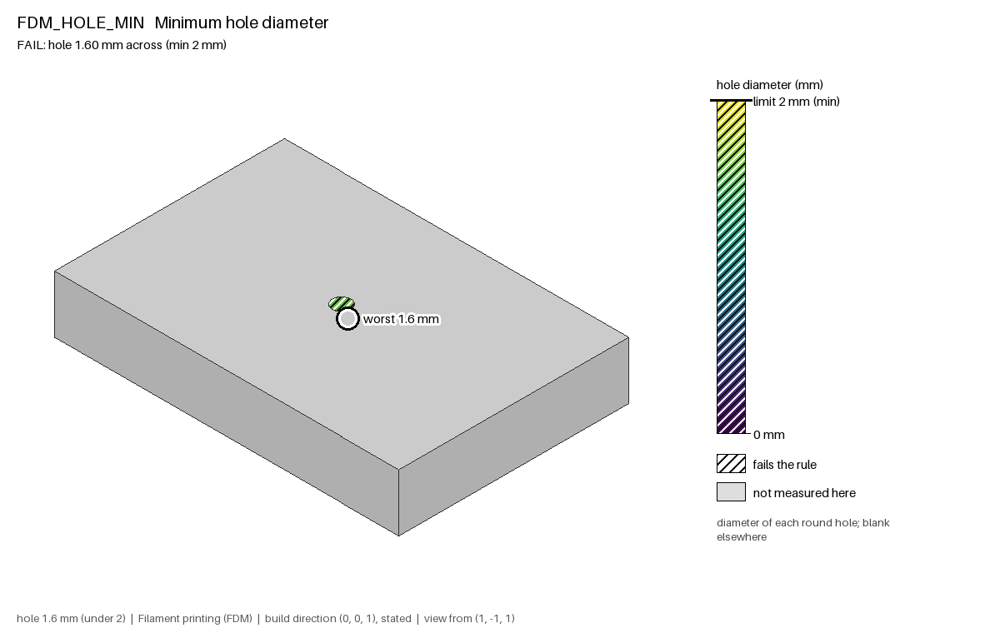

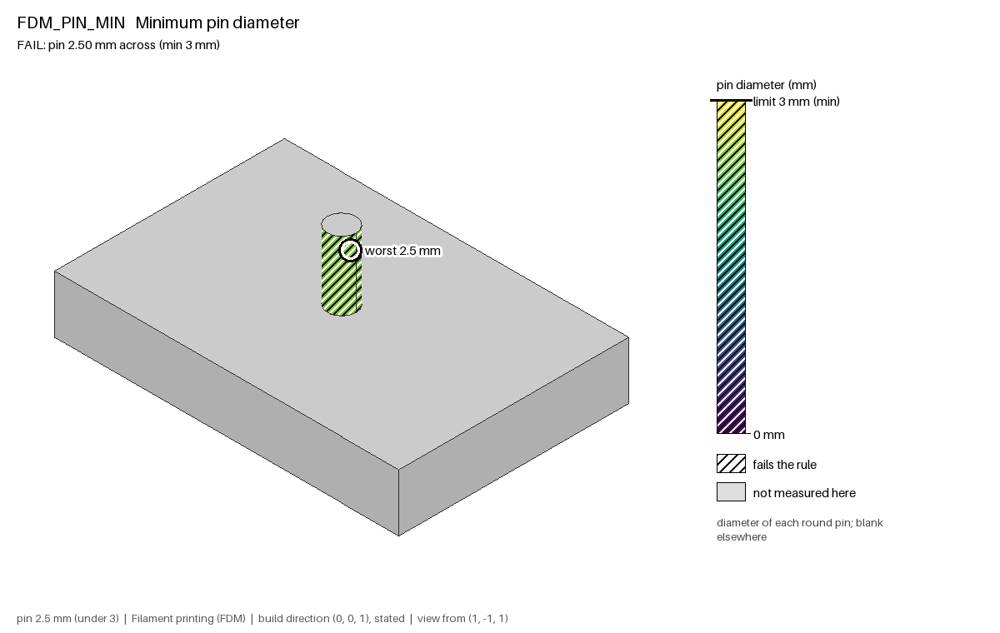

**Gap.** From each sample a ray goes straight out of the surface; if it
meets the same part again, that distance is the gap. It catches slots,
narrow clearances and small holes alike.

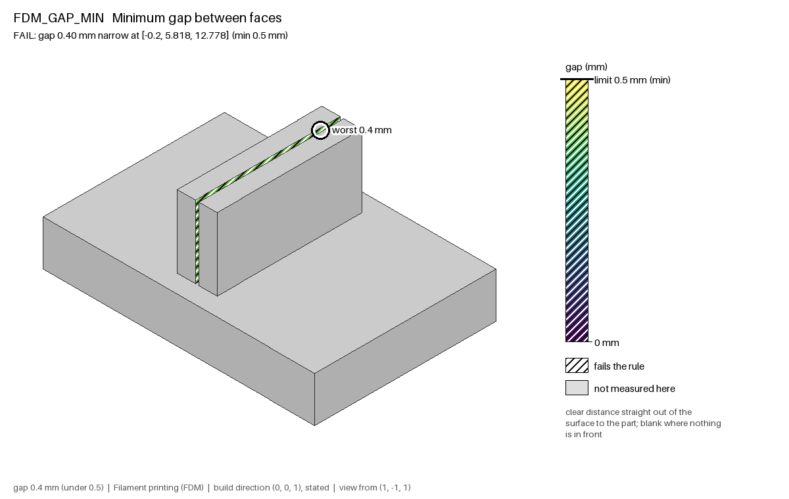

**Bed contact.** The flat faces facing straight down at the part's lowest
point, summed. No flat face there (a part standing on an edge, a point or
a curve) fails.

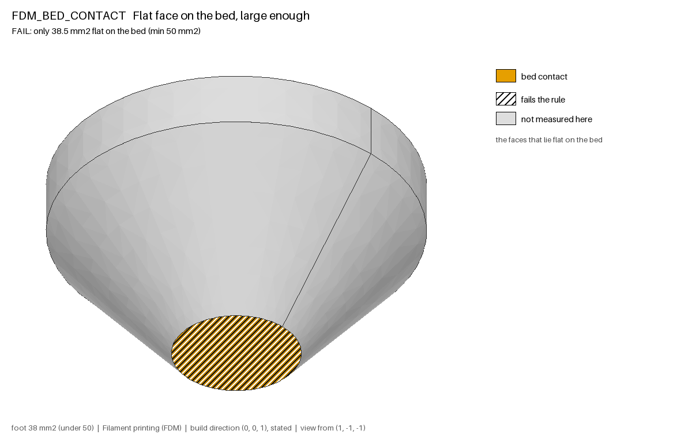

**Sealed hollows.** A solid with more than one closed skin has a sealed
cavity inside.

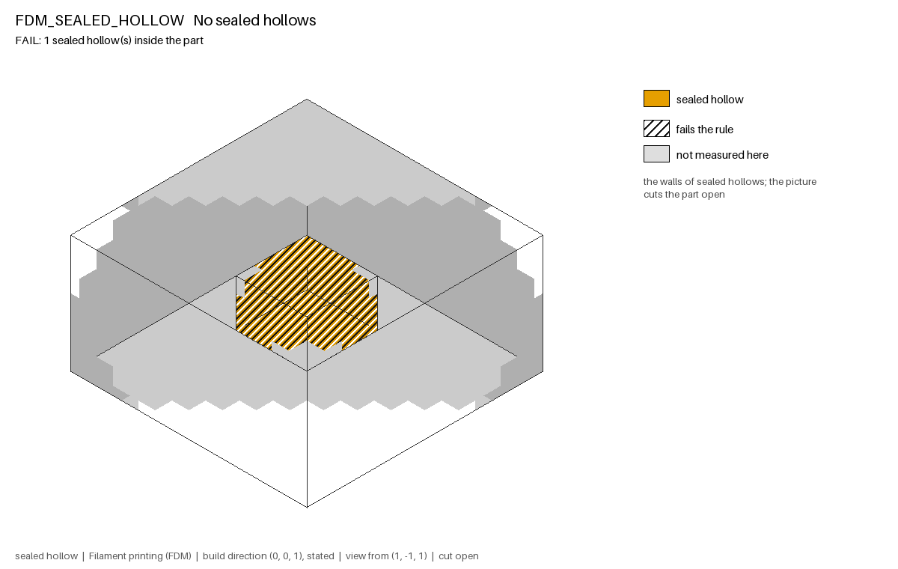

## Injection moulding (two-part mould, straight pull)

Limits are for a general-purpose plastic such as ABS or PP, in the cheap
mould: two halves, no side actions (no sliders, no lifters). A part that
needs side actions fails `IM_UNDERCUT`, on purpose.

| Rule | Limit | Measured | Source |
|---|---|---|---|
| `IM_DRAFT` | at least 1° | sampled | Protolabs and most guides |
| `IM_UNDERCUT` | none | sampled | a straight pull releases only what it can see |
| `IM_WALL_MIN` | at least 1.0 mm | sampled | Protolabs: ABS from about 1.1 mm |
| `IM_WALL_MAX` | at most 4.0 mm | sampled | Protolabs: ABS to about 3.5-4 mm |
| `IM_WALL_UNIFORM` | thickest at most 1.5 x nominal | sampled | guides: keep variation within 25-50 % |
| `IM_RIB_RATIO` | rib at most 0.6 x wall | exact | Protolabs and others: 40-60 % |
| `IM_SHARP_CORNER` | inner radius at least 0.5 x wall | exact | Protolabs: 0.5 x wall |

**Draft.** Faces running within 10° of the pull line need draft. Their
angle to the pull line must be at least 1°. Faces across the pull (flat
tops and bottoms) need none.

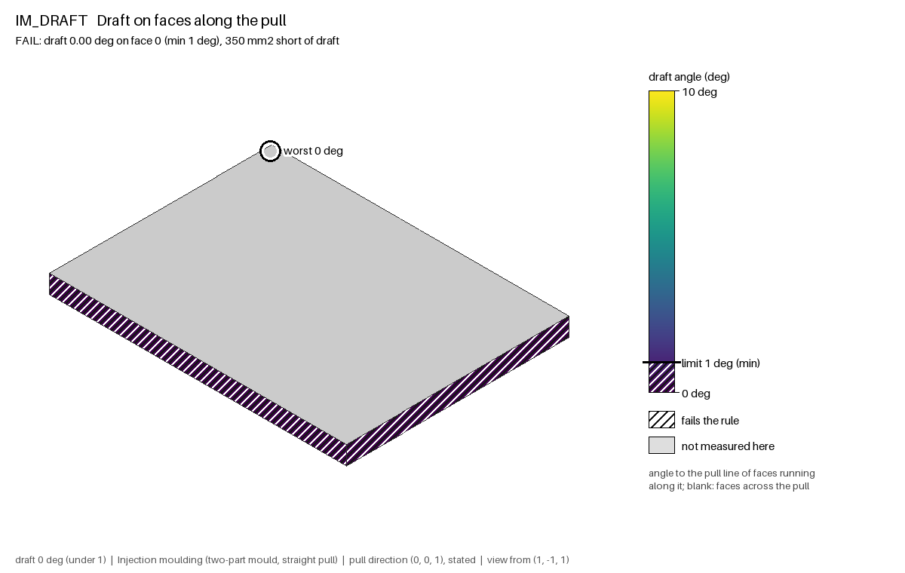

**Undercut.** At every sample, the mould half facing that surface must be
able to pull straight away from it without anything of the part in the
way. A ray goes from the sample along the pull, on the side the surface
faces. If the ray meets the part again, that spot is hidden from both
halves. The hidden area must be zero. A side hole, a hook, or a C-shape
across the pull all fail here.

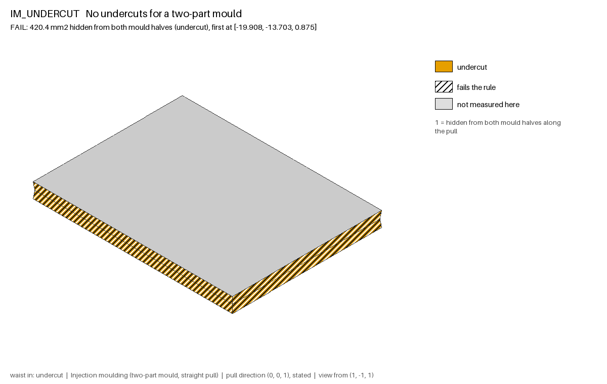

**Wall minimum.** As for printing: the shortest straight ray through the
material.

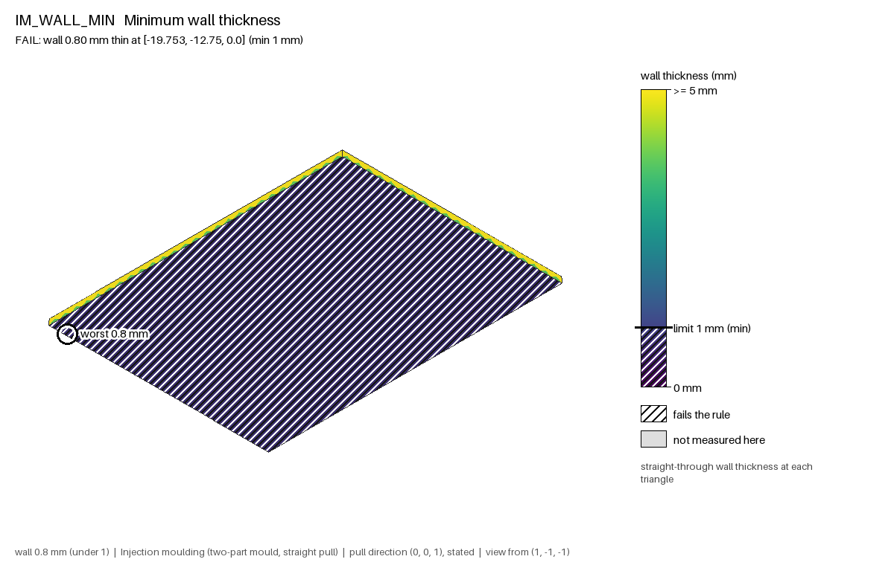

**Wall maximum.** Here the ray over-estimates (along a plate), so
something else is used: the largest ball that touches the surface at the
sample and still fits inside the material. It is found by shrinking a ball
until no surface is closer than its radius, with exact distances. Its
diameter is the true local section thickness, the thing that sinks and
voids. Near a sharp inner corner the ball is smaller than the section,
which can only make this rule more lenient there, never fail wrongly. The same happens close to a convex
edge (the ball touching there is small), which shows as darker speckles
along edges in the pictures.

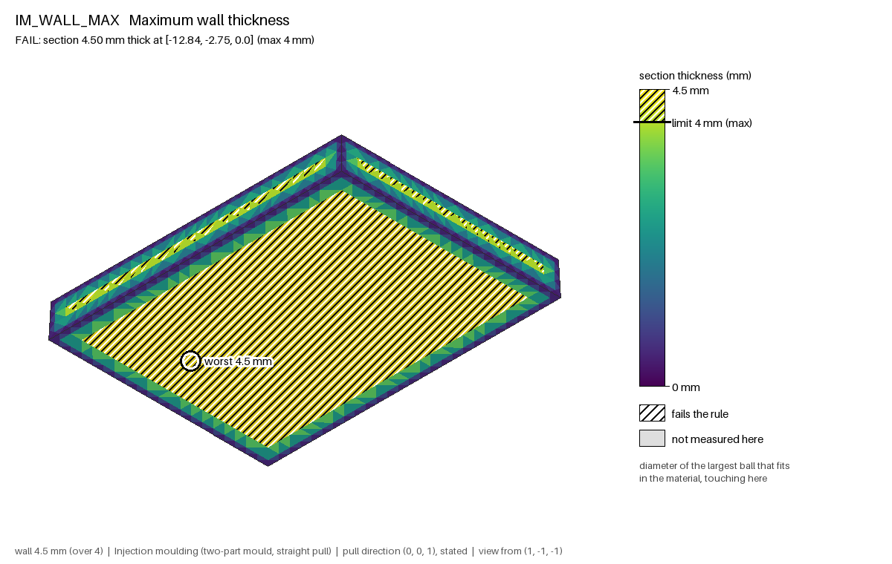

**Even wall.** The thickest section (ball above) divided by the nominal
wall. The nominal wall is the thickness most of the part's surface has:
the area-weighted median of the sampled wall. A local thick spot fails
even when it is under the absolute maximum.

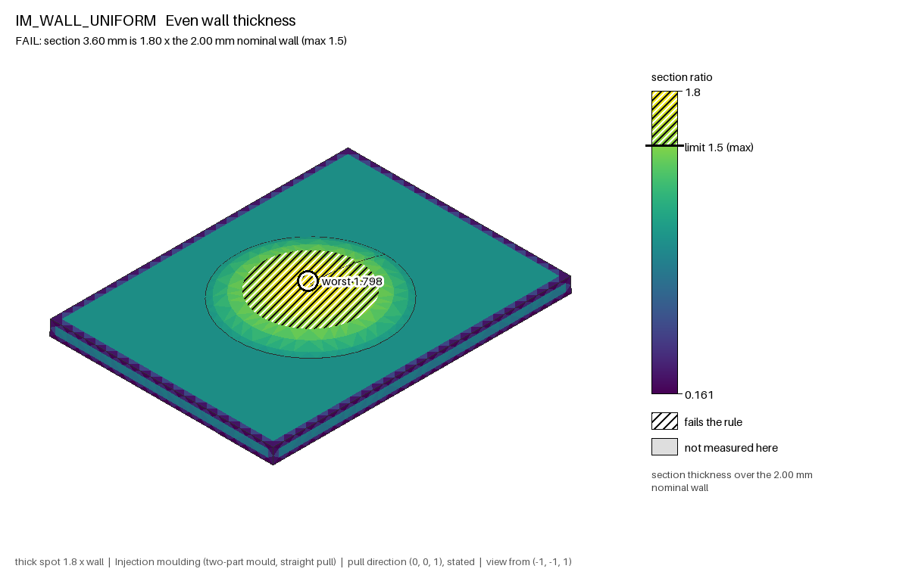

**Rib ratio.** A rib is found from the faces themselves. Two flat faces
nearly opposite each other (within 10°, so drafted ribs count) face away
from each other, and both are joined by an inner corner to the same flat
base face. The corner may be sharp or run through a fillet. The rib's
thickness is measured exactly at the base, between the lines where its two
sides meet the base plane. It is divided by the thickness of the wall it
stands on.

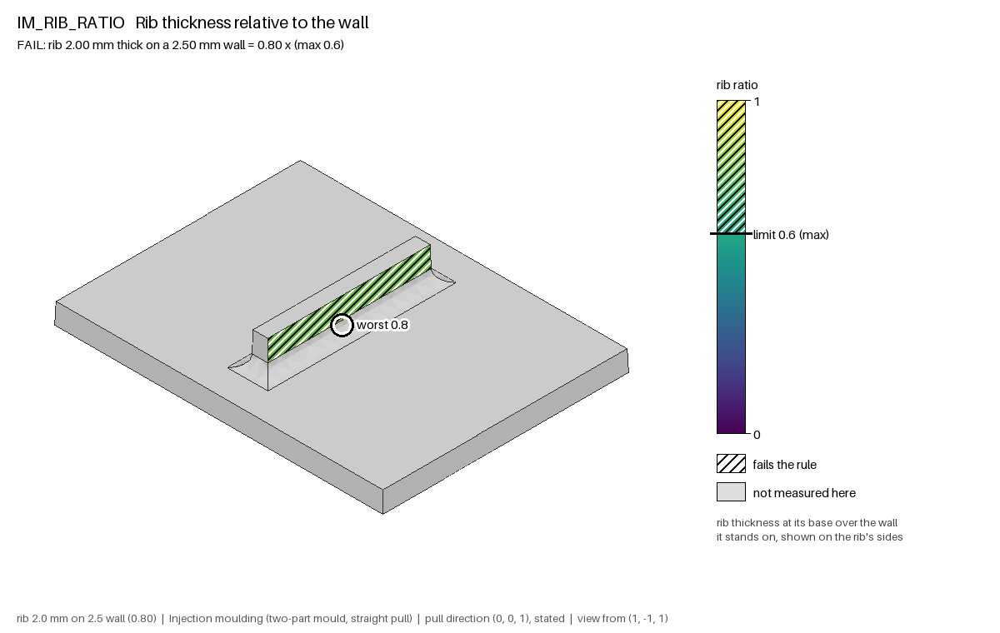

**Sharp inner corners.** Every edge where the surface turns by at least
30° (a setting) and the material is on the inside is a sharp inner corner:
radius 0, a fail. Gentler bends are not corners. Inner fillets (partial
cylinders with material outside) are read exactly; their radius divided by
the nominal wall must be at least 0.5.

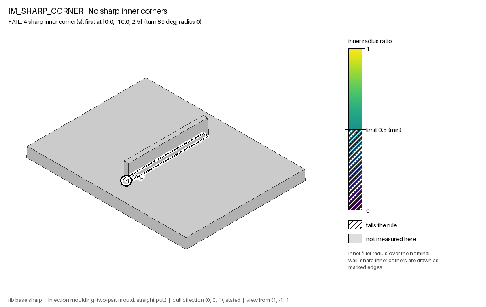

### Support (filament): two levels

The same filament test comes at two levels, set by one knob, **`support`**:

* **`"allowed"`** (brief: *"Support is allowed but counts as material"*):
  the overhang and bridge rules are reported, not required (`required:
  false` in the JSON, "info" in the text report). The material estimate
  counts support in the declared build direction, as its own line beside
  shell and infill.
* **`"forbidden"`** (the default; brief: *"must print without support"*):
  the overhang and bridge rules are required, as before.

It is set with `check(..., support="allowed")`, or the process file's
`support_allowed` setting (0 = forbidden).

**At both levels, support that cannot be removed fails the part**
(`FDM_SUPPORT_REMOVABLE`, required). Support is needed under every sample
the overhang or bridge rule flags. For each, the support column runs down
to the part or the bed, and its middle point is judged:

* **closed in**: no straight line from it in 14 directions (the axes and
  the diagonals) leaves the part. The support sits in a closed pocket or
  cavity and can never be reached.
* **too narrow**: the column ends on the part and is shorter than the
  reach limit (support in a thin gap between a ceiling and a floor of the
  part; a short column down to the bed is open all round), or the slot it
  stands in is
  narrower than the reach limit in some horizontal direction (walls close
  on both sides).

The reach limit is **3 mm**, a judgement call: the narrowest gap in which
support can still be reached with pliers or a pick and broken out. The
value is the overhang area held up by unremovable support (limit 0 mm²).
It is sampled, with exact rays, and computed once, in the final
direction.

Self-test rows:

| part | support | result |
|---|---|---|
| a shelf over open air | allowed | passes, with a support volume |
| a sealed cavity whose 14 mm ceiling needs support | allowed | fails (unremovable, and a sealed hollow) |
| the same cavity | forbidden | fails |
| a top plate cantilevered over a 2 mm gap | allowed | fails (support in a 2 mm gap) |
| the same over a 5 mm gap | allowed | passes |

## Powder bed fusion (SLS / MJF)

`--process pbf`. Nylon (PA12) on an SLS or Multi Jet Fusion machine, as a
print service runs it.

**No overhang or bridge rules.** This is the main difference from filament
printing. The part is built inside a bed of loose powder, and the powder
holds up every overhang and every bridge while the part is built. So no
rule depends on the build direction, and the report gives none
(`direction.vector` is empty in the field file). What matters instead is
the powder, which must be able to leave every hollow, and heat: thick
sections, abrupt changes of thickness and large thin flat areas distort as
they cool.

| Rule | Fails when | Limit | Source |
|---|---|---|---|
| `PBF_WALL_MIN` | a wall is thinner than | 0.8 mm | Hubs SLS 0.7 mm, HP MJF 0.5-1 mm |
| `PBF_SEALED_HOLLOW` | a cavity has no opening at all | none allowed | trapped powder cannot be removed |
| `PBF_ESCAPE_HOLES` | a hollow reached only through round holes has fewer than 2 holes of 5 mm or more | 2 holes | Hubs SLS, HP MJF |
| `PBF_HOLE_MIN` | a round hole is narrower than | 1.5 mm | Hubs SLS |
| `PBF_PIN_MIN` | a round pin is thinner than | 0.8 mm | Hubs SLS |
| `PBF_GAP_MIN` | two faces that must not fuse are closer than | 0.5 mm | HP MJF, Hubs SLS (0.4-0.5 mm) |
| `PBF_SECTION_MAX` | a solid section is thicker than | 15 mm | judgement from HP MJF / Formlabs Fuse (hollow from 10-20 mm) |
| `PBF_TRANSITION` | at an inside corner, the section on one side is more than 3 x the other | 3 x | judgement |
| `PBF_WARP_FLAT` | a flat face is more than 40 x as long as the section under it | 40 x | judgement |

Not built: minimum embossed or engraved detail (about 0.5 mm in the
guides). Telling lettering from other small features would need a notion
of "detail" the solid does not carry; it is not cheap, so it is left out.

**Wall, holes, pins, gap.** Measured exactly as for filament printing,
with these limits. Powder printing allows finer features than filament
printing, but needs a wider gap: loose powder between two close faces
sinters and joins them.

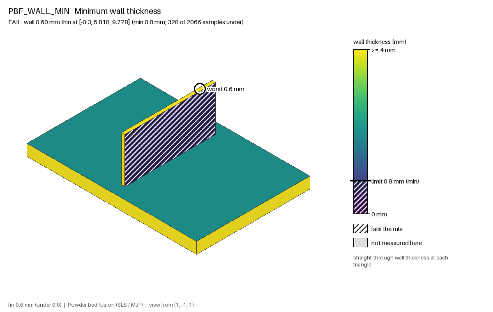

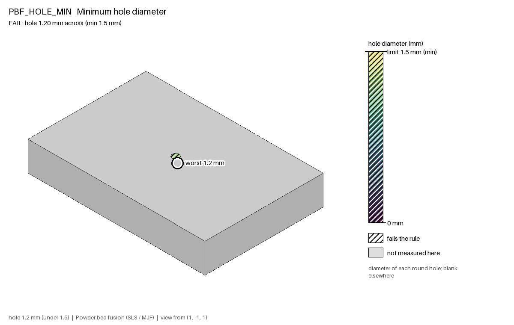

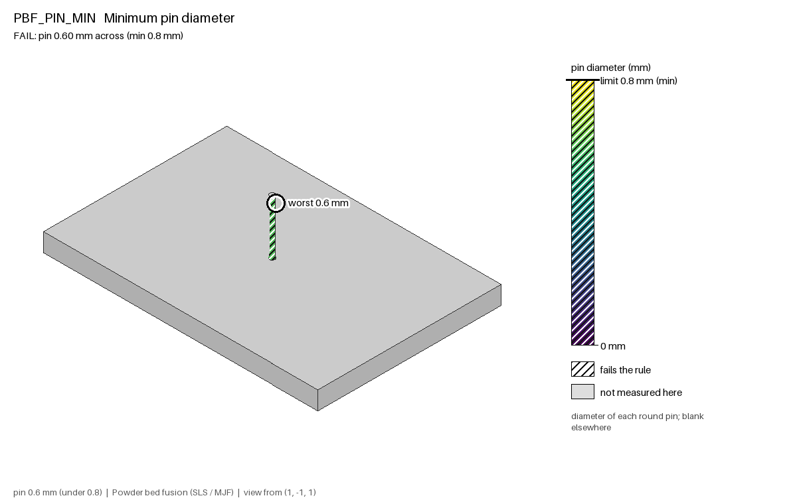

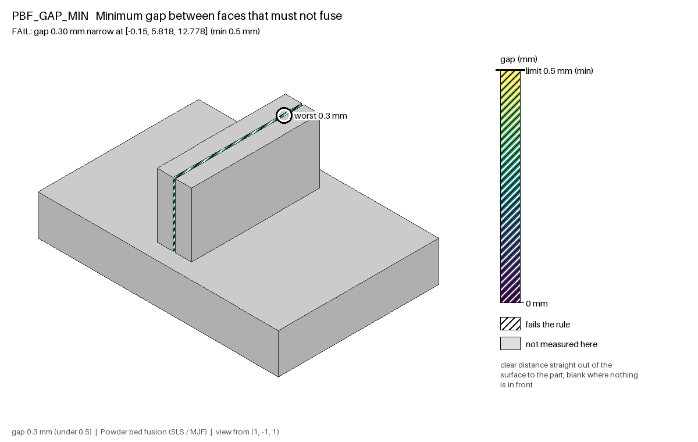

**Sealed hollows.** Exact: any closed skin inside the solid.

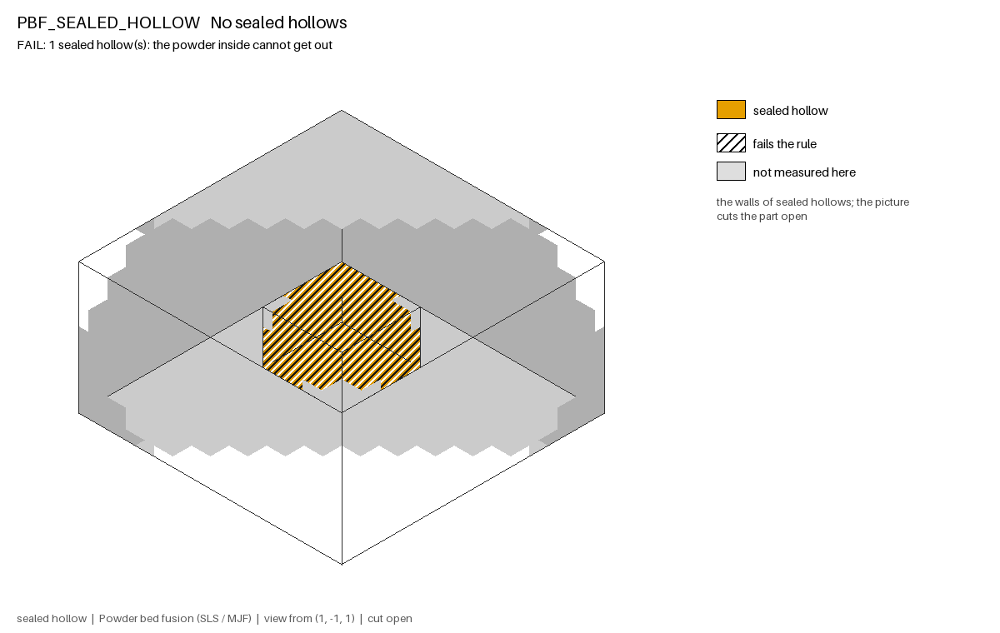

**Escape holes.** Exact. Every round hole is plugged with a cylinder of its
own radius and length. A hollow that is sealed in the plugged part, but not
in the real one, is reached only through holes. The checker then counts how
many of the holes into it are at least 5 mm across. Two are needed: one to
blow air in and one for the powder to leave. A hollow opened by a slot or
another non-round opening is not checked, because there is nothing round to
plug. Such a hollow passes this rule, which is a known gap.

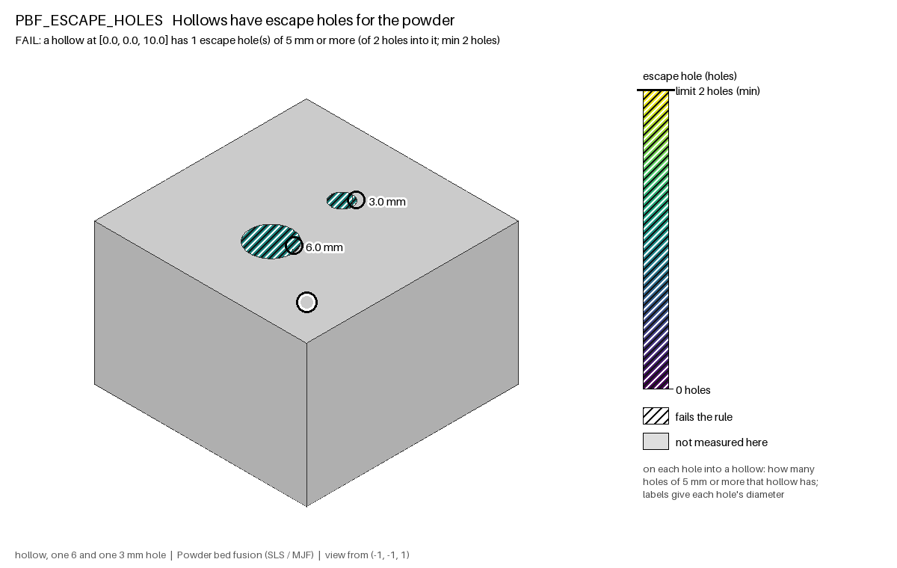

**Thick sections.** The diameter of the largest ball that fits in the
material, sampled (the same measure as moulding's maximum wall).

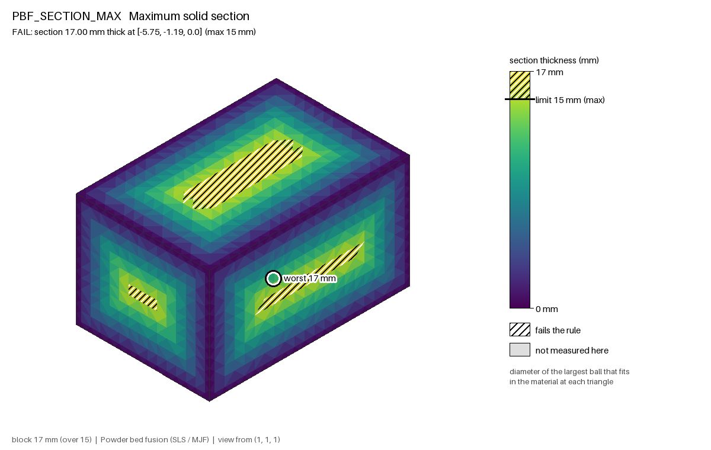

**Abrupt transitions.** At every inside corner (an edge turning at least
30°, material inside), the sections of the two faces are compared. A
face's section is the largest ball that fits against it. The ball shrinks
near the face's own edges, so a median would understate the section. A
thin wall meeting a block more than 3 times as thick fails. A 2 mm plate
with a 5 mm boss passes (x2.5); with an 8 mm boss it fails (x3.8).

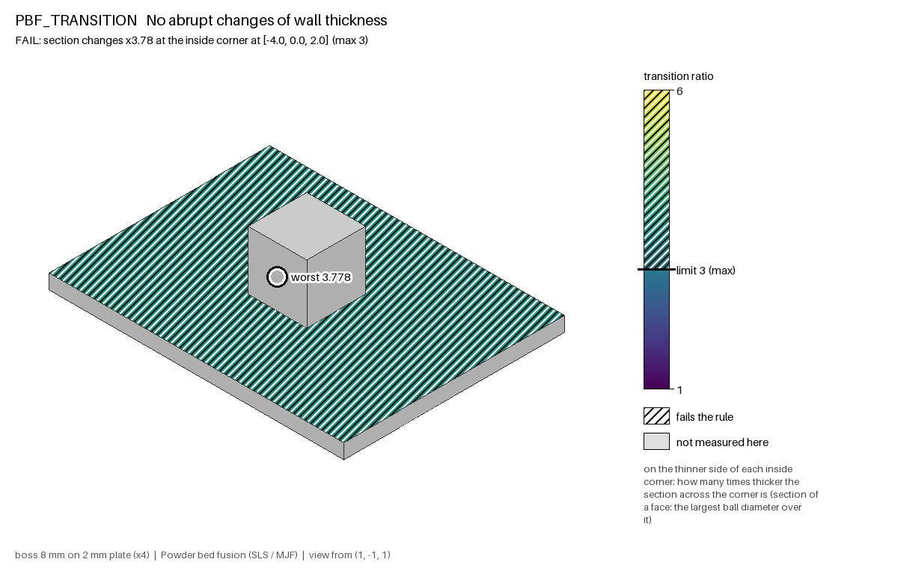

**Warping.** For each flat face, its length (the spread of its points
along its longest direction) divided by the straight-through thickness
under it (median over the face). A 2 mm plate 60 mm long passes (x30); at
100 mm long it fails (x50).

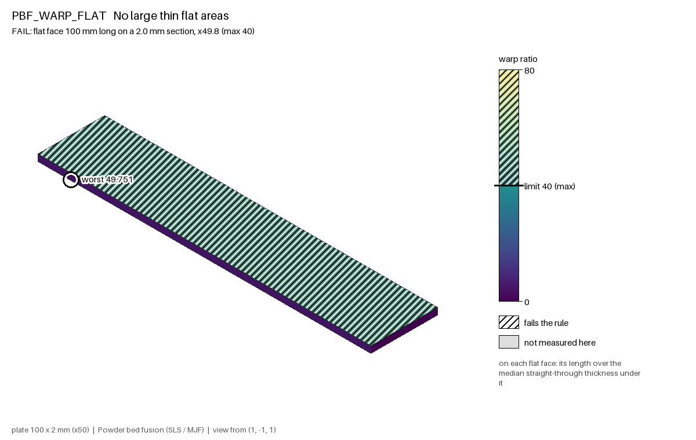

## Speed, and asking for only some rules

**Where the time goes** (Haiku's level 2 answer, 15,748 sample triangles,
one process, measured on this machine):

| step | time | used by |
|---|---|---|
| mesh the part (1.5 mm) | 1.3 s | every rule that samples |
| wall rays, gap rays | 0.2 + 0.2 s | wall and gap rules |
| largest ball at every sample | **12 s** | moulding max wall and evenness; powder-bed section and transition |
| filament: 12 trial build directions | 2.8 s | overhang, bridge, bed contact |
| moulding: 6 trial pull directions | 1.7 s | draft, undercut |
| everything else | under 0.2 s | |
| quality checker (own 2 mm mesh) | 1.0 s | |

Ray casting was never the problem: it is already exact and compiled
(OpenCASCADE). The cost is the largest-ball measurement: up to 40 exact
distance queries per sample, each against every face.

**What was done, without changing any number:**

* **One part per file.** The loaded solid, its mesh and every measurement
  (rays, balls, edges, holes) are kept per file, keyed by the file's
  content, and shared by all processes. Checking a file for filament,
  moulding and powder bed now meshes it once and measures each sample
  once. Powder bed, which needs nothing the other two have not measured,
  dropped from 8-39 s to under 0.1 s.
* **Ask for only the rules a task requires**: `check(path, process,
  rules=[...])` or `--rules FDM_WALL_MIN,FDM_HOLE_MIN`. Only those rules are
  reported, and measurements no asked-for rule needs are skipped: no ball
  unless a thick-section rule is asked for, no direction search unless a
  direction rule is asked for. A wall-holes-gap check of a level 2 answer
  costs the mesh and the rays: about 2 s of work (1.3 + 0.5 s), plus
  2-3 s to start Python and the CAD kernel when run as a separate command
  (7.6 s measured as a command on the loaded machine). On a file already
  checked in the same process it costs almost nothing. The quality checker takes `rules` too; its rules
  are all exact and cheap (1 s together), so it only filters the report.
* **Without the compiled helper, the ball measurement can be split over
  helper processes**, each
  loading the same file and running the same code on its share of the
  samples. The result is bit-identical. It pays off only with idle cores
  (each helper needs about 2 s to start), so it switches itself off when
  the machine is busier than half its cores. `JOINTBENCH_WORKERS=1` turns
  it off.

**Proof that nothing changed:** seven parts (two level 1 and two level 2
references, three model answers) were checked for filament, moulding,
powder bed and quality before and after: **28 of 28 reports identical**,
every number, location and field.

**Time, before and after**, for all four checks of each part. The machine
was shared with other heavy work (load 15-30 on 12 cores) throughout, so
these are honest but noisy:

| part | before | after |
|---|---|---|
| level 1 reference s0 | 31 s | 43 s |
| level 1 reference s2 | 150 s | 93 s |
| level 2 reference s0 | 66 s | 51 s |
| level 2 reference s4 | 67 s | 42 s |
| Haiku s700 | 43 s | 45 s |
| Sonnet s702 | 32 s | 17 s |
| Opus s701 | 93 s | 62 s |
| **all seven** | **482 s** | **352 s** |

### The compiled helper (Rust), and what it may not do

**What it does now.** A small Rust module (`src/jointbench/dfm/_native/`)
answers "is this point inside the solid?" for many points at once. It
works on a fine triangle copy of the surface (within 0.0005 mm of the
true faces), with a spatial index, on all cores. The filament bridge
search asks this for every probe point, up to 115,000 on a large part.
A point is decided on the copy only if it lies more than 0.005 mm from
the surface (ten times the copy's tolerance) and three skew rays agree.
Every other point goes to the exact classifier. The answers are the exact
ones.

**What it no longer does: the largest ball.** Commit fd5a5d6 computed the
ball on the triangle copy too, with an exact guard near each rule's
limit. The level 3 answers showed the guard rested on a wrong premise.
The ball is found by shrinking it until it touches the surface, and that
shrinking is ill-conditioned: near a sharp inside edge, or where the copy
lies a hair inside a curved face, a 0.0005 mm difference in distance can
change the ball by millimetres. On the level 3 parts single samples were
off by up to 11 mm, so the 0.1 mm guard band promised nothing.

Checked against an exact-only run of all 19 parts, that commit had
changed **no verdict**, but values differed by up to 0.07 (a transition
ratio) and 0.013 mm (a section). Making the copy fine enough to be
trustworthy (0.00006 mm) and handing every doubtful step to the exact
routine works, but on a level 3 part the copy alone took 67 s. That is
slower than the exact routine. So the ball is exact again: split over
helper processes on large parts when cores are free, otherwise in one
process.

**Install.** `uv run python -m jointbench.dfm.build_native` (needs Rust,
<https://rustup.rs>; about 10 seconds). Without it, or with
`JOINTBENCH_NATIVE=0`, the exact classifier is used everywhere:
identical results, only slower. The self-test gives the same table,
measured values included, in both modes. No prebuilt wheel is published
yet.

### Other speed-ups, each proven not to change a result

* **Meshing**: the per-point face classification first asks OpenCASCADE's
  fast polygon classifier (IntTools_FClass2d). Points it calls ON the
  boundary go to the exact classifier, as before. So do all points on
  faces that wrap around (cylinders, cones), where one seam point was
  seen to be misjudged. The sample mesh is bit-identical on all 19 parts,
  and meshing takes about a third of the time (51 s to 18 s over them).
* **Bridge spans**: the eight directions per sample are computed in one
  array operation; identical arithmetic, checked on 16,000 random cases.
* **The fine copy** is exported in one piece (binary STL) instead of
  triangle by triangle.
* **Wall and gap rays** stay exact. A compiled ray on the triangle copy
  can misjudge a ray that grazes a face or just escapes past an edge; for
  the gap rule that could flip a verdict, and no cheap guard catches it,
  because every ray starts on the surface. Helper processes split them on
  parts over 100,000 samples (each helper needs about 3 s to import the
  CAD kernel, so below that they cost more than they save).
* **Fewer trial build directions** were not adopted. Dropping a candidate
  can change which direction wins, and with it the verdict.

### Proof and times

The proof covers 19 parts: the seven earlier ones and the twelve archived
level 3 model answers. Each was checked for filament, moulding, powder bed
and quality, first with everything exact (`JOINTBENCH_NATIVE=0`), then as
shipped. **76 of 76 reports are identical**: every verdict, value,
location and field.

Over all 19 parts, all four checks each, in seconds. The machine was
shared (load 5-10 on 12 cores):

| | filament | moulding + powder | quality | total |
|---|---|---|---|---|
| everything exact | 412 | 459 | 18 | 889 |
| commit fd5a5d6 (approximate ball) | 138 | 122 | 39 | 299 |
| **now** | **79** | 566 | 18 | 663 |

Moulding and powder are now as slow as exact, because they are exact.
The extra time over the exact run is helper start-up on a shared machine.

**Filament on the largest answers:**

| part | samples | exact | now |
|---|---|---|---|
| Opus L3-s950 | 55,177 | 33 s | 11 s |
| Sonnet L3-s950 | 44,627 | 28 s | 8 s |
| Haiku L3-s950 | 47,886 | 29 s | 7 s |
| Haiku L3-s951 | 24,229 | 62 s | 4 s |

**How time grows with size.** Meshing, the rays and the ball each grow in
proportion to the number of samples. On a 55,000-sample answer the costs
are:

| step | time |
|---|---|
| meshing | about 1.2 s |
| wall and gap rays | 5 s |
| filament directions | 2 s |
| largest ball, exact (moulding, powder) | about 30 s |

The direction search grows with the number of flat ceilings, not with
size alone.

**Powder bed: measuring the section only where it can matter.** Every
section rule (powder-bed thick section and transitions, moulding maximum
wall and evenness) needs only the *largest* ball: over the whole part, or
over one face. A ball can never be larger than the straight-through ray
where it starts, because it starts at half that ray and only shrinks.

So the checker measures samples in falling order of ray length, and
stops once the next sample's ray is shorter than the best ball already
found. The value is the exact one, and so is the location: ties go to the
lower sample number, as before. The full section map is computed only
when pictures or a field file are asked for.

Across the 19 parts, the section is now measured at **35 % of the
samples** (16-64 % per part), so about a third of the former section
work remains. Proof: 76 of 76 reports identical to the exact-only run.

Powder-bed check alone, on the shared machine (load 23-55 during the run,
so the times are pessimistic):

| part | samples | measured | time |
|---|---|---|---|
| Sonnet L2 s702 | 8,602 | 41 % | 5 s |
| Haiku L2 s700 | 15,748 | 34 % | 7 s |
| Opus L3 s951 | 34,565 | 29 % | 22 s |
| Opus L3 s950 | 55,177 | 28 % | 48 s |

The time that remains is mostly the measured third of the balls, plus the
mesh and rays every check shares. A well-conditioned section measure (for
example from a distance field on a voxel grid) would be the next step if
powder bed has to get faster still. It would need its own stated
tolerance.

## Material actually used

`jointbench.dfm.material.material(step, process)` returns the grams of
material a part would actually take for each process, with a breakdown,
for a material score. Settings are in each process file's `[material]`
table, so a brief can state them.

* **Filament printing**: a printed part is a shell around sparse infill,
  not a solid. The settings are a common 0.2 mm slicer profile:
  * side faces get 3 perimeters of 0.4 mm (1.2 mm of skin);
  * faces within 45° of horizontal get 4 solid layers of 0.2 mm (0.8 mm);
  * a skin never takes more than half the wall it sits on, so a wall
    thinner than two skins is solid;
  * the rest of the volume is filled at 20 % infill;
  * PLA, 1.24 g/cm³.

  Support is estimated under every sample the overhang or bridge rule
  flags in the declared (or chosen) build direction, down to the part or
  the bed, at 15 % density. It is always reported as its own line, and
  counted in the total when support is allowed (`support="allowed"`, see
  "Support" above). The skin and support figures are sampled (the
  same 1.5 mm samples and exact rays as the rules); the volume is exact.
* **Powder bed**: the part is fully dense, so the material is its volume
  (PA12, 1.01 g/cm³). Loose powder around the part is sieved and reused,
  so it is not counted. Powder sealed in a hollow cannot get out and is
  shipped with the part, so it is counted, at half the part's density.
* **Moulding**: the volume per shot (ABS, 1.05 g/cm³; runners and sprues
  left out, because they depend on the tool). The thickest section is
  reported beside it, because cooling time grows with its square.

**What it does to the three level 2 answers to task s702:**

| answer | solid volume | filament used | share of solid | powder bed | moulding (thickest section) |
|---|---|---|---|---|---|
| Sonnet (the stick) | 9.3 cm³ | 7.8 cm³, 9.7 g | 84 % | 9.3 g | 9.7 g (5.1 mm) |
| Haiku | 13.1 cm³ | 8.8 cm³, 10.9 g | 67 % | 13.3 g | 13.8 g (8.8 mm) |
| Opus (block-like) | 68.5 cm³ | 25.2 cm³, 31.2 g | 37 % | 69.2 g | 71.9 g (28.3 mm) |

By solid volume, Opus's block uses 5.2 times Haiku's material; printed,
it uses 2.9 times. The order is the same (Sonnet, Haiku, Opus), but a
chunky part is punished far less when it is printed. A block is mostly
cheap infill; a thin part is mostly skin. The stick would also need
5.5 cm³ of support if support were allowed, more than half its own
material.

**Stiffness of an infilled part.** The stiffness score analyses a dense
solid. A part printed at 20 % infill is less stiff than that: the skin
carries most of the bending, so a thin-walled part loses little, while a
block loses much of the stiffness of its core.

* **Simplest honest treatment (recommended):** keep analysing the solid,
  and state that the figure is for a dense part. That is right for powder
  bed and moulding. For filament it is an upper bound, closest for lean
  parts.
* **Better, for filament only:** give the core elements (those deeper than
  the skin, which the mesh already knows from the distance to the
  surface) a reduced stiffness. A usual estimate is the infill share times
  the plastic's stiffness for a grid pattern; gyroid infill does a little
  better. Cost: a second material in the analysis and a calibration
  against one printed-and-tested part, or a published test, to trust it.
  About a day's work. Not built: your decision.

## Saying where a fault is

A bare point is hard to act on: the modeller has to work out which two
surfaces of their own part bound it. So every failing wall, gap and
thickness transition also says what it lies between:

* **the two faces**, each by type and size as a modeller would recognise
  it: "plane face 36.2 x 19.8 mm", "outside of a round member r = 3.00 mm,
  60.0 mm long", "inside of a hole r = 1.70 mm", "inside fillet r = 2.00
  mm", "spherical face r = 6.00 mm", with the face number for a viewer;
* **the direction** across the gap or wall;
* **whether the two faces meet at an edge**, and at what inside angle. A
  gap between two faces that meet is a crevice, which is often what a
  "narrow gap" really is;
* **how far it runs**: at one spot, or along a strip about so many mm
  long.

For a thickness change, the message names the thinner face and the
thicker face with each one's section.

The point stays as before. The same information is in the JSON, as
`where[0].between` and `details.between`. It says where, never how to
fix.

Example, an archived level 2 answer:

> gap 0.13 mm narrow at [-73.596, 27.239, 24.51] (min 0.5 mm): gap from
> the plane face 36.2 x 19.8 mm (face 22) straight out to the plane face
> 38.8 x 11.1 mm (face 111), direction [-0.727, -0.386, 0.569]; these two
> faces meet along an edge at an inside angle of 34 deg: a crevice; at
> one spot; their shared edge is 0.5 mm long

Self-test: a gap between two fins, a thin fin and a plate meeting a boss.
In each the named faces, sizes and direction are the known ones.

## When the geometry kernel cannot measure

A valid, closed solid can still make OpenCASCADE fail. Seen on a level 3
answer: a sphere meets a cylinder with a 0.02 mm gap, covered by the edge
tolerance. The kernel's ray intersector throws on any line that passes
there. Its per-face intersector, worse, silently misses the hit.

**Rays** now have a fallback for exactly the rays where the intersector
fails:
* the line is crossed with every face's underlying surface;
* crossings that lie on their face (within 0.03 mm) are grouped;
* the first group across which the solid classifier changes side is the
  hit.

The answer is the same exact crossing. Against the normal intersector on
600 rays it matched on 599, and within 0.00004 mm on the last. On the
failing part, 2 rays of 29,898 needed it (both directions at one sample). The other 19 proof parts are
unchanged (76 of 76 reports identical).

**If the kernel still fails** anywhere in a check, `check` raises
`jointbench.dfm.MeasurementError`, naming the process and stage (for
example "pbf, direction-free rules: Standard_Failure"). That means the
part could not be measured, not that it cannot be made. The grader should
report it as its own verdict, error, and not count it as a graded attempt,
as for a missing output.step. That change belongs in `grade.py`, which is
not part of this module.

## Milling (planned)

`processes/milling.toml` lists the intended rules: tool access from the
set-up directions (the same visibility test as moulding undercut), inner
corner radius at least the tool radius, pocket depth at most 4 x tool
diameter, minimum wall, and hole depth at most 4 x diameter. The checker
refuses `--process milling` until those rules have code and self-test
parts.

## The self-test

`python -m jointbench.dfm --selftest` builds a set of small parts, writes
each to a real STEP file, and checks it. For every rule there is at least
one part that must pass and one that must fail, built either side of the
limit: a fin 0.7 and 0.9 mm thick, an overhang at 40° and 50°, a bridge of
8 and 12 mm, a hole of 1.6 and 2.4 mm, a pin of 2.5 and 3.5 mm, a gap of
0.4 and 0.7 mm, a foot of 38 and 64 mm², a pocket open and sealed, a plate
with 0°, 0.5° and 1.5° draft, an hourglass and a diamond edge (undercut
and none), walls of 0.8, 1.2, 3.6 and 4.5 mm, a gentle thick spot of 1.3
and 1.8 x the wall, ribs of 0.52 and 0.80 x the wall, and a rib base sharp,
filleted too small and filleted enough. A failing part counts as expected
only if it fails **exactly** the named rule and nothing else. Two more rows
check that a part which fails in one stated direction passes when the
checker may choose.

## The three processes as a ladder

Every part checked against all three processes, the direction left to the
checker (for printing and moulding). Ten generated tasks per level (seeds
0-9, as generated on 2026-11-11) and the nine archived level 2 model
answers (all passed the grader):

| parts | powder bed (pbf) | filament (fdm) | moulding |
|---|---|---|---|
| level 1 references | **9 of 10** | 7 of 10 | 0 of 10 |
| level 2 references | 0 of 10 | 1 of 10 | 0 of 10 |
| level 2 model answers | 0 of 9 | 0 of 9 | 0 of 9 |

**Level 1** shows the ladder as expected: powder bed is the easiest, then
filament, then moulding. The 3 filament failures are overhangs (the round
pocket for a motor's pilot boss, lying across the build direction). The
one powder-bed failure is warping, just over the limit (L1-s2: a flat face
166 mm long on a 4 mm section, x41.5 against 40).
Every task fails moulding, on draft, undercut, thick sections and sharp
corners.

**Level 2** does not show a ladder, for two reasons.

* The reference answers carry solid sections of 20-27 mm (in the three
  checked closely), so 8 of 10 fail the powder-bed thick-section limit
  (15 mm), and 8 fail the transition limit (3 x; measured 3.4-5.8). Both
  limits are judgement calls; a print service would print these parts,
  with some distortion and powder cost. The limits flag them, not forbid
  them.
* The joints are untidy (see [quality.md](quality.md)). Slivers and
  shallow crevices where two faces almost meet read as walls of a few
  hundredths of a millimetre and gaps of 0.06 mm. That fails the wall and
  gap rules of every process alike. Those faults would vanish if the
  reference construction were cleaned up.

The model answers fail all three processes. The powder-bed failures are
mostly the same thin walls and narrow gaps at untidy joints (7 of 9 each).
The three Opus blocks also exceed the thick-section limit.

So on clean geometry the processes form a ladder of strictness. On the
current level 2 geometry, the modelling faults dominate every process,
and a manufacturing track would first need clean joints.

Times per part (this machine, shared): filament 10-29 s, moulding 28-32 s,
powder bed 14-16 s.

## Attaching it to a level

The task brief must state:

1. **The process**, by its id (`fdm` or `moulding`), with the plain-language
   version for the reader ("filament printed in PLA, 0.4 mm nozzle, no
   support material").
2. **The rules and limits**, copied from the process file into the brief,
   so nothing has to be looked up (the STEP.bench principle). A level that
   tests engineering knowledge could withhold them, as the planned *rules
   not told* mode does for the grading rules.
3. **The direction**, or that it is free. If the brief states a build or
   pull direction, the level passes it to `check(...)`. If free, the
   checker chooses, and the brief should say so.
4. **Which rules are graded.** By default all of the process's rules. A
   level can grade a subset (a first manufacturing level might grade only
   overhang, wall and bed contact).

In the grader, the manufacturing result becomes one named check, for
example `MAKEABLE`, failing with the first failing rule's reason. The full
rule report goes into the check's details, so the agent sees every failing
rule and where it is.
