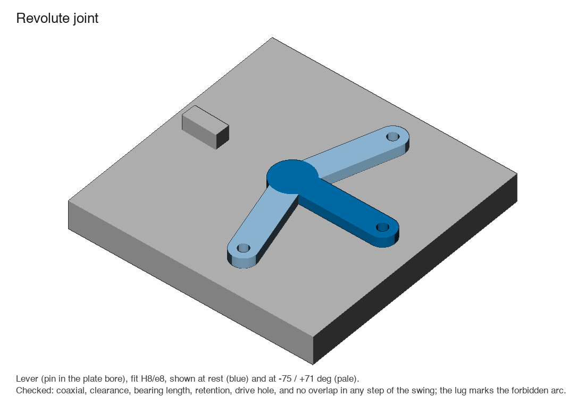
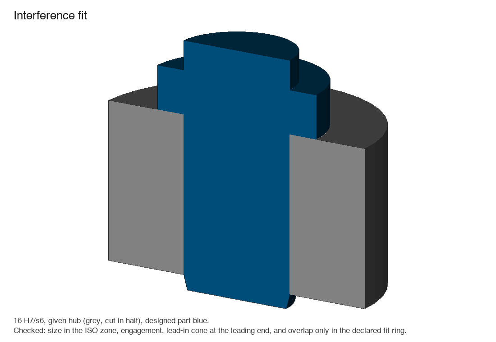
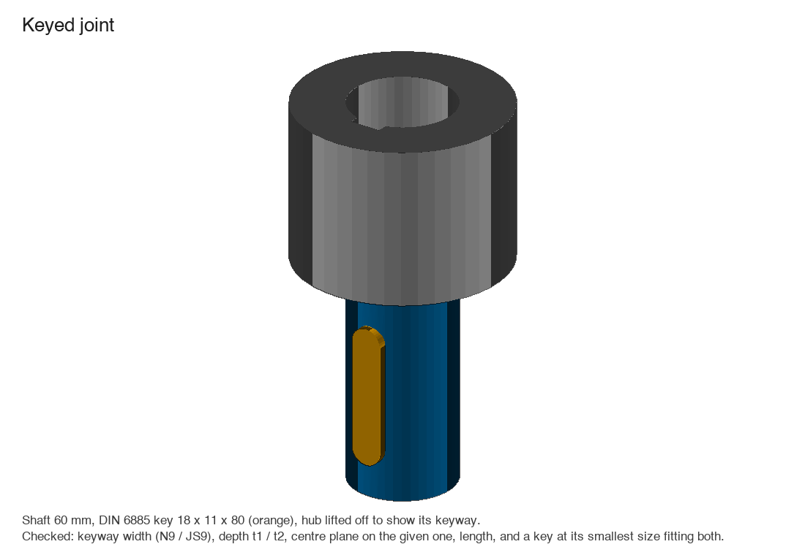
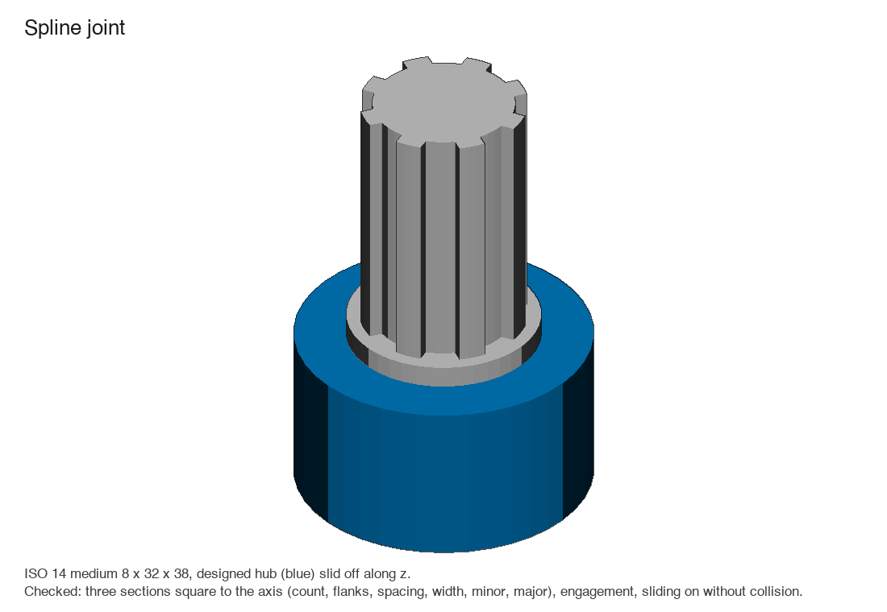
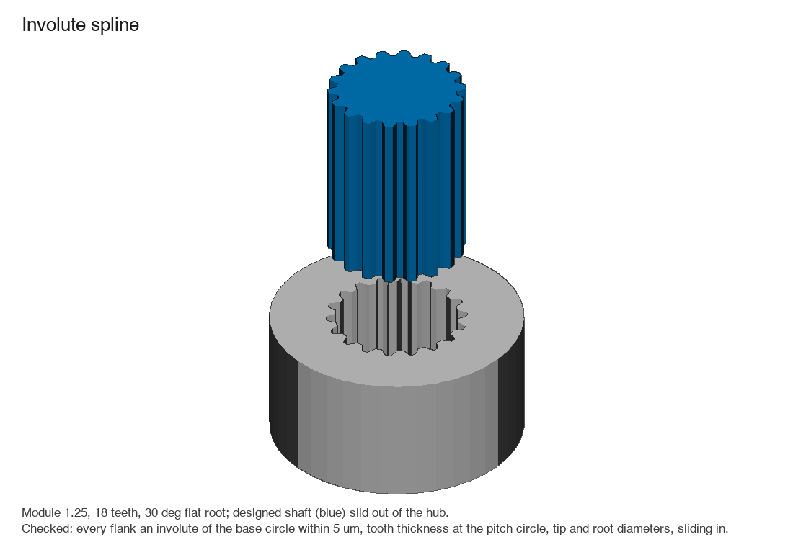
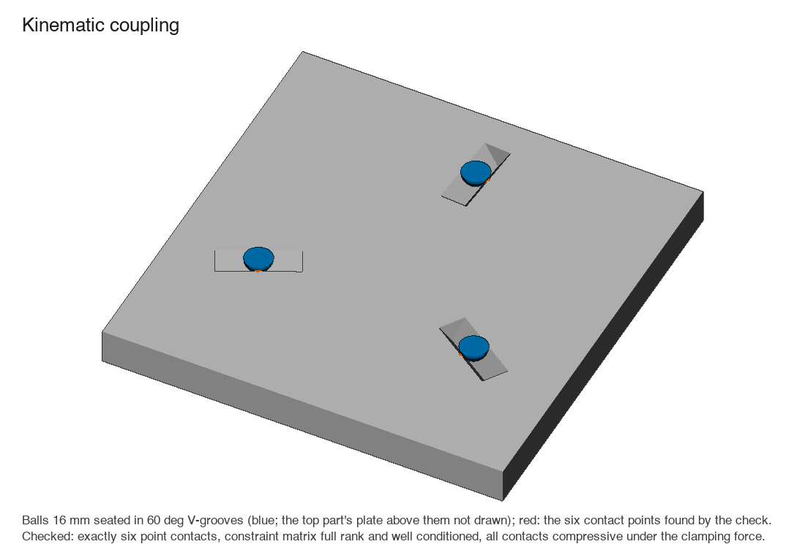
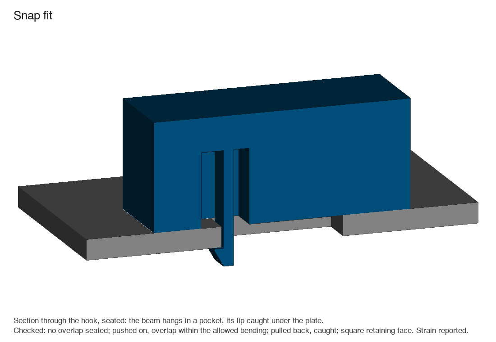

# Joint catalogue

Today STEP.bench has one joint: the bolted connection (clearance holes, a flat seat, room for the
bolt head). This page describes seven more ways two parts connect. Each one has its own exact
check, a generator that builds the answer first, a brief that states every number, and a self-test.
They live in `src/jointbench/joints/`, separate from the core. Each is also a registered task
family ([families.md](families.md)), so `jointbench gen`, `verify`, `selftest`, `baselines` and
`solve` work on them; see "The joints as task families" below.

```
uv run python -m jointbench.joints all --selftest --seeds 0-4     # every joint, five seeds
uv run python -m jointbench.joints keyed --gen --seed 0 --n 5 --out joint_tasks
uv run python -m jointbench.joints keyed --verify joint_tasks/keyed-s0          # grades output.step
uv run python -m jointbench.joints keyed --verify joint_tasks/keyed-s0 --json
uv run python -m jointbench.joints spline --picture spline.png --seed 1
uv run pytest tests/test_joints.py
```

## The rules all joints keep

**Measured only where the measurement is exact.** Every check reads exact planes, cylinders,
cones, spheres and straight-sided sections from the STEP solid, or measures exact boolean overlap
volumes. The same file always gets the same numbers. Where a joint would need judgement or a
simulation, that part is left out and the reason is given below.

**The joint frame.** Each joint is built with its axis along local z. The generator places that
frame anywhere in space (a random rigid placement from the seed), and the brief states the frame.
The check moves the submitted solid back by the exact inverse placement before it measures. So the
agent faces an arbitrary orientation, while the check reads plain numbers on a z axis.

**Answer-first.** The generator draws the numbers, builds a correct part, and the self-test grades
it through a real STEP file. Next to the correct part it grades broken copies: one just inside each
limit, which must pass, and one just outside it, which must fail on the named check. "Just" means a
few micrometres for sizes, 0.002-0.05 mm for positions, and 1-3 degrees for angles.

**Limits shared with the core.** Overlap counts as zero below 0.01 mm³, the core's
`overlap_volume_max`. Coaxial means the axis lies within 0.01 mm of the joint axis and within
0.01 degrees of parallel. The core's cylinder finder (`checks.holes`), overlap volume
(`checks.base`) and STEP writer (`geometry`) are imported, not copied.

**Either side.** Wherever it makes sense, either part can be the given one. The pin or the bore,
the hub or the shaft: the agent designs the other.

**"Rules not told".** With this setting, a joint's brief names only the standard (for example
"H7/p6", "DIN 6885 form A, normal fit", "ISO 14 6 x 23 x 26", "exactly constrained"), not the
numbers. This tests engineering knowledge on purpose. The checks stay the same.

## Self-test and timing

Five seeds per joint, every row through a real STEP file (M-series MacBook, one process):

| joint | rows as expected | check time, median / max | where the time goes |
|---|---|---|---|
| revolute | 80 / 80 | 0.26 / 0.40 s | 60-170 rotation steps, each one boolean |
| interference | 80 / 80 | 0.04 / 0.12 s | |
| keyed | 85 / 85 | 0.05 / 0.07 s | |
| spline | 95 / 95 | 0.51 / 0.79 s | 30-60 insertion steps |
| involute | 50 / 50 | 4.45 / 7.49 s | booleans on B-spline flanks: about 0.2 s each, 20 insertion steps |
| kinematic | 60 / 60 | 0.03 / 0.07 s | |
| snap fit | 45 / 45 | 0.13 / 0.42 s | about 100 insertion steps of 0.25 mm |

The whole self-test, seven joints by five seeds, takes about six minutes; the involute spline is
four of them.

---

## 1. Revolute joint



**The situation.** A plate with a bore (the agent's lever carries the pin), or a base with a
standing pin, with or without a head (the agent's lever carries the bore). A lug on the plate marks
the arc the lever must not enter. The lever has a drive hole at a stated radius.

| check | passes when |
|---|---|
| `REV_COAXIAL` | the running cylinder (convex for a pin, concave for a bore) lies within 0.01 mm and 0.01 deg of the joint axis |
| `REV_CLEARANCE` | bore diameter minus pin diameter lies inside the stated range: an ISO 286 running fit (H7/f7, H7/g6, H8/f7, H8/e8), with the given side modelled at the middle of its zone |
| `REV_BEARING` | the running surface overlaps the counterpart's surface along z by at least 0.8 x its length |
| `REV_RETAINED` | *retained*: the part can move along the axis by at most 0.3 mm each way before it touches (measured by bisection to 0.001 mm); *free end*: lifted along +z it touches nothing, in 1 mm steps until clear |
| `REV_DRIVE` | a hole of the stated diameter (+0.1), parallel to the axis, within 0.05 mm of its stated position |
| `REV_ROTATION` | turned through the stated range, nothing overlaps the given part at any step; the step is chosen so the part's farthest point moves at most 1.5 mm (at most 2 deg) |

**Limits.** Turning is checked in steps, not as a continuous sweep. A feature thinner than 1.5 mm
at the part's outer radius could slip through an obstacle between two steps. The lugs and plates
here are 6 mm or more, so it cannot happen in these tasks. A future obstacle thinner than that would
need a finer step, set by the obstacle's own thickness. Retention is checked with the part modelled
as assembled (a pin with two collars cannot actually be pushed in), and the brief says so. A real
design would use a circlip or a peened end; the check sees only the assembled geometry.

**A full task.** *Given*: the plate or base, the lug, the swing range, the fit. *Design*: the lever.
*What makes it hard*: choosing a diameter inside a zone a few hundredths wide; a running length
that fits beside an arm that must clear the plate; play under 0.3 mm in both directions; an arm
that clears the lug over the whole range, at an arbitrary orientation. *Settings*: `given` (hole or
pin), `retained` (yes or no), `rules_told`, `aligned`; later, several lugs and a range
over 180 degrees.

## 2. Interference fit



**The situation.** A hub with a bore (the agent designs the shaft), or a shaft on a flange (the
agent designs the hub). Press fit H7/p6, H7/r6 or H7/s6 per ISO 286, sizes 10-60 mm. The given
side is modelled at the middle of its zone. The part is pressed on along -z, so its lowest end
is the leading end.

| check | passes when |
|---|---|
| `FIT_COAXIAL` | the fitted cylinder lies on the joint axis |
| `FIT_SIZE` | its diameter lies inside the agent's ISO zone (shaft p6/r6/s6, or bore H7); the resulting interference with the given part is reported in micrometres |
| `FIT_ENGAGEMENT` | the fitted cylinder overlaps the counterpart's along z by at least 0.75 x the hub length |
| `FIT_LEAD_IN` | a coaxial cone continues the fitted cylinder at its leading end, with a half-angle of 5-30 deg, at least 1 mm long, and an entering edge at least 0.05 mm clear of the given part's diameter |
| `FIT_OVERLAP` | the usual no-overlap rule with **one declared exception**: the overlap with the given part, minus a thin ring, must be below 0.01 mm³. The ring runs from the given surface to the far edge of the agent's tolerance zone, along the given part's fitted length. A shoulder sunk 0.05 mm into the hub, or a shaft 10 um above its zone, fails. |

**Sources.** ISO 286-1/-2 (IT grades and fundamental deviations; tables in `standards.py`, checked
by tests against textbook values such as 25 p6 = +22/+35 um). The lead-in rule (5-30 deg, 1 mm,
0.05 mm clear) is the benchmark's own statement of workshop practice. It is not taken from a
standard.

**Limits.** Only geometry is checked. The press-in force and the torque the joint can carry
follow from the interference through the thick-walled-cylinder formulas (DIN 7190). That is a
calculation, not a measurement, and it is left out. It could be reported as information later,
like the snap fit's strain.

**A full task.** *Given*: hub or shaft, the fit. *Design*: the other part, pressed home. *Hard*:
micrometre sizes; with the rules not told, knowing that "25 p6" means +22 to +35 um; a lead-in on
the correct end; touching the hub with a shoulder without sinking into it. *Settings*: `given`,
`rules_told`, `aligned`; later, a stepped shaft with two fits.

## 3. Keyed joint



**The situation.** A shaft with a form A keyway (the agent designs the hub), or a hub with a through
keyway (the agent designs the shaft). One DIN 6885-1 form A parallel key of the standard section
for the shaft diameter (12-80 mm). Normal fit: shaft keyway N9, hub keyway JS9; bore H7 on a shaft
h6. The key length is taken from the standard length series, at least 1.2 x d.

| check | passes when |
|---|---|
| `KEY_SEAT` | the bore (or shaft) lies on the axis, with its diameter in H7 (or h6) |
| `KEY_WIDTH` | the keyway width, the distance between its two flat side walls, lies in N9 (shaft) or JS9 (hub) |
| `KEY_DEPTH` | shaft floor at d/2 - t1, or hub roof at d/2 + t2, from the axis, within +0.1 mm (key height up to 6) or +0.2 mm (above) |
| `KEY_ALIGN` | the keyway's centre plane lies within 0.01 mm of the given one everywhere across the keyway (offset plus tilt times the roof radius) |
| `KEY_LENGTH` | the shaft keyway's straight part is at least L - b, and the hub keyway covers the key along z |
| `KEY_FITS` | a form A key at the small end of its own tolerance (width h9, height h11), laid on the shaft keyway's floor and centred in it, overlaps neither part |
| `KEY_OVERLAP` | shaft and hub do not overlap |

**Sources.** DIN 6885-1 (key section b x h and depths t1, t2 per diameter range; the sections
are those of ISO/R 773). ISO 286 for N9, JS9, H7, h6, h9, h11. The tables in `standards.py` were
written from memory of the standard and spot-checked against known values (d = 40 mm: 12 x 8,
t1 = 5.0, t2 = 3.3). They should be compared line by line with a copy of DIN 6885-1 before release.
The depth tolerance of +0.1 / +0.2 mm is also from memory.

**Found while building.** An angle limit on alignment (first 0.1 deg) was wrong for large shafts:
0.08 deg already pinched the key on a 60 mm shaft, because the tilt matters at the keyway's outer
edge. The limit is now a distance at that edge, 0.01 mm. That is below the smallest side clearance
of the normal fit (IT9 / 2 = 0.015 mm for a 4 mm key), so a keyway that passes alignment never
pinches the key.

**A full task.** *Given*: shaft or hub with its keyway, at an arbitrary angle. *Design*: the other
part. *Hard*: with the rules not told, the brief names only the diameter and "DIN 6885 form A,
normal fit". The agent must know b x h, t1 and t2, and the zones, and must place the keyway on the
given one's centre plane. A keyway 90 deg out is the typical slip, and it fails as "the key does
not fit". *Settings*: `design`, `rules_told`, `aligned`; later, two keys at 180 deg, or a tight
fit (P9 both sides).

## 4. Spline joint (straight-sided)



**The situation.** A hub with an internal ISO 14 spline (the agent designs the shaft), or a splined
shaft (the agent designs the hub). Light and medium series, 6-10 splines, minor diameter 11-62 mm.
ISO 14 sliding fit: hub d H7, D H10, B H9; shaft d f7, D a11, B d10.

The profile is checked by cutting the agent's part square to the axis at three stations (10%, 50%
and 90% of its span inside the counterpart). Each section is read as exact edges: straight flank
lines and circular arcs.

| check | passes when |
|---|---|
| `SPL_PROFILE` | at every station: the stated number of splines; the two flanks of each spline parallel within 0.01 deg (straight-sided); each spline symmetric about a radius within 0.01 mm; splines evenly spaced within 0.02 deg |
| `SPL_WIDTH` | every spline (or slot) width, the distance between its two parallel flank lines, lies in d10 (or H9) |
| `SPL_MINOR` / `SPL_MAJOR` | the inner and outer arc diameters lie in their zones (f7 / a11 for the shaft, H7 / H10 for the hub) |
| `SPL_ENGAGEMENT` | every flank face spans at least 0.9 x the hub length of the given splines |
| `SPL_INSERTION` | slid out along +z in 1 mm steps, from home until clear, it overlaps nothing; this also covers the home position |

Splines are found from the section alone. Each outer arc (spline tip, or slot bottom) is paired
with the nearest long straight edge on each side of it. Short lines (chamfers under 40% of the
flank height) are ignored, so a chamfered or rounded tip still measures.

**Limits.** A 1 mm sliding step cannot jump over anything, because the given splined length is at
least 20 mm. Three stations sample the profile but do not prove it is prismatic between them. A
twisted or tapered spline that happens to match at all three stations would still be caught by the
sliding check, which a twisted spline cannot pass.

**Sources.** ISO 14 (series dimensions and tolerance classes; the tables in `standards.py` were
written from memory and should be compared with the standard before release). ISO 286 for the
zones.

**A full task.** *Given*: hub or shaft. *Design*: the other part. *Hard*: three independent zones;
with the rules not told, only the designation ("6 x 23 x 26") is given, so the agent must know the
spline width and the fit classes; the splines must line up with the given ones at an arbitrary
angle; and the part must be able to slide on, with nothing on its leading side wider than the bore.
*Settings*: `design`, `rules_told`, `aligned`; later, fixed fit (h7 / h10) instead of sliding.

## 4b. Involute spline



**Can it be checked exactly?** Yes, and it is built: `involute`, with the hub given and the shaft
designed. An involute flank is not a primitive surface; every CAD program stores it as a B-spline.
It can still be measured exactly, because one quantity is constant along a true involute of base
radius rb. A point at radius r and angle phi lies on the involute with start angle
`c = phi +- inv(a_r)`, where `inv(a) = tan a - a` and `cos a_r = rb / r`. Sampling each flank in a
section and computing c along it gives three things. The spread of c, times rb, is the profile
deviation, because it is the normal distance between the extreme involutes. Whether c is constant
with + or with - tells which side of the tooth the flank is on. The c values of a tooth's two
flanks give its thickness at the pitch circle, where no edge of the model lies.

**Evidence that the stored B-spline does not decide the verdict.** A B-spline fitted through n
points of a true involute was written to STEP, read back, and measured the same way:

| points through the involute | worst deviation after STEP round trip |
|---|---|
| 4 | 0.24 um |
| 6 | 0.025 um |
| 10 | 0.003 um |
| 20 | below 0.001 um |

The profile limit is 5 um (`PROFILE_MAX`). So any honest involute passes, whatever program
wrote it, while circular arcs or straight lines standing in for the flank fail.

| check | passes when |
|---|---|
| `INV_PROFILE` | the stated number of teeth at three stations, every flank an involute of the stated base circle within 0.005 mm, teeth evenly spaced within 0.02 deg |
| `INV_THICKNESS` | tooth thickness (arc) at the pitch circle in the stated range |
| `INV_MAJOR` / `INV_MINOR` | tip and root diameters in range |
| `INV_INSERTION` | slides out along +z without touching the hub |

**Not built.** The proportions are those of ISO 4156 with a 30 deg pressure angle and a flat root
(major diameter m(z+1), minor m(z-1.5) for the shaft). The tolerances are stated as plain numbers
(tooth thickness from s - 0.06 to s - 0.02 mm), not from ISO 4156's tolerance formulas, which
distinguish effective from actual space width. Doing that properly needs a measurement over
all teeth together, which is still exact but is a second piece of work. Only the shaft side is
designed for now.

## 5. Kinematic coupling



**The situation.** A base with three V-grooves (60, 90 or 120 deg included angle) on a circle at
120 deg spacing: a Maxwell coupling. The agent designs the top part with three balls of the stated
diameter (6-16 mm), modelled as spherical faces of the one solid.

| check | passes when |
|---|---|
| `KC_OVERLAP` | no overlap with the base |
| `KC_CONTACTS` | the contacts are counted. A sphere touches a plane when the gap is within +-0.005 mm and the touching point lies on both faces (computed exactly from the sphere's centre and the plane). Any other pair touches when the kernel's exact distance is within 0.005 mm. Exactly six point contacts pass. Five or fewer fail as **loose**, seven or more, or any face-on-face contact, as **over-constrained**. A ball sunk more than 0.005 mm into a flank also fails. |
| `KC_CONSTRAINT` | the six contacts form a constraint matrix: per contact its normal, and its moment about the contacts' centroid divided by their RMS distance from it. The matrix must have full rank (6) and a condition number of at most 10. A Maxwell coupling measures about 2.4. |
| `KC_PRELOAD` | under the stated clamping force, the six contact forces that balance it are all compressive, each at least 1% of the mean. A clamping force outside the ball triangle tips the part, and fails. |

**Why rank and condition number.** Six contacts can still leave the part free to move. If all
three grooves run parallel, the part slides along them: rank 5. The self-test checks exactly
that. The condition number catches the near-miss, where grooves are almost parallel and the part
is held only weakly in one direction. The moment rows are divided by a length so that forces and
moments compare on the same scale. Without that, the number would change with the unit of length.

**Limits.** Contacts are geometric: touching within 5 um. Hertzian contact stiffness, friction and
wear are not modelled. A ball touching the groove's edge instead of its flank is counted by the
kernel distance, with its normal taken from the ball centre. That is correct for a sphere and
would need care for other curved shapes.

**Source.** The six-contact rule and the constraint matrix are standard exact-constraint design
(Maxwell; Blanding, *Exact Constraint*; Slocum, *Precision Machine Design*).

**A full task.** *Given*: the base and its grooves. *Design*: the top part. *Hard*: each ball
centre must sit at the exact height where the ball touches both flanks, to 5 um; nothing else may
touch; with the rules not told, the brief says only "exactly constrained". *Settings*:
`rules_told`, `aligned`, groove angle from the seed; later, a Kelvin coupling (cone, V-groove and
flat, in which the agent must work out that it still gives 3 + 2 + 1 = 6 contacts).

## 6. Snap fit



**The situation.** A plate (2-4 mm) with a rectangular window. The agent designs a part that sits on
the plate and holds itself with one cantilever hook. The hook goes down through the window, bends
towards -x as its ramp passes the window's edge, and springs back so its lip catches under the
plate.

| check | passes when |
|---|---|
| `SNAP_SEATED` | seated, no overlap with the plate |
| `SNAP_INSERTION` | moved back up along +z in 0.25 mm steps until clear, the overlap with the plate is never wider across x than the stated deflection (overlap volume measured exactly, its width read from its vertices and edges) |
| `SNAP_RETENTION` | pulled up 0.5 mm, the overlap is at least the stated engagement wide across x (the lip is held), and the face it bears on is square to the pull within 5 deg (a sloped face would let it slide out) |
| `SNAP_STRAIN` | information only: bending strain eps = 1.5 t y / l^2 |

The allowed band is narrow on purpose. The engagement has to be at least `engage_min`, and the
deflection must stay at most `deflect_max`, 0.6 mm higher. So the lip's overhang must land within
0.6 mm.

**The strain, and how far to trust it.** The beam is found as two flat faces facing +x and -x,
a thickness t apart, running side by side along z. l is their common length, and y is the largest
deflection the insertion check measured. Then eps = 1.5 t y / l^2, the textbook formula for a
rectangular cantilever with a rigid root and the load at the tip. It is reliable to the formula's
own assumptions: a straight beam of constant section, small deflection, a root that does not flex.
Two effects work in opposite directions in a real part. A sharp root corner concentrates strain
there (higher than the formula). A root that itself flexes lets the beam deflect with less bending
(lower). Neither is measurable from geometry without a simulation, which is why the strain is
reported, not graded. If the beam tapers, or its two faces end at different heights, the report
says the root is unclear and the figure is rough. A taper is not recognised. A beam that is not
flat-faced is not found, and the report says so.

**Limits.** The check knows the bending direction (x), not which material bends. A rigid bump
overlapping the plate by less than the allowed deflection would pass the insertion check. The strain
report would then show no slender beam, or an implausible strain, and a human reading it would see
the problem. Grading the strain against a material limit (see settings) would close the gap.

**A full task.** *Given*: the plate with its window. *Design*: the part with its hook. *Hard*: the
overhang band; the small axial gap under the plate; a pocket for the beam to bend into; a square
retaining face. *Settings*: `aligned`; later `strain_max` (grade the strain against a stated
permissible strain, for example 2% for ABS, which makes the agent size the beam), and two opposed
hooks.

## 7. Flexure (not built)

Left for later, as asked: it needs the stiffness analysis in `src/jointbench/stiffness/`
(finite elements), not only geometry.

---

## The joints as task families

Every joint is a registered task family, with a package in `src/jointbench/families/<joint>/`
built on the interface in [families.md](families.md). Each package is three lines; the wrapping
itself is `src/jointbench/joints/family.py`. So the normal commands work:

```
uv run jointbench gen --family kinematic --level 2 --seed 0 --n 5 --out tasks
uv run jointbench verify tasks/kinematic-L2-s0
uv run jointbench selftest --family keyed --level 3 --n 3 -j 0
uv run jointbench baselines --family revolute --n 3 -j 0
uv run jointbench solve -q --baseline naive tasks/kinematic-L2-s*
uv run jointbench gen --family revolute --level 1 --knob given=pin --knob retained=false --out tasks
```

**Levels.** The same for every joint:

| level | brief | frame |
|---|---|---|
| 1 | rules told: every number stated | the joint frame is the world: axis along world z, at the origin |
| 2 | rules told; clean modelling required | the joint frame placed anywhere: positions must be worked out |
| 3 | rules not told: only the standard is named ("H7/p6", "DIN 6885 form A, normal fit", "ISO 14 6 x 23 x 26", "exactly constrained"); clean modelling required | placed anywhere |

The snap fit and the involute spline have levels 1 and 2 only: their briefs have no "rules not
told" form yet. Knobs: which side is given (`given` or `design`, drawn from the seed when not set)
and, for the revolute joint, `retained`.

**What a task holds.** The given parts are catalogue kind `solid`, each in the joint frame and
placed by the frame. The workspace writes them as `given_<name>.local.step` (read back by the
grader) and `fixed_<name>.step` (world coordinates, for the agent). The task also holds the
joint's numbers, frame and brief in `meta`. The core checks that apply are `NO_INTERFERENCE` and
`CLEAN`, plus `MANUFACTURING` for the snap fit; `FILE_VALID` always runs. Then come the joint's
own checks. The interference fit declares its intended overlap (`intended_overlaps`, a cylinder
on the axis out to the far edge of the agent's zone), so `NO_INTERFERENCE` stands guard everywhere
else. Generation is answer-first. The joint's own seed comes from
`"<joint>-L<level>-<seed>-<attempt>"`, and the reference must pass the joint's checks and, from
level 2, the clean-modelling rules, or the next attempt is used.

**Level 3 keeps the standard's numbers to itself.** A level 3 task names the standard and
nothing more, so neither the agent's folder nor the grader's messages may carry the numbers the
standard gives:

- `task.json` holds the joint's settings, frame and the draw's attempt number, but not the
  worked-out numbers (`meta.joint.params`) or the joint's seed. The grader draws the joint again
  from the family, level, seed and attempt. A test checks every level 3 joint: no hidden number
  appears in `task.json`, and the reference still passes from the folder.
- The interference fit's declared overlap would give the zone's edge away, so at level 3 its
  radius has a margin beyond any ISO 286 press fit. `FIT_OVERLAP` still measures the exact ring.
- A failure message states the measured size and the direction only: "spline width 6.9780 mm:
  too wide", not the limits or the tolerance class. The kinematic coupling says "too few to hold
  it", not "needs 6". The keyed joint names "the standard key", not its section. A test runs
  every broken copy each joint has and checks that no hidden number appears in a reason.
- The README says that `task.json` holds the placement and that the standard's numbers are the
  agent's to know.

Anyone who runs the generator again from the seed in the task's name gets everything, as for every
family. That is a question of keeping the code away from the agent, not of the task folder.

**Self-test rows.** Every joint self-test row that only changes the part carries over. The core
self-test draws the side of the joint from the seed, so a row written for one side ("hub
given") carries over only where it holds for either side, which is the case for the revolute
joint. Rows that need a fixed retention setting or a changed check limit stay in the joint's own
self-test (`python -m jointbench.joints <joint> --selftest`), which runs all of them.

**Proof, through the normal commands.** `jointbench selftest --family <joint>` and
`jointbench baselines --family <joint>`, three seeds per level:

| family | levels | self-test rows as expected (per level, 3 seeds) | reference | naive | template |
|---|---|---|---|---|---|
| kinematic | 1-3 | 24 / 24 at every level | passes every level | fails every level | passes L1 only |
| revolute | 1-3 | 36 / 36 at every level | passes every level | fails every level | passes L1 only |
| interference | 1-3 | 36 / 36 at every level | passes every level | fails every level | passes L1 only |
| keyed | 1-3 | 48 / 48 at every level (4 seeds) | passes every level | fails every level | passes L1 only |
| spline | 1-3 | 39 / 39 at every level | passes every level | fails every level | passes L1 only |
| involute | 1-2 | 30 / 30 at both levels | passes both | fails both | passes L1 only |
| snapfit | 1-2 | 27 / 27 at both levels | passes both | fails both | passes L1 only |

For the two-level families, `baselines` needs `--level 1 2` (it asks for level 3 by default). The
whole run takes about half an hour on one machine; the involute spline is a third of it.

The *naive* baselines are knowledge-free. Revolute: a plain pin at nominal size, or a plain bore,
with no arm. Interference fit: a nominal-size part with no lead-in. Keyed: the part with no
keyway. Splines: a plain round part. Kinematic coupling: a flat plate lying on the base. Snap fit:
a block on the plate with no hook. The *template* baseline is the level-1 answer applied blindly:
the reference built in the joint frame and left at the world origin. It passes level 1 by
construction and fails from level 2 on, which is what level 2 is for.

**Fixes found while wrapping.** Four parts were corrected. Two reference parts failed the core's clean-modelling rules and
were corrected. The interference fit's shaft ran 4 mm past its shoulder (`Q_STUB` wants 5); it now
runs 6. The revolute joint's "bearing just long enough" copy left a 0.2 mm full-diameter sliver
under its neck (`Q_SLIVER_FACE`); the neck now runs to the pin's end. A keyway shifted 0.008 mm met
the shaft's seam line and left a tiny edge (`Q_SHORT_EDGE`); the seam is now turned away from the
keyway. The snap fit's "sunk body" copy detached its beam, so it failed as an invalid file instead
of on the overlap; the pocket now sinks with the body.

## What each task requires beyond its own check

Once the requirement groups apply to joint families:

| requirement | which checks | proposal |
|---|---|---|
| fits | the joint's own checks, `FILE_VALID`, `NO_INTERFERENCE` (for the interference fit with its one declared overlap) | always required |
| cleanly modelled | the core's `CLEAN` rules (`Q_*`) | required from level 2. Every joint's reference passes them; generation checks this. One finding: the interference fit's reference shaft ran 4 mm past its shoulder and failed `Q_STUB` (5 mm), so it now runs 6 mm. |
| sturdy | `SECTION_MIN` measures sections between bolted mounts, so it does not apply. `STIFFNESS` could later apply to the snap fit's beam and the revolute lever. | not applied |
| makeable | the stated process's rules | reported; required only where the stated process exists in the checker (see below). The snap fit's reference is a solid block, so the moulding rules report an undercut and thick walls on it. Requiring makeable would first need a shelled, moulding-grade reference. |

**Which process makes sense for which joint.** The checker has filament printing (FDM), powder bed
fusion (PBF) and injection moulding today. Milling is planned. Turning, grinding, reaming,
broaching and hobbing are not there.

| joint | natural process | why, and what follows |
|---|---|---|
| revolute | turning / milling, reamed bore | an ISO running fit holds 10-50 um. FDM and PBF hold about +-0.1-0.2 mm, so a printed version needs a printing clearance (0.2-0.4 mm) stated instead of an ISO fit. That would be a separate knob, `process=fdm` with its own clearance range. |
| interference | turning (and grinding for the shaft) | a press fit in micrometres only means something for machined parts. Not sensible printed or moulded. |
| keyed | turning plus milling (shaft keyway), broaching or slotting (hub keyway) | the hub's internal keyway cannot be cut by a 3-axis end mill through the bore; a milling checker would rightly flag it. |
| spline (both) | hobbing or milling (shaft), broaching (hub) | none of these is in the checker; makeable stays reported. |
| kinematic | milled top plate; the balls are bought precision balls, bonded or pressed in | the one-solid model merges plate and balls, so a makeability check would judge spheres no process makes. Only the plate should be judged. |
| snap fit | injection moulding (the classic), also FDM and PBF | the only joint whose process exists today. Moulding: the lip is an undercut that needs a side action or a through-opening behind it, which the moulding checker should report. FDM: the beam must run along the layers, or it breaks across them, so the print direction becomes part of the task. |

So `MANUFACTURING` is declared for the snap fit only (stated process: moulding). For the others,
the process is recorded in the task (`milling`, the nearest planned process) and stays out of
the core checks until a matching process exists. Turning is the one most of these joints need.

## Interface points passed to the core session

These were found while wrapping. None is fixed here, because the files are core files.

1. **Website, task view and thumbnail** (`web/data.py`, `scene`, `task_thumb`): they build the task
   with `Task.from_json`, without its folder, so a `solid` fixed part cannot be read back. Setting
   `root` to the task folder (or using `Task.load`) is enough: with it, the scene shows the given
   part, its download and the reference (tried on a kinematic task).
2. **Website, overview index** (`web/data.py`, `index_entry` / `plan`): the plan view takes the
   first bolt mounting face. A task without one fails (`IndexError`). It needs a fallback, for
   example a thumbnail of the fixed solids.
3. **Intended overlap shapes**: cylinder and box. When the agent designs the hub of a press fit,
   the true region is a ring. A full cylinder also excuses overlap deeper inside the bore. The
   joint's own `FIT_OVERLAP` measures the exact ring, so nothing wrong passes, but a `ring` kind
   (with an inner radius) would let `NO_INTERFERENCE` say it too.
4. **Self-test rows per side**: `SELFTEST_VARIANTS` cannot fix a knob for one row. Rows written for
   one side of a joint therefore stay in the joint's own self-test. A per-row knobs entry would
   carry them over.
5. **`baselines` levels**: the command asks for levels 1-3 by default, so it fails on a family with
   two levels unless `--level 1 2` is given. It could default to the family's own levels.
6. **`gen` summary line** prints each part's kind and bolt (`solid ,` for a solid part); cosmetic.
7. **Process**: most joints are turned or milled parts. Milling is planned in the checker, and
   turning is absent, so `makeable` stays out for six of the seven joints.
8. **Submission template** (`workspace.py`): every task folder gets the connecting-part
   `submission.py`, which says "bolts to both fixed parts" and reads `mounting_faces` and `bolts`.
   A joint task has neither. A neutral template (read `task.json`, load the given parts, write
   `output.step`) is `joints.family.SUBMISSION`. Done: the core added `Family(submission=...)`
   (05a1601) and the joint families use it.
