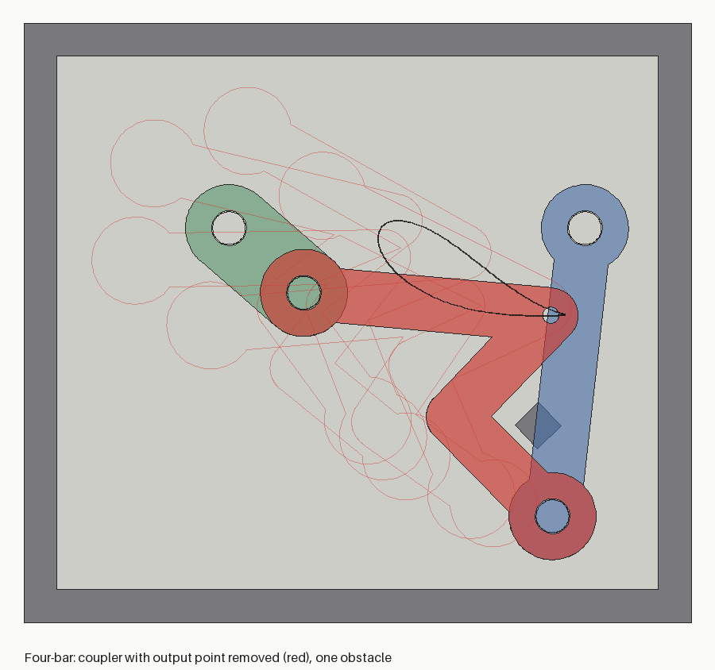
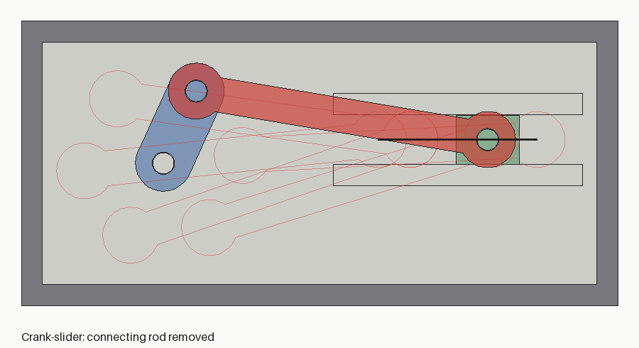
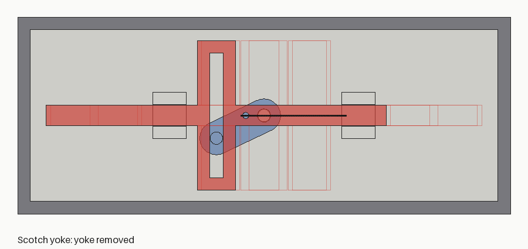
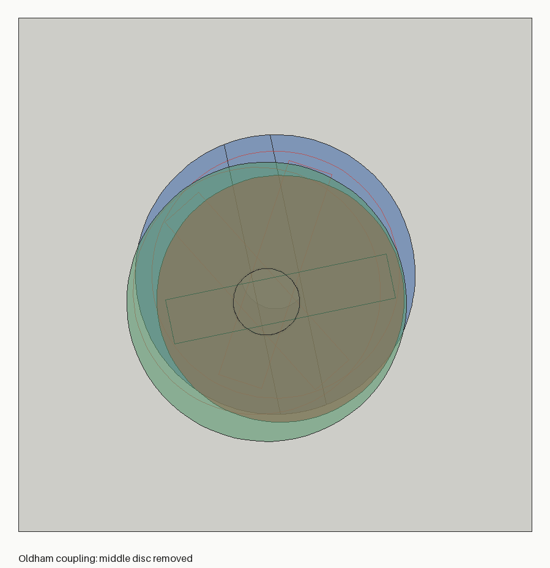
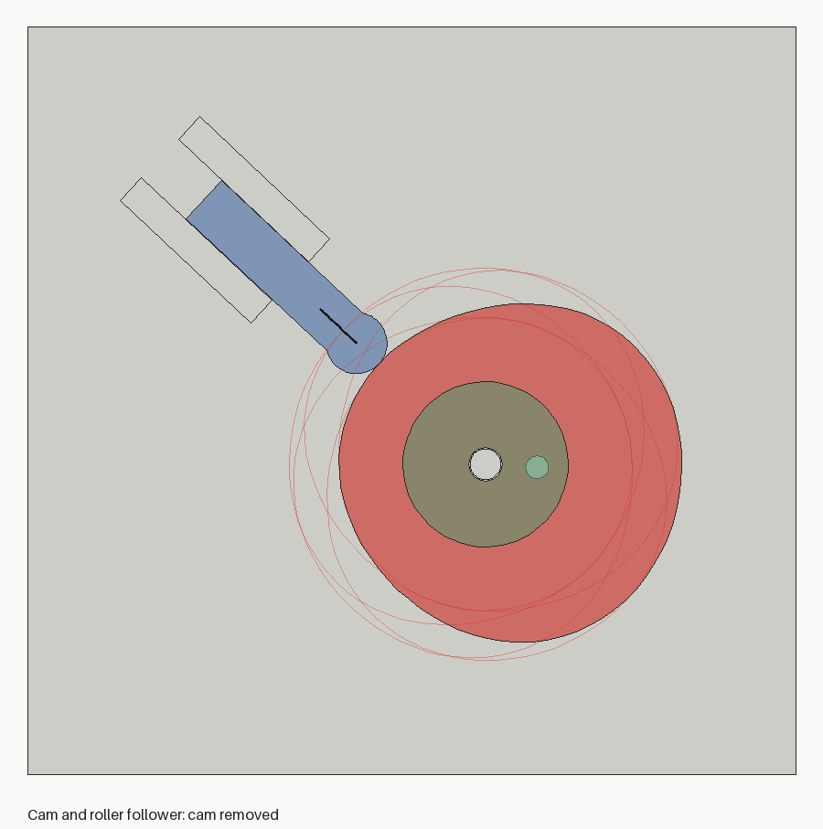
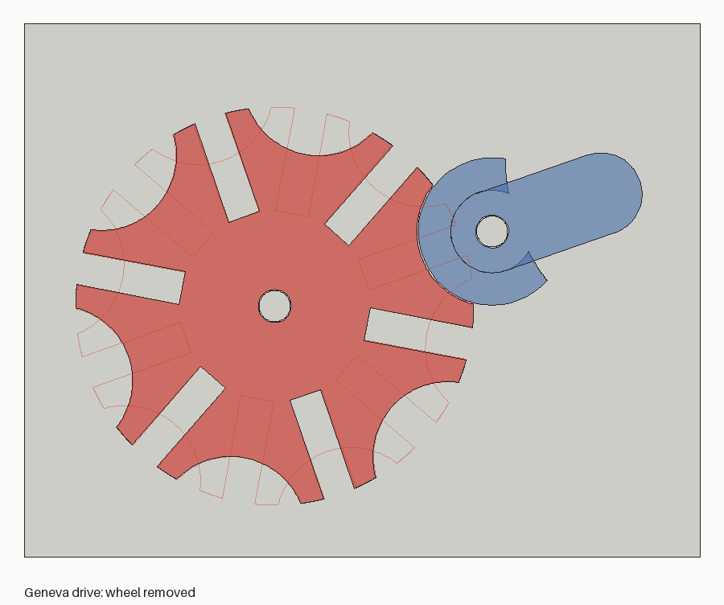
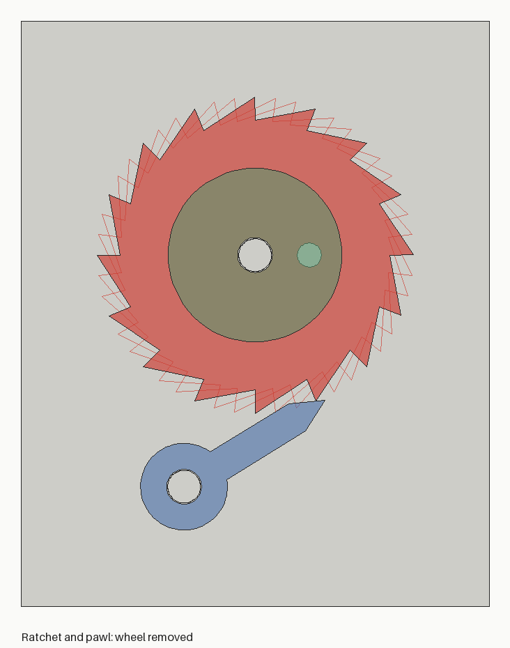

# Motion: mechanisms with one part missing

A working mechanism has one part removed. The agent designs a replacement so
that the whole moves as required: through the full input range, following a
table of input against output, and without any two parts touching. The
package is `src/jointbench/motion/`; it stands on its own and runs as

```
python -m jointbench.motion gen --type fourbar --seed 0 --out tasks
python -m jointbench.motion verify tasks/motion-fourbar-s0        # grades output.step
python -m jointbench.motion selftest --n 3 -j 0                   # proof the grader can be trusted
python -m jointbench.motion agree --n 20                          # closed form vs numeric solve
python -m jointbench.motion stepsize --n 3 -j 0                   # how fine the step must be
python -m jointbench.motion show --type geneva --out geneva.png
```

Types: `fourbar`, `slider` (crank-slider), `yoke` (Scotch yoke), `oldham`
(Oldham coupling), and the contact-driven `cam`, `geneva`, `ratchet`.

## The idea: motion as a series of still positions

There is no force simulation. The input (a crank angle) is stepped through
its range; at every step every part is placed, and still checks run on that
still picture. Two things make this trustworthy:

- **Where each part sits is computed, never searched,** wherever the
  linkage allows it. Each joint pairs a feature on one part with a feature on
  another; a short list of steps places the parts one or two at a time, each
  in closed form (a circle meets a circle, a circle meets a line, two lines
  meet). This is the linkbench method carried into 3D.
- **The answer is graded on what it does, not where it was drawn.** The
  submitted solid is measured for its joints (true cylinders and pairs of
  parallel faces); the mechanism is rebuilt with those and posed at every
  step. A different body with the same joints passes; a joint 0.5 mm out
  shows up as the path it actually produces.

Parts move in planes parallel to one *mechanism plane*, placed anywhere in
space. Heights along the plane's normal never change, so parts in different
height bands ("layers") can cross in plan view without touching, which is
how real planar linkages are built.

## The mechanisms

### Four-bar linkage



A crank turns a full circle on a frame post; a coupler joins its pin to the
pin of a rocker on a second post. Drawn linkbench-style: the pins are placed
first, lengths read off, and the draw kept only if the crank can turn fully
(Grashof, with an 8 mm margin) and the worst transmission angle stays above
35°. The coupler and rocker close the loop in one of two ways; the brief
states which (the shared pin to the left or right of the line from crank pin
to rocker pivot), and along the sweep the solver keeps the solution nearest
the previous one, so the mechanism cannot jump between the two.

Removable: coupler, rocker or crank. The output is the rocker's angle, or a
point on the coupler marked by a 3 mm hole (the coupler curve, drawn black).

### Crank-slider



A crank drives a connecting rod whose far pin sits on a slider block running
between two rails (offset up to 0.3 x crank radius). Circle meets line; the
brief says which side the slider sits. Output: the slider pin's position, or
a marked point on the rod. Removable: rod, slider or crank.

### Scotch yoke



The crank pin runs in a slot of a yoke that slides in two guides. One linear
equation per step. Half the draws tilt the slot 10-25° off square, which
changes the motion from pure sine and makes the slot's angle matter. Output:
a marked point on the yoke's bar. Removable: yoke or crank.

### Oldham coupling



Two hubs on parallel shafts 3-8 mm apart, each with a groove; the middle disc
has a tongue in each groove, at right angles. Line meets line. The output hub
turns exactly with the input; a disc whose tongues are not at right angles
still turns, but the output lags or leads by the error, and that is what the
grader sees. Sliding a tongue sideways changes nothing (true of the real
coupling), so for this mechanism "shifted" means "turned". Removable: disc.

### Cam and roller follower



A cam on a driving disc pushes a roller follower along a guide (cycloidal
rise, dwell, cycloidal return, dwell). The removed part is the cam: the
answer is a profile. At each step the follower is advanced along its guide
until the roller touches the cam (below). The reference profile is the inner
offset of the pitch curve; its table, found by contact on the reference
solid, agrees with the lift law it was drawn from to 0.00004-0.0002 mm.

### Geneva drive



A driver with one pin and a locking disc turns a slotted wheel (4-6 slots)
a step per turn, holding it still in between. The removed part is the wheel.
At each step the wheel stays put unless the driver's pin would be inside it;
then it is turned the least angle that frees the pin. The output is the
wheel's rotation since the start.

### Ratchet and pawl



A toothed wheel with a pawl resting on it (a spring is assumed). The removed
part is the wheel. Two tests: turned forward one full turn the pawl must
ride over every tooth; turned backward from three starting positions it must
lock within one tooth pitch (+2°).

## The checks

| check | passes when |
|---|---|
| `FILE_VALID` | the core's check: one closed, valid solid |
| `JOINTS` | for every joint of the missing part there is a feature of the right kind, size and height: a hole 0.1-0.6 mm larger than the neighbour's pin (or a pin that much smaller than its hole), a slot 0.1-0.6 mm wider than the tongue (or the reverse), overlapping the mate's height band by at least 2 mm; plus the 3.0 ±0.1 mm output mark if the output is on this part. Several holes of one size: every assignment is tried and the one that moves best kept |
| `GUIDED` | every sliding joint of the missing part is carried on real guide faces at every pose (1° steps). Both parts are measured as their actual flat faces, so the gap between two guide blocks carries nothing. The tongue must bear on at least 1.5 x its own width of guide face in all, and where the guide is two or more separate blocks it must cover at least half of each, so it is never carried on one block alone and cannot tip. 1.5 x width is the usual length-to-width rule for a plain sliding bearing (a slide shorter than about 1.5 times its width tends to rack and bind under an off-centre push). The mechanism still poses, so this is its own check, not a jam. Self-test rows sit at the limit: a yoke bar just inside both blocks passes, one ending 1 mm short of the far block fails; an Oldham tongue bearing 1.5 x width + 1 mm passes, - 1 mm fails. Generator version 3 lengthens the crank-slider's slider block to 1.5 x 14 + 4 = 25 mm (it was 18); tasks record their version and are rebuilt with it |
| `ASSEMBLES` | the mechanism can be posed at every input value. Fails with the value and the shortfall: "jams at 159.8 deg: the coupler and the rocker cannot reach: pins 0.04 mm too far apart"; "the pin of the crank reaches the end of the slot in the yoke"; "the slider runs off the frame: the shorter of the two is 18.0 mm end to end, and only 4.0 mm of it still overlaps (need 9.0)". |
| `TRANSMISSION` | the transmission angle (between coupler and rocker, rod and guide normal, slot and guide) never falls below 20° (the generator demands 35°): near 0 the mechanism binds |
| `OUTPUT` | at every table row the output is within 0.2 mm (points) or 0.2° (angles) of the table. Reports the worst row and how many are out |
| `NO_INTERFERENCE` | at every step, no two parts overlap by more than 0.01 mm³ (the core's limit). Fails with who, whom and where: "the coupler fouls the housing at 272.8 deg: 0.151 mm3 overlap (from 272.8 deg to 349.8 deg)" |
| `MOTION` (contact) | the contact search finds a position at every step |
| `PRESSURE_ANGLE` (cam) | the angle between the contact normal and the follower's travel stays under 35° |
| `LOCKED` (Geneva) | during the dwell the wheel cannot turn 1° either way without meeting the locking disc |
| `LOCKS_BACKWARD` (ratchet) | backward, the wheel locks within one tooth pitch +2° |

Overlap is measured by exact boolean intersection of the placed solids, with
the core's own measure (`jointbench.checks.base.volume`). Before that, sound
shortcuts settle most pairs: parts in height bands that do not meet; parts
split into pieces whose plan outlines are separated; a pin inside its own
hole (provably clear, and the hole is verified empty once); a pin or tongue
inside the empty channel of its slot; flat plates whose outlines at each
height are clear (sampled within 0.001 mm, then within 0.0001 mm, with the
remaining doubt bounded below half the 0.01 mm³ limit). A typical planar
grading then needs no exact boolean at all.

## The step size

Grading checks every 1° of input. Measured by `stepsize`: 36 deliberately
shallow clashes (a bump reaching 0.1, 0.3 or 1 mm into the housing or frame
where the part comes closest, 3 seeds of each planar mechanism) graded at
10, 5, 2, 1, 0.5, 0.25 and 0.1°, with 0.1° taken as the truth:

| step | verdicts different from 0.1° | largest move of any point between steps |
|---|---|---|
| 10° | 6 of 36 | 11.0 mm |
| 5° | 0 | 5.5 mm |
| 2° | 0 | 2.2 mm |
| **1° (default)** | 0 | 1.1 mm |
| 0.5° | 0 | 0.55 mm |

The shortest clash seen was 5° wide (a 0.1 mm bump). 1° is five times
finer than that. What it can still miss is stated plainly: a clash that
starts and ends between two steps, which needs a feature sweeping past
another by less than the largest move between steps (about 1.1 mm at 1°)
and in less than 1° of input. Every report prints that largest move.

## How exact each mechanism is

- **Four-bar, crank-slider, Scotch yoke, Oldham**: positions are exact
  (closed form, double precision). The closed form is checked against an
  independent method on every generated mechanism: a Newton solve of all
  joint equations at once, from the joints alone, with no steps. They agree
  to better than 1e-11 mm (`agree`; the generator rejects a draw over
  1e-6 mm). Joint features are read from the exact BRep.
- **Cam**: the follower's position is found by stepping the roller in by its
  current clearance to the cam, which can never step past the first touch,
  until the clearance is under 1e-7 mm. The cam's outline is OpenCASCADE's
  sampling of its exact edges, within 0.0001 mm; a flat cam is read at one
  height, any other at three. Between steps nothing is checked; the
  follower is assumed to stay on the cam (no jump at speed).
- **Geneva**: the wheel's angle is the least turn that frees the pin, by
  bisection to 1e-7 rad, against the same 0.0001 mm outline. Impact and
  acceleration are not modelled; locking during the dwell is a geometric
  test (1° either way), not a force.
- **Ratchet**: contact is frictionless. Locking means the contact normal at
  the moment of first touch turns the pawl into the wheel; friction would
  only make locking easier, so the test is on the safe side. When the pawl
  drops off a tooth crest it falls in one step (largest move ~1.5 mm), so
  interference is not meaningful during that drop.

## Generation: answer first

1. Draw pins, read lengths (as linkbench). 2. Sweep in closed form; reject
on a jam or a transmission angle under 35°. 3. Require the Newton solve to
agree to 1e-6 mm. 4. Fit a frame plate and a housing 3-6 mm round the swept
envelope. 5. Remove a part; optionally place obstacles: keep-out boxes in
the removed part's layer, centred where a straight version of it passes at
some step, and bend the reference round them (so the straight link fouls,
as the self-test proves). 6. Write the table from the reference's own
motion. 7. Grade the reference with the real grader; any failure throws the
draw away. Same seed and knobs, same task.

Knobs (`--knob name=value`):

| knob | values | effect |
|---|---|---|
| `remove` | per type (above) | which part is missing |
| `output_on_removed` | 0 / 1 | the output point is on the missing part: the agent places it (coupler-curve synthesis) |
| `pivots` | `given` / `withheld` | given: the brief lists each joint's position at the first input value. Withheld: parts whose position depends on the missing one are drawn parked in a wrong pose; where they sit follows from the motion |
| `obstacles` | 0, 1, 2 | keep-outs that bite on the straight version (links only: four-bar, crank-slider rod) |
| `placed` | `anywhere` / `flat` | the mechanism plane at a random position and angle, or the world XY plane |

## A task folder

```
motion-fourbar-s0/
  README.md          the brief: plane frame, joints the part must make, rules, the table
  motion.json        the same, machine-readable (fixed parts as rebuildable recipes)
  brief.png          plan view of what is given
  fixed_<part>.step  each remaining part in world coordinates, as drawn
  _solution/         reference.step and the full mechanism (not for the agent)
```

The submission is `output.step`: one solid, in world coordinates, placed
where the part sits at the first input value.

## Self-test

`selftest` builds variants of each removed part and grades them:

| row | expected |
|---|---|
| reference | passes |
| reshaped (thinner, lightening holes; a different yoke frame; a chamfered block; a square disc; holes in cam, wheel) | passes |
| shift 0.05 / 0.25 / 0.5 / 1 mm (Oldham: tongue turned that many degrees) | verdict equals an independent computation of the shifted part's path (Newton solve of its joints as built), and the grader's reported error equals it to 1e-4 |
| fouls (bump into the housing or frame where the part passes closest) | fails `NO_INTERFERENCE`, named at that input value |
| jams (a length the loop cannot close; a slot too short; tongues parallel) | fails `ASSEMBLES` |
| straight (with obstacles: the unbent link) | fails `NO_INTERFERENCE` against the obstacle |
| cam profile offset 0.05 / 0.3 / 1 mm; drive hole 1 mm off | 0.05 passes; 0.3 and 1 fail `OUTPUT`; hole off fails `MOTION` |
| Geneva slots narrower than the pin; locking arcs removed | fails `MOTION`; fails `LOCKED` |
| ratchet teeth reversed; tooth faces sloped | both fail `LOCKS_BACKWARD` (the pawl rides over both ways) |

Run on 3 seeds of every setting (`selftest --n 3`): **285 of 285 rows as expected.** Per type and row, how many passed and the median grading time:

| type | row | passed / graded | median s |
|---|---|---|---|
| fourbar | reference | 12 / 12 | 1.5 |
| fourbar | reshaped | 12 / 12 | 1.5 |
| fourbar | shift_0.05 | 12 / 12 | 1.4 |
| fourbar | shift_0.25 | 5 / 12 | 1.4 |
| fourbar | shift_0.5 | 2 / 12 | 1.4 |
| fourbar | shift_1 | 0 / 12 | 1.4 |
| fourbar | fouls | 0 / 12 | 3.0 |
| fourbar | jams | 0 / 12 | 0.0 |
| fourbar | straight | 0 / 3 | 4.3 |
| slider | reference | 9 / 9 | 1.3 |
| slider | reshaped | 9 / 9 | 1.6 |
| slider | shift_0.05 | 9 / 9 | 1.3 |
| slider | shift_0.25 | 3 / 9 | 1.2 |
| slider | shift_0.5 | 3 / 9 | 1.2 |
| slider | shift_1 | 3 / 9 | 1.2 |
| slider | fouls | 0 / 9 | 4.2 |
| slider | jams | 0 / 6 | 0.0 |
| slider | straight | 0 / 3 | 6.2 |
| yoke | reference | 6 / 6 | 4.4 |
| yoke | reshaped | 6 / 6 | 4.6 |
| yoke | shift_0.05 | 6 / 6 | 4.9 |
| yoke | shift_0.25 | 0 / 6 | 4.7 |
| yoke | shift_0.5 | 0 / 6 | 4.7 |
| yoke | shift_1 | 0 / 6 | 4.6 |
| yoke | fouls | 0 / 6 | 9.2 |
| yoke | jams | 0 / 6 | 0.0 |
| oldham | reference | 3 / 3 | 3.3 |
| oldham | reshaped | 3 / 3 | 9.2 |
| oldham | shift_0.05 | 3 / 3 | 2.8 |
| oldham | shift_0.25 | 0 / 3 | 3.7 |
| oldham | shift_0.5 | 0 / 3 | 3.6 |
| oldham | shift_1 | 0 / 3 | 3.0 |
| oldham | fouls | 0 / 3 | 6.6 |
| oldham | jams | 0 / 3 | 0.0 |
| cam | reference | 3 / 3 | 6.3 |
| cam | reshaped | 3 / 3 | 5.2 |
| cam | profile_0.05 | 3 / 3 | 5.2 |
| cam | profile_0.3 | 0 / 3 | 6.0 |
| cam | profile_1 | 0 / 3 | 7.1 |
| cam | drive_hole_off | 0 / 3 | 0.2 |
| geneva | reference | 3 / 3 | 6.8 |
| geneva | reshaped | 3 / 3 | 5.2 |
| geneva | narrow_slots | 0 / 3 | 0.3 |
| geneva | no_locking_arcs | 0 / 3 | 1.2 |
| ratchet | reference | 3 / 3 | 28.8 |
| ratchet | reshaped | 3 / 3 | 49.4 |
| ratchet | teeth_reversed | 0 / 3 | 21.3 |
| ratchet | sloped_faces | 0 / 3 | 19.9 |

Shifted joints, all planar settings together (how many of the shifted parts fail on the path, and the grader's error against the independent computation):

| shift | fail | largest grader-vs-independent difference |
|---|---|---|
| 0.05 | 0 / 30 | 5.0e-06 |
| 0.25 | 22 / 30 | 5.0e-06 |
| 0.5 | 25 / 30 | 5.0e-06 |
| 1 | 27 / 30 | 5.0e-06 |

The three 1 mm rows that pass are crank-slider rods carrying the output mark: lengthening the rod by 1 mm moves that mark less than 0.2 mm, and the independent computation says the same. Times above were taken with six gradings running at once on a machine also running another session's jobs; a lone planar grading takes 0.5-2 s, a cam or Geneva 2-5 s, a ratchet about 12 s.

The closed form and the Newton solve agree on 80 generated planar mechanisms (20 per type) to 1.1e-11 mm (`agree --n 20`).

## Speed

Pose solving is closed form (25-90 µs per mechanism per step, in Python); fixed parts
are built once from their recipes; each part's pieces and outlines are
prepared once and reused at every step; bounding circles and convex outlines
are tested before any exact boolean. Measured times per grading at 1° (361
poses), on a machine shared with other jobs, are in the self-test table
above. Contact mechanisms cost more because each step is a search.

## As task families

The four planar mechanisms are task families on the core interface
(`src/jointbench/families/{fourbar,slider,yoke,oldham}/`, wrapping in
`motion/family.py`), so the core tools pick them up:

```
uv run jointbench gen --family fourbar --level 2 --n 5 --out tasks
uv run jointbench verify tasks/fourbar-L2-s0
uv run jointbench selftest --family slider --level 3 --n 3 -j 0
```

| level | four-bar, crank-slider | Scotch yoke, Oldham |
|---|---|---|
| 1 | joint positions given, mechanism plane = world XY | same |
| 2 | placed anywhere, one obstacle against the straight link | placed anywhere |
| 3 | the output point is on the missing link (path synthesis), parts depending on it drawn parked, one obstacle | - |

What the agent's `task.json` holds is only what the brief states: the
plane, the table, fits and tolerances, the joints of the missing part as far
as the level tells them, one stored pose (the drawing, parked parts parked),
and which generator draw was kept. The joint graph, every part's features,
the motion of the parts that depend on the missing one and the generator's
record are not in it. The grader rebuilds them from family, level knobs,
seed and that draw number: the draws are replayed exactly and not graded
again (each draw before the kept one is known to have failed). Nothing is
read from `_solution` (the families register this rebuild as the core's
`grader` hook and put nothing in `_solution` for it), so a redacted or
edited copy of the folder grades the same. `submission.py` is the
mechanism's own starting point (core `submission` hook). A test checks that a level 3 `task.json` contains none of the
withheld numbers (pin spacing, mark offset, the parked part's true
position). The seed itself is in every task file of every family; with the
open generator it regenerates any task, so only hidden sets with withheld
seeds can close that.

How a mechanism maps onto the interface: every remaining part (frame,
housing, obstacles, moving neighbours) is a fixed part of catalogue kind
`solid`; the checks run at each row of the motion table (`check_poses`), while
`task.json` stores one pose, the drawing. At grading:

- `pose_answer` measures the answer's joints, solves the mechanism with it
  and returns where the answer sits at each row; a jam fails `POSES` with
  its reason.
- `pose_scene` returns every fixed part where the *answer's* motion puts
  it, so the core `NO_INTERFERENCE` tests the scene the answer actually
  makes, the answer against every fixed part and every fixed part against
  every other (a wrong coupler can drive the crank into the rocker).
- The motion checks (`JOINTS`, `ASSEMBLES`, `TRANSMISSION`, `OUTPUT`) and
  `MOTION_CLEAR` (every part against every other, every 1°) run once per
  grading, as one family check.
- `check_poses` is the number of table rows: the core check runs at the
  37 rows (10°), not at the one stored pose. At 1° it would cost about ten times as much with plain booleans,
  and `MOTION_CLEAR` already covers 1° with its shortcuts. The step study
  shows 10° alone would miss shallow clashes, so `MOTION_CLEAR` is the one
  that decides those.

The interface points raised earlier (neighbours not following the answer,
fixed parts never tested against each other, the `gen` summary line) were
answered by the core session with `pose_scene`, `check_poses` and the
fixed-against-fixed test (commit b59eca3), and are now used here.

For a viewer, `motion.family.motion_poses(task)` gives the whole motion of
a one-pose folder: one dict per input value, part id to `Placement`, the
same kind `task.poses` holds, with the missing part included. Without an
answer it is the reference motion, solved in closed form from `task.json`
alone (about 1 s the first time a task is seen, while the mechanism is
rebuilt; then about 0.02 s for 361 positions). The missing part's entry
places `reference_solid(task)`; `values=` picks the input values (default
the table's 37). With `answer=` (a STEP path or a world solid) it is the
motion that answer drives, at the table rows, as one grading would pose it
(about 0.3 to 3.5 s), and the missing part's entry moves the submitted
solid from where it was modelled.
