# Modelling quality checker

A part can fit, pass every grading check and still be modelled badly. The
maintainer's example: a plate joined to a body slightly out of line, made in
FreeCAD. Zoomed in, there is a hairline step, a thin wedge tapering to a
knife-thin tip, and a near-flat crease. The solid is valid and it works,
but no engineer would accept it. This checker measures those signs.

```
uv run python -m jointbench.quality part.step [--json] [--fields DIR] [--images DIR]
uv run python -m jointbench.quality --selftest [--images docs/quality]
```

From Python: `from jointbench.quality import check; rep = check("part.step")`.

The report has the same shape as the manufacturing checker's (see
[dfm.md](dfm.md)): for each rule, pass or fail, a one-line reason, the
measured number against its limit, and where on the part (a point and a
face index). `--fields` and `--images` write the same viewer-neutral mesh
file and the same kind of picture, in the format described in `dfm.md`.
A model that passes every rule is reported **CLEAN**, otherwise
**UNTIDY**.

## Everything is measured exactly

Every rule reads its number straight off the solid's own faces, edges and
corners: face areas, edge lengths, the angle between two faces across an
edge, the angle between two edges at a corner of a face, distances between
corners. Nothing is sampled, so no fault is too small to be seen. That
matters here, because these faults are hundredths of a millimetre. The
display mesh is used only for the pictures and fields.

Because the faults are tiny, a picture of the whole part cannot show them
by colour alone. Every fault is therefore **ringed** and labelled with its
number, on top of the colouring.

## The rules

Limits live in `src/jointbench/quality/quality.toml`, each with a unit and
a note. There is no published standard for modelling tidiness, so **every
limit is a judgement call**, except "unmerged faces", which is a plain fact
(either a face is split on its own surface or it is not). They are set so
that a deliberate feature of a machine part never trips them.

| Rule | Fails when | Limit | Judgement? |
|---|---|---|---|
| `Q_SLIVER_FACE` | a face at least 10 x longer than wide is under 0.25 mm wide | 0.25 mm | yes |
| `Q_TINY_FACE` | a face is smaller than 0.1 mm² | 0.1 mm² | yes |
| `Q_SHORT_EDGE` | an edge is shorter than 0.1 mm | 0.1 mm | yes |
| `Q_SMALL_STEP` | a face steps between two faces facing the same way, under 0.2 mm high | 0.2 mm | yes |
| `Q_THIN_WEDGE` | a face corner, or an edge between faces, narrows at under 5° | 5° | yes |
| `Q_CREASE` | two faces meet at a bend under 2° that is not smooth | 2° | yes |
| `Q_UNMERGED` | two neighbouring faces lie on the same plane or cylinder | none allowed | no |
| `Q_NEAR_VERTICES` | two corners not joined by an edge are closer than 0.05 mm | 0.05 mm | yes |
| `Q_STUB` | a member runs on less than 5 mm past the face it joins | 5 mm | yes |
| `Q_SHALLOW_JOINT` | two faces meet at an inside angle under 45°, leaving a crevice | 45° | yes |

**Sliver faces.** A face's mean width is twice its area divided by the
length of its outer boundary; its length is half that boundary. A face at
least 10 times longer than wide and under 0.25 mm wide is a leftover, not a
feature. A 0.5 mm chamfer passes; a 0.15 mm chamfer fails.

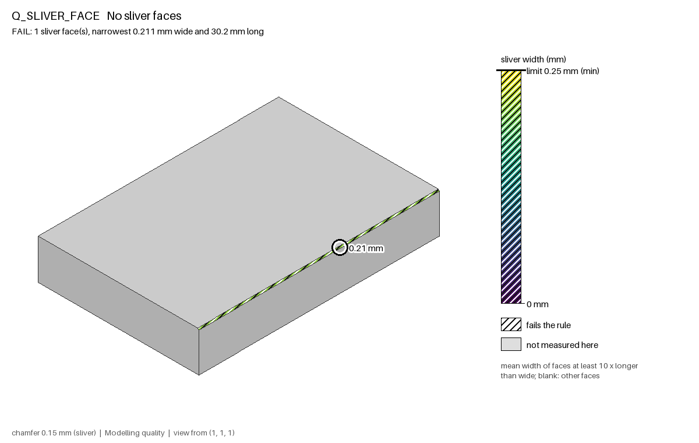

**Tiny faces.** Any face under 0.1 mm², about a 0.3 x 0.3 mm patch.

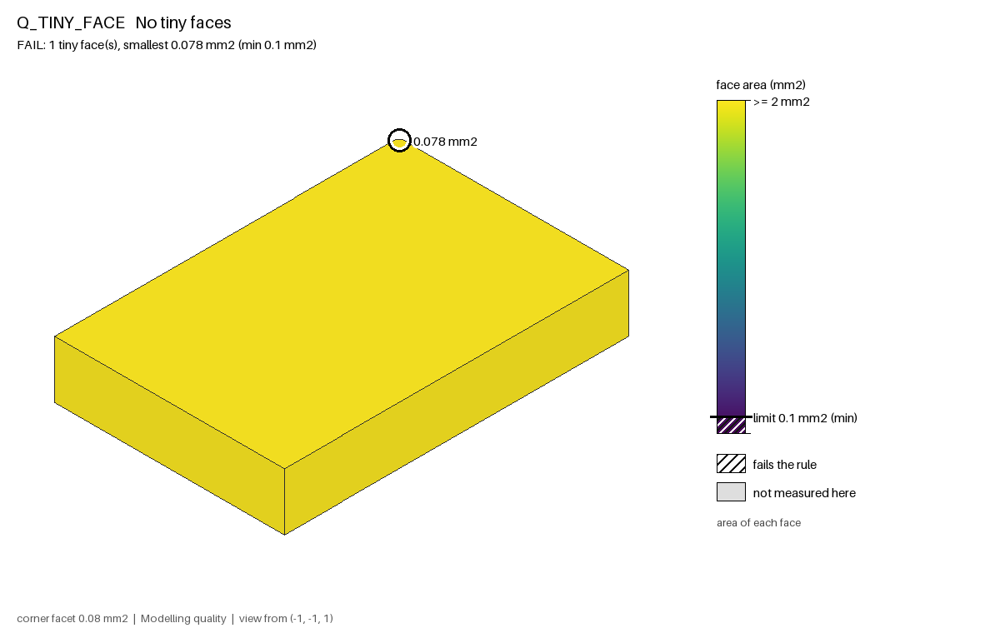

**Short edges.** Any edge under 0.1 mm. A short edge almost always comes
with a sliver face beside it, so the two often fail together.

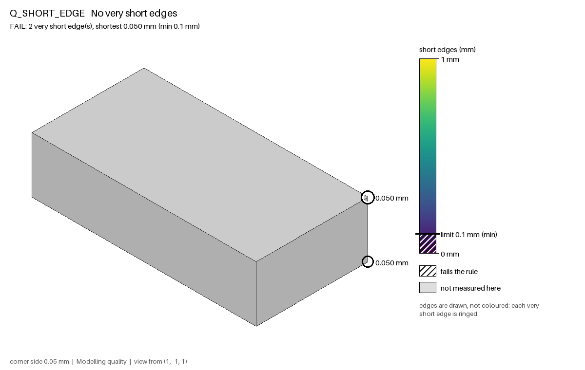

**Small steps.** A face that sits between two faces facing the same way
(within 3°), with its far corners less than 0.2 mm from either of them. The
two faces were meant to be flush; the step is the misalignment. A 1 mm step
passes as deliberate; a 0.12 mm step fails.

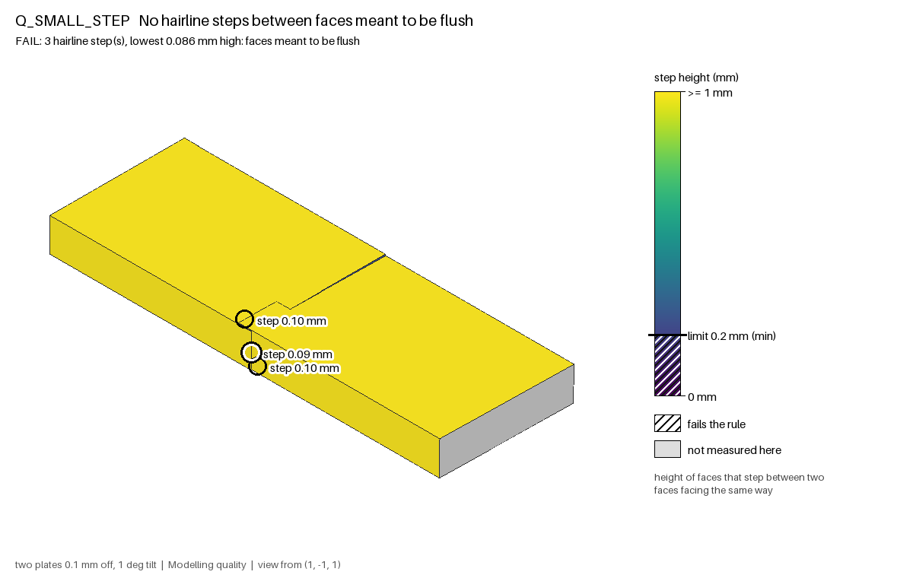

**Thin wedges and knife edges.** Two kinds of corner are measured. One is
the angle inside a face where two of its edges meet: a long triangle
tapering to a 1° tip. The other is the angle across an edge where two faces
fold almost back on each other: a knife edge of material, or a crack of
air. Under 5° fails. A wedge-shaped part with an 8° tip passes; 4° fails.

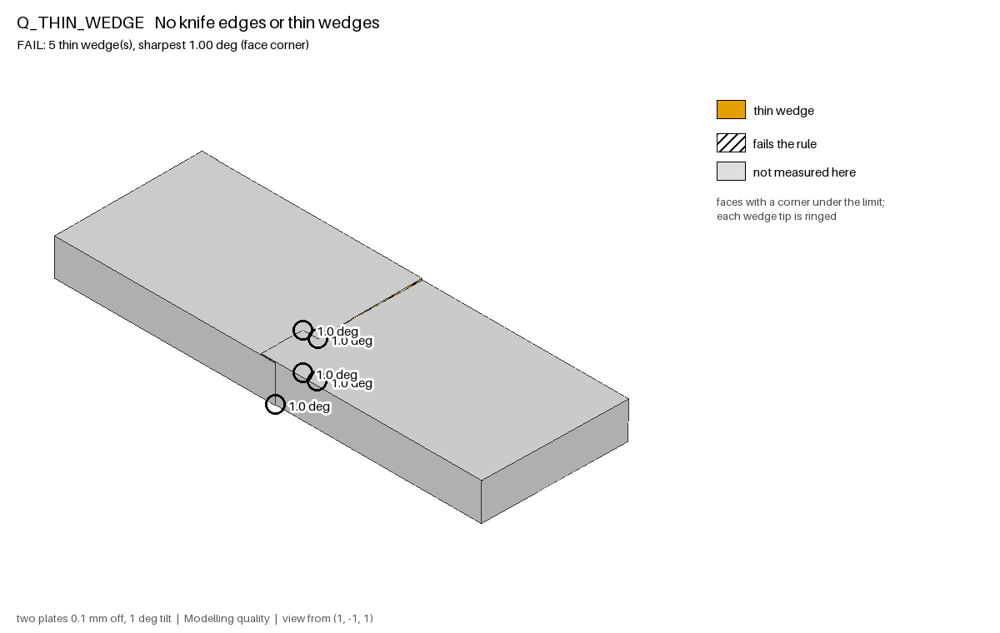

**Near-flat creases.** Two faces meeting at an edge where the surface
bends by less than 2°, but not smoothly (smooth means under 0.05°, as at
the edge of a fillet). Such faces were meant to be one flat or one smooth
surface. A 5° bend passes; a 1° bend fails.

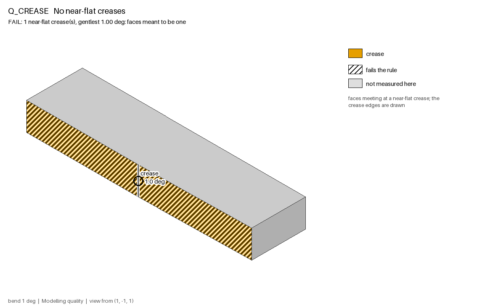

**Unmerged faces.** Two faces sharing an edge that lie on the same plane,
or on the same cylinder (same axis and radius). The edge between them is
left over from a boolean operation that was not cleaned up. Exact.

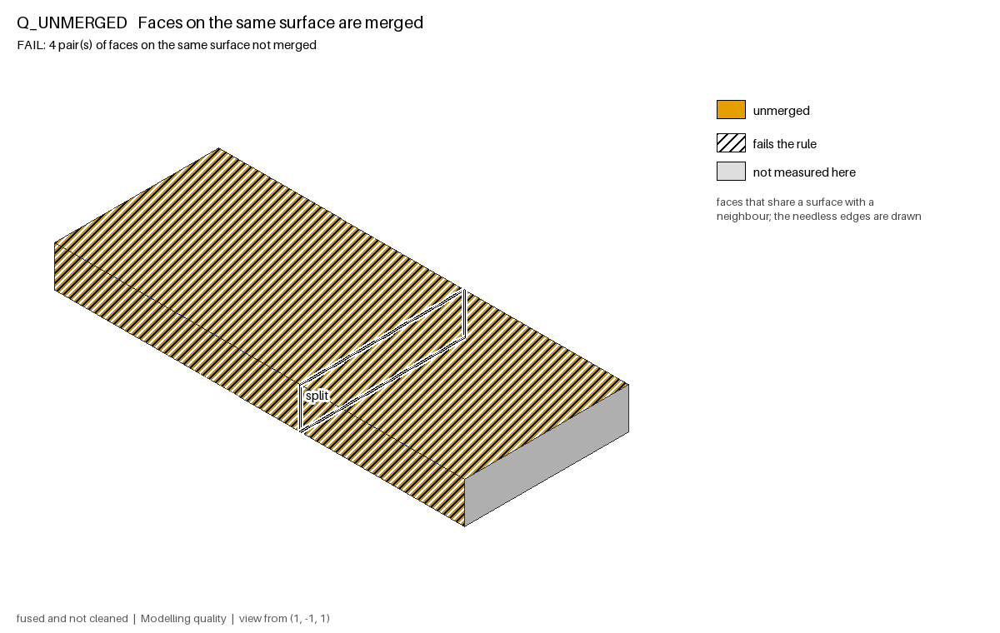

**Near-coincident corners.** Two corners of the solid, not joined by an
edge, closer than 0.05 mm: meant to be one point. The test part is a V
notch whose two lips almost touch; it also fails the wedge rule, as such a
notch must.

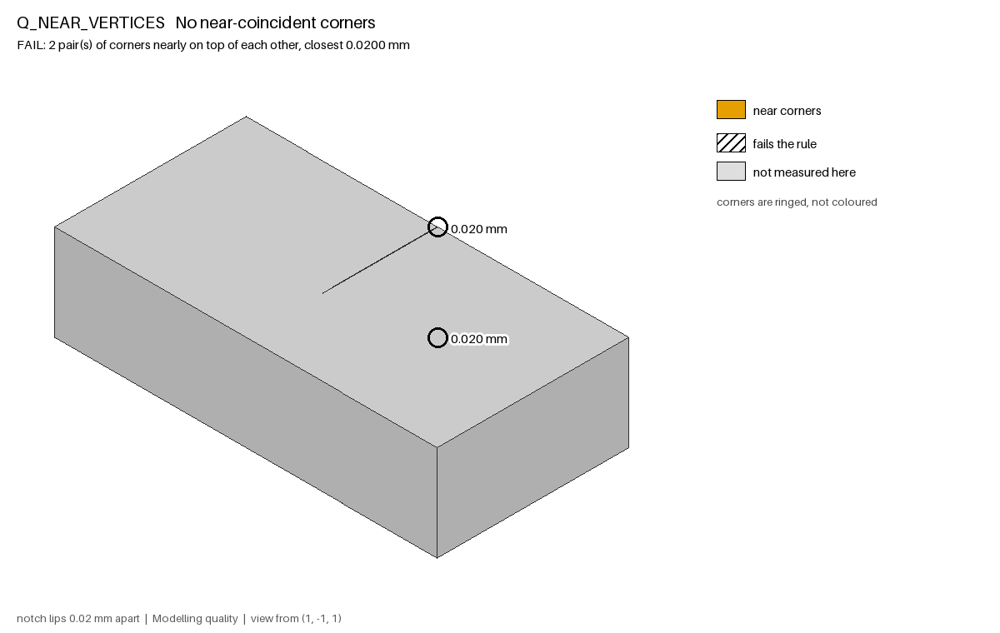

**Stubs.** A member (a bar, a web) simply run into a plate and on past it,
instead of ending at the plate's face. From every inside corner on a flat
face, the checker collects the material lying wholly on that face's outer
side. That material is a stub if the member visibly carries on through the
plate: either its side lies on the same plane as a face on the plate's
inner side (the side was split by the plate), or a side face runs on
through and meets the plate's opposite face at an inside corner. The
stub's length is how far it reaches past the face, measured exactly from
its corners. A boss or rib standing on a plate, or a rim flush with the
plate's edge, does not count; the self-test proves that. A bar trimmed to
the plates passes; the same bar run 4 mm on past them fails (3.6 mm stubs).

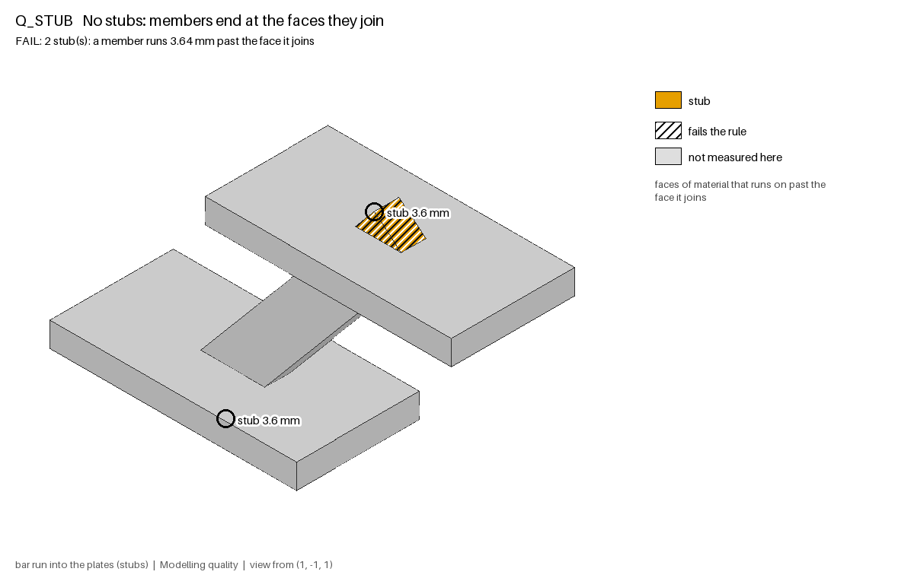

**Shallow joints.** Where two faces meet at an inside corner, the open
angle between them. Under 45° the joint leaves a narrow crevice that cannot
be cleaned, filleted or inspected, typically where a member meets a plate
at a slant. A bar meeting the plates at 60° passes; at 30° it fails. This is
the most debatable limit: a round strut leaning more than 45° from square
to its plate always leaves such a crevice on its acute side, and some
designers would accept that.

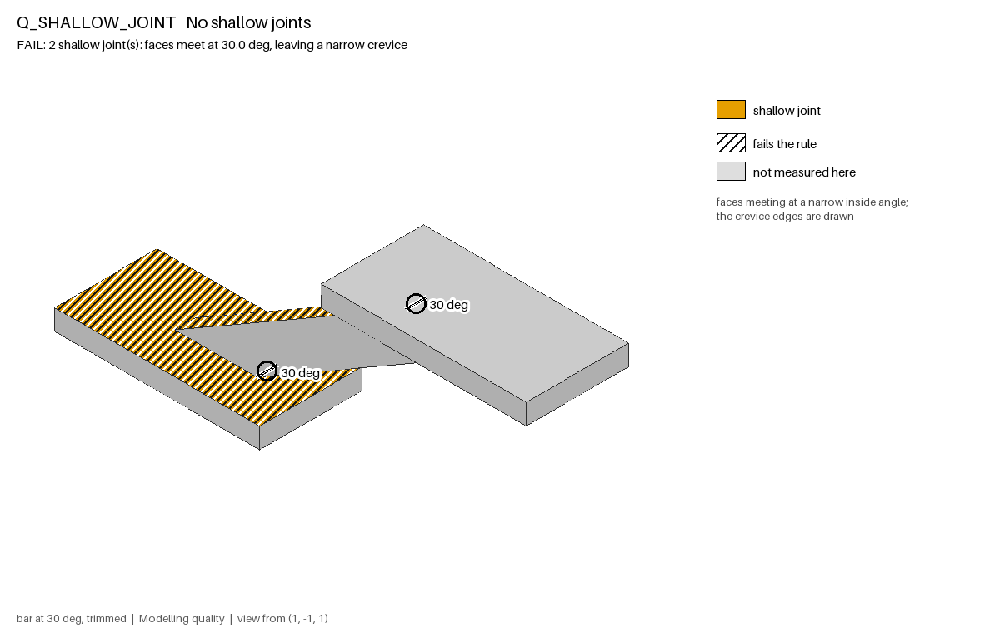

**Information only.** The report also gives the number of faces and edges,
the share of faces (and of surface area) that are planes, cylinders or
other, and the number of inside corners left sharp versus filleted. No pass
or fail. A part made of planes and cylinders is easy to draw, dimension
and machine, but other surfaces are not wrong. A sharp inside corner where
a member joins a plate is a stress raiser, but without loads it is a
judgement call, so it is counted, not judged.

## The self-test

`--selftest` builds a passing and a failing part for every rule, writes
each to a real STEP file and checks it. Some faults cannot occur alone: a
0.12 mm step is also a 0.12 mm wide face, so it is also a sliver. A failing
row therefore names the rule that must fail and the only other rules
allowed to fail with it; all other rules must pass.

The maintainer's example is a self-test row: two 30 x 20 x 5 mm plates, the
second joined 0.1 mm high and tilted 1° across the joint. It fails on the
step (0.086 mm) and the wedge (1.0°), and also on sliver faces, short
edges, the 1° crease and a stub (the second plate pokes 0.1 mm past the
first). All of these are honestly there.

## Second example: a bar run into two plates

The maintainer's review of Sonnet's passing level 2 answer (task s702): two seat
plates joined by a thin rectangular bar that simply runs into each plate at
a slant. At both joints the bar's end pokes past the plate. It is valid and
it fits, but it reads as two shapes pushed together. On that file:

* **`Q_STUB` fires**: the bar runs 2.5 mm past one plate and 2.6 mm past the
  other.
* **`Q_SHALLOW_JOINT` fires**: one side of the bar meets a plate at 44°,
  just under the 45° limit. A slightly steeper bar would pass this rule;
  the stubs are the robust catch.
* Information: 12 inside corners, all sharp, none filleted.
* Everything else passes: the little triangular faces at the joints are
  5-9 mm² with corners of 36° and more, well clear of the sliver, tiny-face
  and wedge limits. They are a symptom of the stub, not a fault of their own.

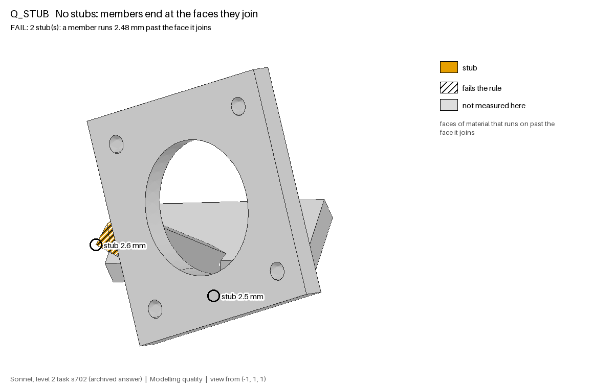

What no rule measures in it:

* that the bar is not shaped to the plates at all: its ends are cut by
  nothing but the plates and the fixed parts. The stub rule catches the
  result only where an end pokes out; a bar end buried inside a plate is
  invisible from outside and harmless to geometry, so it is not judged;
* proportion: a thin 8 x 4 mm bar between two much heavier plates, and a
  bar landing on a plate's edge rather than across its face. Whether that
  is weak depends on loads, which the benchmark does not state;
* the lack of fillets: counted (12 sharp, 0 filleted), not judged;
* the overall impression of "two shapes pushed together" rather than one
  designed part. That is about intent and style. It shows in the
  measurable symptoms (stubs, crevices, sharp corners), but no geometric
  rule can grade it directly.

## What it does to current results

**Level 2 model run** (3 tasks per model, the answers in the archived run;
every one of them passed the grader):

| model | clean | untidy, and why |
|---|---|---|
| Haiku | 2 of 3 | s701: a round strut meets a plate at a slant, leaving a 35° crevice |
| Sonnet | 0 of 3 | s700: a tube grazing a plate at 6° and one edge of 0.092 mm; s701: a 43° crevice; s702: two stubs and a 44° crevice (the maintainer's second example) |
| Opus | 1 of 3 | thin wedges of 1.4-1.7° and a 1.5° crease; slivers 0.1 mm wide |

The Opus findings have the same signature as the maintainer's first example: a
plate set slightly out of line with the body it joins. Sonnet's are the
second: members run into plates rather than ended at them. Two of the
six untidy answers (Haiku s701, Sonnet s701) fail only on shallow joints
(35° and 43°), the most debatable limit; at a 30° limit, Haiku would be 3 of 3 clean and Sonnet
1 of 3.

**Level 2 reference answers** (ten generated tasks, seeds 0-9): **0 of 10
clean.** Every reference has leftovers where its angled web meets the two
plates: faces as small as 0.004 mm² and a hundredth of a millimetre wide,
edges of 0.02 mm, wedge tips between 0.7° and 5°, in two tasks a step of
0.014-0.018 mm, and in every task the web poking 0.01-0.46 mm past a plate
(a stub). The generator joins tilted pieces whose faces almost,
but not exactly, meet. The ten level 1 references, where everything is
square, are all clean.

So if this check were graded today, it would fail every level 2 reference
answer. The reference construction should be fixed first (snap the web to
the plates' faces, or build it from the plates' own edges), so that the
benchmark's own answers are clean before agents are asked to be.
