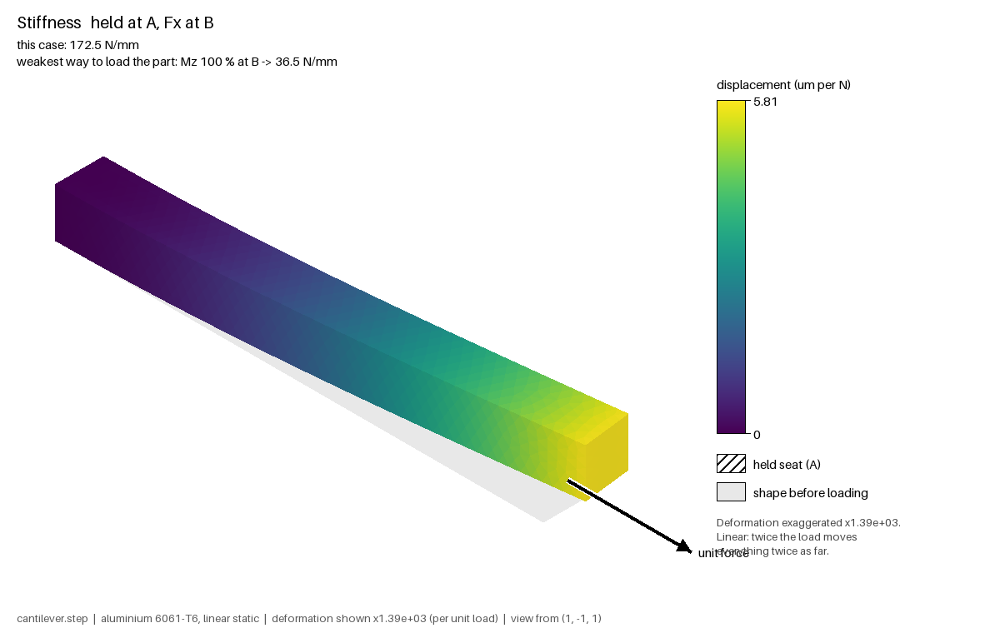
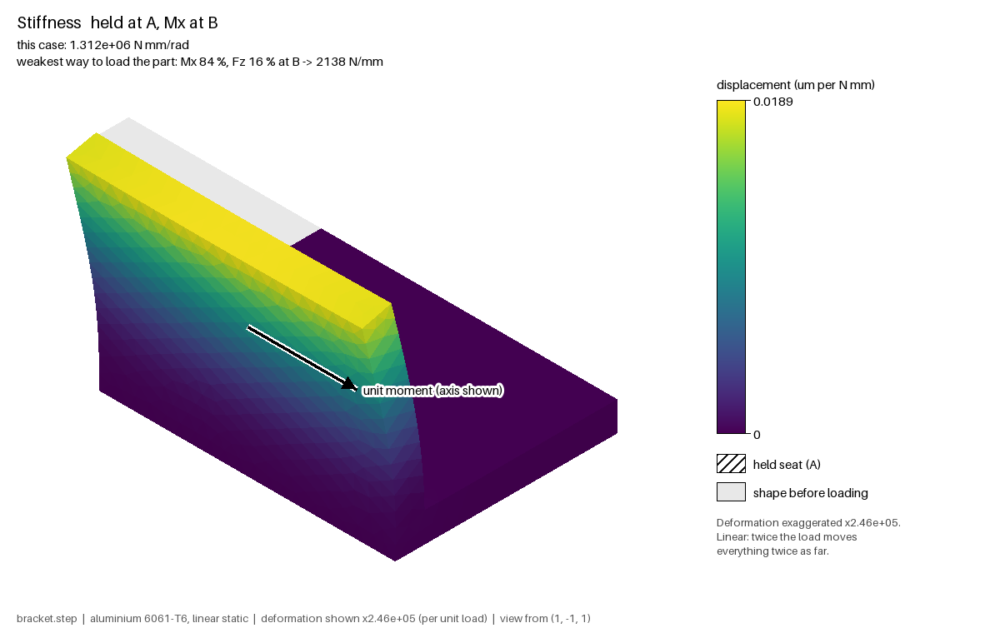
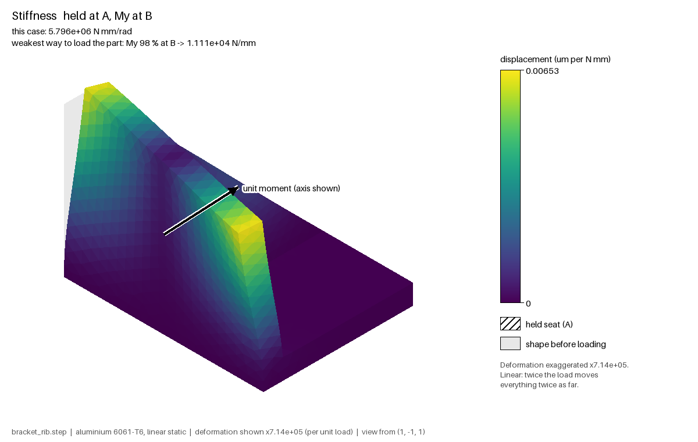
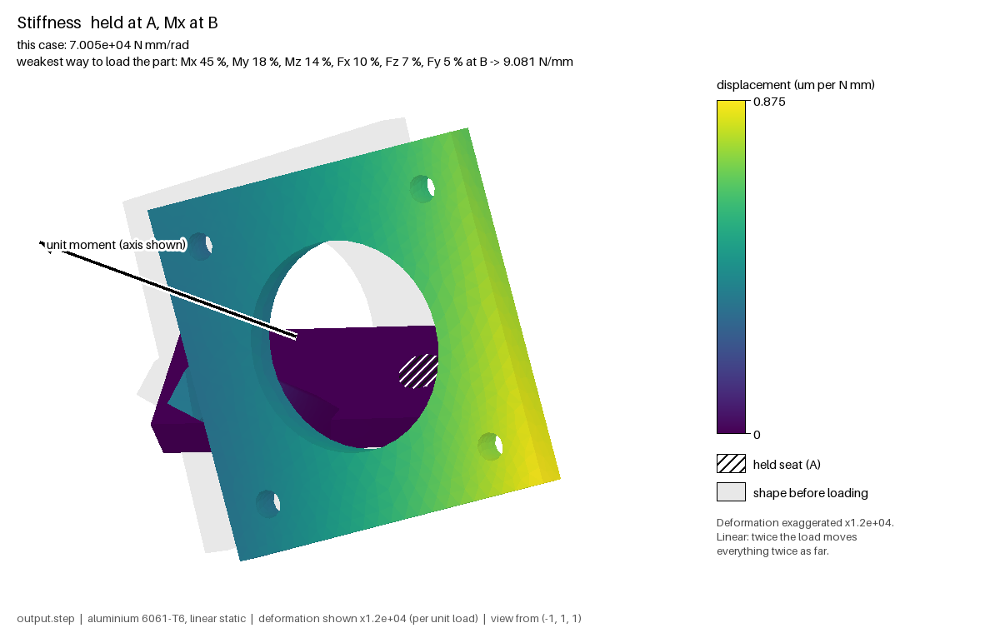
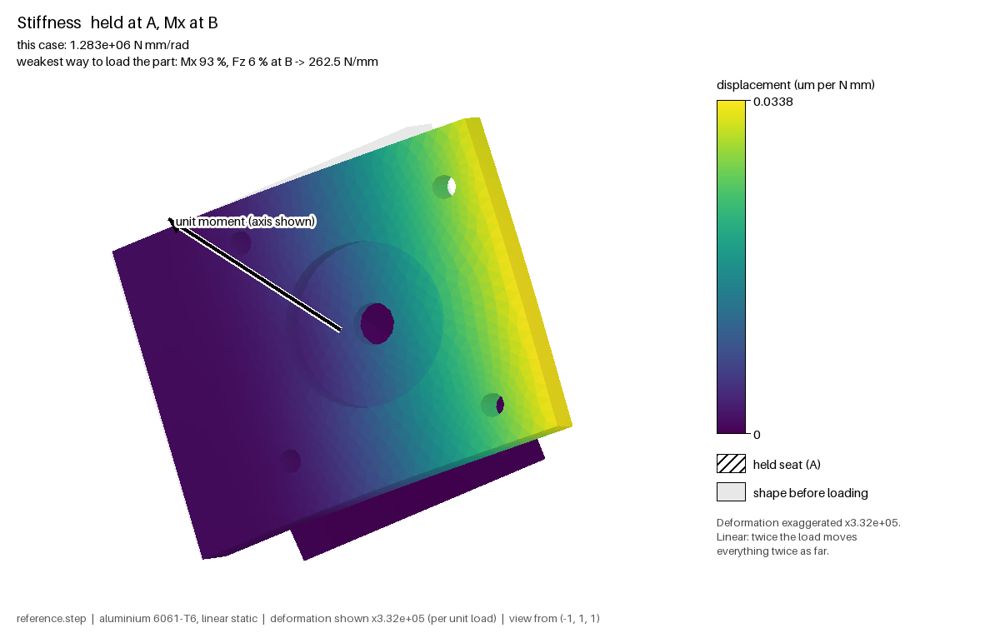
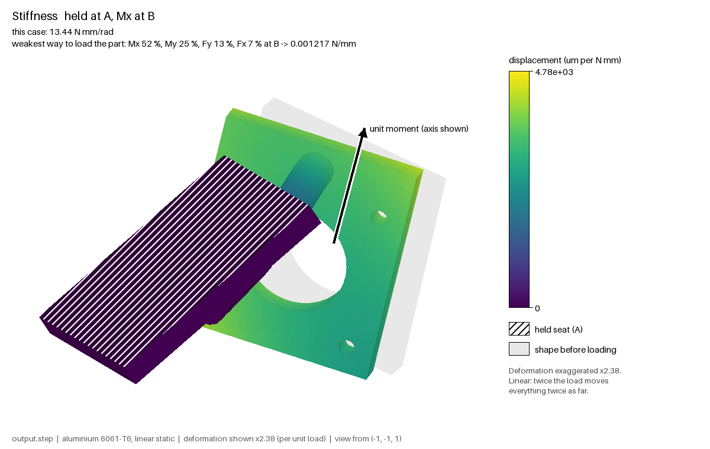
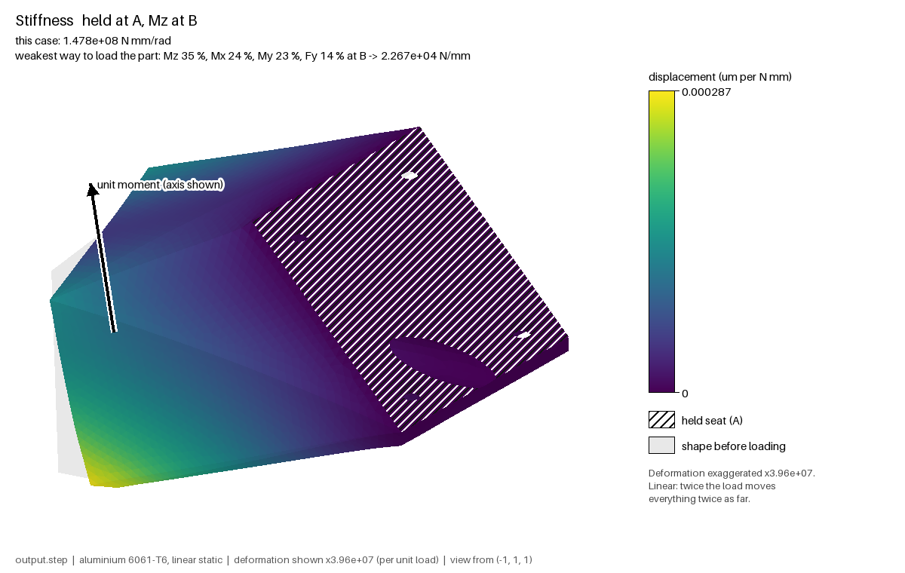
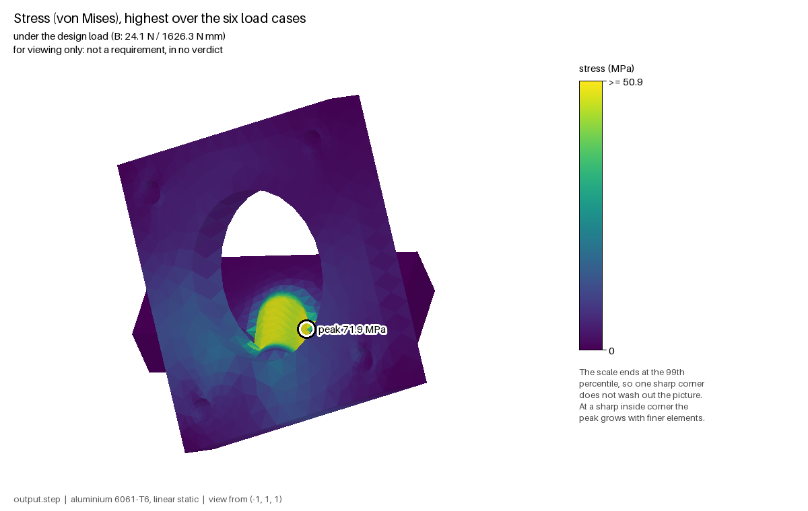
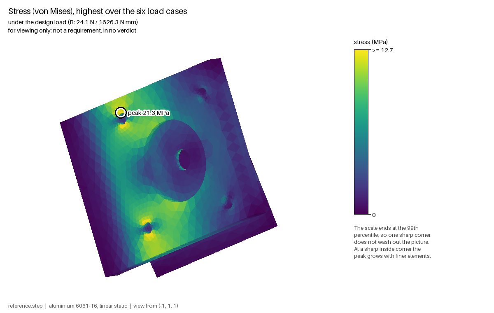

# Stiffness score

Passing the grader says a part fits. It does not say whether the part is
any good at its job, which is to hold one thing firmly to another. A thin
stick that touches both mounts passes, and so does a solid block. This
score measures how stiff the part is between its mounts, and how much
material it spends to get there, against the task's own reference answer.
It is a **score, never a pass/fail gate**: every part that can be analysed
gets a number.

```
uv sync --extra stiffness                     # once: installs the solver
uv run python -m jointbench.stiffness <task-folder> [--file answer.step] [--json]
                                      [--reference ref.step] [--fields DIR] [--images DIR]
uv run python -m jointbench.stiffness --selftest [--convergence] [--images DIR]
```

From Python: `from jointbench.stiffness import check; rep = check("tasks/L2-s702")`.

## What is installed, and why it is optional

Four ordinary Python packages, installed by the `stiffness` extra and
nothing else:

| package | does | licence |
|---|---|---|
| `gmsh` | cuts the solid into small tetrahedra (reads the STEP with the same OpenCASCADE kernel the rest of the benchmark uses) | GPL-2.0+ |
| `scikit-fem` | builds the finite-element equations | BSD-3 |
| `pyamg` | the multigrid preconditioner that makes the equations quick to solve | MIT |
| `threadpoolctl` | keeps the maths library on one thread, so results repeat exactly | BSD-3 |

No external program (CalculiX or similar) is needed; everything installs
with `pip`/`uv` on Mac, Linux and Windows. Without the extra, the rest of
the benchmark runs as before and `python -m jointbench.stiffness` says what
to install. `gmsh` is GPL: it is called as a library at run time and not
shipped with the benchmark, which is the usual way to keep the benchmark's
own licence (Apache-2.0) unaffected, but whoever redistributes a bundle
with gmsh inside should check that.

## How a part is loaded

Generic mounts have no story: nothing says which way the motor pulls. So
the loads are chosen to be neutral and complete.

* **Held**: the first mount of the task (A) is held completely still over
  its seat (the part's surface lying on the mounting face, inside its
  outline) and the walls of its bolt holes.
* **Loaded**: every other mount in turn gets six load cases: a unit force
  along each of its own three axes (two along its face, one along its
  bolts) and a unit moment about each. The load is spread over the mount's
  seat and bolt-hole walls as through a rigid washer: force evenly per
  area, moment as a linear spread about the mount's centre.
* **Read back**: the mount's movement is the best-fit rigid movement of
  those same surfaces. Because load and reading are mirror images of each
  other, the six-by-six table of "movement per unit load" must be
  symmetric; the solver checks it on every part (it is, to 1 in 10^12).
* **Linear static**, one material for all: **aluminium 6061-T6**
  (E = 68.9 GPa, Poisson 0.33). Aluminium rather than PLA because it is
  isotropic and stays linear up to yield, so a linear model is honest for
  it; a printed PLA part is layered, and its stiffness depends on how it
  was printed. Every ratio against the reference is independent of the
  material; only the absolute numbers change (PLA, E about 3.5 GPa, would
  make every part about 20 times more flexible).

## The figure: the weakest way to load it

"Stiff whichever way you load it". Of all combinations of force and moment
at a loaded mount, the checker finds the one that moves the mount most per
unit of load; its stiffness is the figure, in N/mm. To compare a moment
with a force, a moment M is counted as a force M / L, and a rotation r as a
movement r x L, where L is the span between the held and the loaded mount
(as if the moment were a pair of forces at the two ends of the part). This
makes the figure independent of how the axes were chosen, and it finds a
weakness that lies between two axes, which a list of six separate cases
would miss. The six separate cases are reported as well.

The **par** is the task's reference answer, analysed the same way.
Against it the report gives:

| ratio | meaning |
|---|---|
| stiffness | the answer's figure / the reference's figure |
| material | the answer's volume / the reference's volume |
| **specific stiffness** | stiffness / material: stiffness per unit of material, as asked for |
| shape efficiency | stiffness / material squared: see below |

### Why stiffness per unit of material is not enough

Stiffness per unit material (N/mm per cm3) **rewards bulk**. Make a solid
bar twice as thick and it gets four times the material but sixteen times
the bending stiffness: four times the stiffness per unit material. The
self-test shows it: a 20 mm square block scores 13 times a 6 mm rod per
unit material, though both are equally unshaped.

For straight members of the same span, **stiffness / material squared**
removes that: a thin and a thick rod, a stick and a block score the same,
and only a rib, a gusset or a closed tube scores higher (x6 for a tube in
the self-test, x4.5 for a rib). It is reported as **shape efficiency**.

But on the real level 2 tasks neither ratio punishes a block (see the
results): a compact block between two close mounts is a short, deep
member, and it beats the reference answer, which carries the load through
thin plates in bending, even on stiffness per material squared. So no
single stiffness-per-material number makes "a block passes" go away. What
does is the maintainer's other proposal: **stiffness as a requirement, material
as the score.** A block meets any sensible requirement, and then loses on
material; a stick fails the requirement. That is how I recommend using it.

## Requirement mode

The task states a required minimum for the figure; the module returns
**pass**, **fail** or **marginal**. Because the figure is known only to
+/- 2 %, noise is never allowed to flip a verdict:

* pass: figure at least required x 1.02;
* fail: figure below required x 0.98;
* marginal: in between; counted as a pass, flagged.

**How the requirement is set: from the task alone (the default).** It
works like a specification, and nothing in it comes from the reference
answer. At each loaded mount:

* **Design load** = 1.2 N per mm² of bolt tensile stress area at the weaker
  of the two mounts (the held one and the loaded one). Four M3 bolts
  (4 × 5.03 mm²) give 24 N; four M8 bolts give 176 N. The load grows with
  the bolts the joint was given, because a designer picks bolts for the
  load.
* **Allowed deflection** = span / 250, the way a building code limits a
  beam's sag. The span is the distance from the held mount to the loaded
  one.
* **Required stiffness** = design load / allowed deflection, in N/mm. It is
  compared with the part's weakest way of loading that mount (forces and
  moments together, as the figure), so twisting is already covered and no
  separate moment requirement is needed.
* Every number is read from `task.json`: bolt size and count per mount,
  and where the mounts are. The stress areas are the ISO 898-1 table, in
  `settings.toml`.

How it scales (two mounts with the same bolts):

| bolts at the weaker mount | design load | span 60 mm | span 90 mm | span 120 mm |
|---|---|---|---|---|
| 2 × M3 | 12 N | 50 N/mm | 34 N/mm | 25 N/mm |
| 4 × M3 | 24 N | 101 | 67 | 50 |
| 4 × M4 | 42 N | 176 | 117 | 88 |
| 2 × M5 | 34 N | 142 | 95 | 71 |
| 4 × M5 | 68 N | 284 | 189 | 142 |
| 4 × M6 | 97 N | 402 | 268 | 201 |
| 4 × M8 | 176 N | 732 | 488 | 366 |

The required stiffness falls with span only in proportion to it, while a
part of a given section loses stiffness with the cube of the span. So a
longer bracket must be proportionally deeper, as in real design. Bigger
bolts ask for a stiffer part.

**Calibration**, once, globally, on 17 tasks: the ten generated level 2
tasks, the three archived level 2 tasks and the four level 3 tasks. Each
was analysed with its reference, the two scripted baselines (`hull`, a
solid block; `rod`, plates joined by a 10 mm rod) and the archived model
answers. All runs used the 4 mm screen setting (±15 %, ample here); the 18
archived level 2 runs reused the full analyses. Three rod baselines could
not be meshed and are left out. An answer passes if every loaded mount
passes.

| design stress | rods (lazy) | Sonnet (stick, necked, limp) | references | blocks (hull) | Haiku | Opus |
|---|---|---|---|---|---|---|
| 0.6 N/mm² (half) | 5 of 17 pass | 1 of 4 | 17 of 17 | 17 of 17 | 2 of 7 | 7 of 7 |
| **1.2 N/mm²** | **0 of 17** | **0 of 4** | **15 of 17** | **16 of 17** | **0 of 7** | **3 of 7** |
| 2.4 N/mm² (double) | 0 of 17 | 0 of 4 | 11 of 17 | 8 of 17 | 0 of 7 | 3 of 7 |

* At 1.2 N/mm² every lazy answer fails: the rod baseline on all 17
  tasks, Sonnet's stick, its necked rod and its limp answers. The
  references and blocks almost all pass.
* The two references that fail are both level 3 (s900 and s950, at
  61 % and 64 % of their requirement). Under the rule that a draw whose
  reference fails is redrawn, those two draws would be redrawn, or their
  recipe made sturdier.
* **Sensitivity**: the outcome holds between about 1.15 and 1.4 N/mm²
  (below 1.13 the best rod passes; above 1.4 a third reference fails).
  At half, five rods pass, so the requirement stops catching lazy
  answers. At double, a third of the references fail, so it starts
  demanding more than today's recipe builds. The best rod reaches 94 % of
  the chosen requirement; the weakest reference reaches 61 %.
* **What it does to the models**: Haiku's answers are as flexible as the
  rods, and none pass. Of Opus's answers 3 of 7 pass (its level 2 blocks;
  its level 3 answers do not).

Measured margin per task, as the design stress at which each answer
would just pass (N/mm² × 250; pass at 300):

| task | reference | block | rod | Haiku | Sonnet | Opus |
|---|---|---|---|---|---|---|
| L2 s0 | 806 | 502 | – | | | |
| L2 s1 | 2124 | 1096 | 166 | | | |
| L2 s2 | 1498 | 541 | 74 | | | |
| L2 s3 | 673 | 666 | 106 | | | |
| L2 s4 | 362 | 537 | 139 | | | |
| L2 s5 | 2517 | 1294 | – | | | |
| L2 s6 | 775 | 555 | – | | | |
| L2 s7 | 1789 | 1650 | 282 | | | |
| L2 s8 | 1702 | 516 | 99 | | | |
| L2 s9 | 883 | 319 | 86 | | | |
| L2 s700 | 390 | 879 | 153 | 146 | 0 | 85,627 |
| L2 s701 | 394 | 436 | 125 | 221 | 0 | 688 |
| L2 s702 | 880 | 850 | 203 | 71 | 30 | 14,938 |
| L3 s900 | 182 | 399 | 100 | 69 | 126 | 209 |
| L3 s901 | 686 | 3187 | 204 | 105 | 230 | 168 |
| L3 s950 | 193 | 282 | 26 | 173 | 111 | 298 |
| L3 s951 | 331 | 853 | 120 | 85 | 66 | 188 |

**A second form considered**: "at least as stiff as a solid round bar of
c × the bolt diameter across the same span" (textbook torsion of a round
bar). It separates the groups a little less cleanly (at c = 3.5: no rod
passes, but 16 of 17 references and only 12 of 17 blocks). It also grows
with the fourth power of the bolt size and falls with the cube of the
span, which is harder to explain. Form A reads like a specification, so
it is the one implemented.

**What the material means.** The analysis is in aluminium by default, the
material the requirement was calibrated in. Each process also has its own
material in `settings.toml` (`[materials.fdm]`: PLA, E 3500 MPa). Passing
the process (`process="fdm"`) analyses in that plastic. The design load
stays what it physically is, and the allowed deflection grows by the same
factor the material is more flexible (span / 250 in aluminium becomes
span / 12.7 in PLA). Every figure and every required figure then fall by
the same factor of about 20, so every verdict is unchanged; only the
numbers printed change. Physically span / 12.7 is loose: a 90 mm printed
bracket would be allowed to bend about 7 mm under its design load. Whether
reports should show the plastic's figures, and whether the limit should
then be tightened, is an open decision; the graders call without a
process, in aluminium.

**The earlier mode** (a fraction of the reference's figure) stays
available: `--fraction F`, `"stiffness": {"fraction": ...}` in task.json,
or `mode = "reference_fraction"` in settings. It is no longer the default.

`--require N` or `--fraction F` set it on the command line. Exit code 0
for pass or marginal, 1 for fail, 2 when no figure could be computed. The
continuous figure and all ratios stay in the report as information.

## How far the figure can be trusted

**Precision: +/- 2 %** at the standard element size (2 mm quadratic
tetrahedra). The convergence study analysed four parts at five element
sizes and compared each figure with the finest (1.2 mm):

| part | 4 mm | 3 mm | **2 mm** | 1.5 mm | 1.2 mm (finest) | time at 2 mm |
|---|---|---|---|---|---|---|
| cantilever beam | +1.29 % | +0.72 % | **+0.25 %** | +0.05 % | 36.41 N/mm | 5 s |
| L bracket with rib | -10.3 % | +2.33 % | **-0.73 %** | -0.07 % | 11 190 N/mm | 8 s |
| Sonnet L2-s702 (bar) | +1.58 % | +1.13 % | **+0.47 %** | +0.20 % | 9.039 N/mm | 18 s |
| reference L2-s702 | +0.20 % | -0.23 % | **-1.11 %** | -0.07 % | 265.5 N/mm | 116 s |

At 2 mm every figure is within 1.1 % of the finest, so +/- 2 % is claimed.
`--quick` uses 3 mm elements, about three times faster, and claims
+/- 4 % (largest seen: 2.3 %). 4 mm is not offered: on the bracket it was
10 % off, because a 4 mm rib is one element thick.

Not all of the residual is mesh refinement. Where a seat ends, the mesh
decides which thin strip of surface counts as seated, so the figure wobbles
by up to about 1 % rather than settling smoothly. That is why the claim is
twice the largest deviation seen.

**Where the claim does not hold.** A part whose two halves are joined
through a sliver of material (a rod that only grazes a plate) has a figure
that keeps falling as the elements get finer, because the true stiffness
of a line contact is close to zero. Two of Sonnet's answers are such
parts; see the results. Their figures are reliable as "practically
nothing", not to +/- 2 %.

**Known answers.** A cantilever beam is within 1 % of the textbook in all
six directions (bending including shear, stretching, twisting, end
moment); the self-test allows 3 %.

**Repeatability.** The same file gives the same figure to the last digit:
meshing, assembly and solving are single-threaded with fixed settings, and
the one random step (a multigrid set-up's eigenvalue estimate, used only
on the largest parts) is seeded. The self-test checks it.

**How the equations are solved.** Conjugate gradients, run until the
residual is 1e-10 of the load, so the figure is fixed to about ten digits
whatever helps the iteration along. What helps it (the preconditioner)
decides only the speed. It is a two-level cycle: the part's corner nodes
alone form the same part in straight elements, a system about eight times
smaller that carries all its large-scale bending and twisting, solved
exactly by sparse factorisation; the full system is smoothed around it
(Gauss-Seidel). Slivers, the nearly flat elements the mesher leaves at
tiny features, defeat that smoothing, so their unknowns are solved exactly
as one block. Before November 2026 the preconditioner was pyamg's
smoothed-aggregation multigrid on the full system, which needed 250-350
iterations on real answers and spent 80-90 % of every check there; the
two-level cycle needs 25-60. Both reach the same residual: on all 77 round 5
level 3 answers the figures agree to 5e-9 or better and every verdict is
unchanged.

**Meshing that cannot succeed fails fast.** When a surface's edge mesh
crosses itself, gmsh splits the edges and retries; each retry costs about
four times the one before. Its default of 10 retries took 83 minutes on
one round 5 answer, only to fail. The limit is 3 (`max_retries`): no
round 5 answer that meshes needed even one.

**What it does not know.** Linear and static only: no buckling, no yield,
no fatigue, no contact (bolts are perfectly bonded to the hole walls, the
held seat is perfectly rigid), no print layering. The figure ranks how the
material is arranged; it is not a load rating.

**Cost.** On this machine (shared with other work), the requirement check
(`screened`: 4 mm screen, then 2 mm only inside the band) takes 4-37 s
per round 5 level 3 answer, 880 s for all 77; before the solver change of
November 2026 it took 11-258 s, 3,901 s for the same 77 (plus 83 minutes
for the one answer gmsh could not mesh, now 6 s). A full 2 mm analysis of
a large part is about 20-30 s. Against the reference the reference is analysed too,
so a scored answer costs about twice that, unless the reference's figure is
stored in `task.json` once at generation (`"stiffness": {"min": ...}`),
which is how I would run it at scale. Memory: up to about 4 GB on the
largest parts.

## Self-test

`python -m jointbench.stiffness --selftest`, about one minute:

| case | expected | measured | |
|---|---|---|---|
| cantilever Fx, Fy (bending, N/mm) | 170.9 +/- 3 % | 172.5 (+0.92 %) | yes |
| cantilever Fz (stretching, N/mm) | 68 900 +/- 3 % | 69 172 (+0.39 %) | yes |
| cantilever Mx, My (end moment, N mm/rad) | 574 170 +/- 3 % | 575 950 (+0.31 %) | yes |
| cantilever Mz (twist, N mm/rad) | 364 190 +/- 3 % | 364 970 (+0.22 %) | yes |
| flexibility table symmetric | asymmetry < 1e-6 | 1e-12 | yes |
| same file twice | identical | identical | yes |
| bracket with rib vs without: stiffness | > x2 | x5.2 | yes |
| bracket with rib vs without: per unit material | > x1.5 | x4.5 (15 % more material) | yes |
| rod vs block, same span: stiffness | rod far weaker | x0.005 | yes |
| rod vs block: per unit material | rod lower | x0.075 | yes |
| rod vs block: shape efficiency | about equal | x1.06 | yes |
| tube vs block, same material: stiffness | tube stiffer | x6.0 | yes |
| tube vs block: shape efficiency | tube higher | x6.0 | yes |

Textbook values: Euler-Bernoulli bending plus Timoshenko shear (Cowper's
shear factor), EA/L, EI/L, and GJ/L with J = 0.1406 a^4 for a square
(Roark).







## Results on level 2

The three archived level 2 tasks (s700, s701, s702), each with its
reference answer, the two scripted baselines that pass the grader by
shape alone (`hull`: the plates joined by a solid block; `rod`: the plates
joined by a 10 mm rod), and the three models' passing answers. Ratios are
against the reference. Verdicts are the requirement at 25, 50 and 75 % of
the reference's figure.

| task | answer | figure N/mm | volume cm3 | stiffness | material | per material | per material^2 | 25 % | 50 % | 75 % |
|---|---|---|---|---|---|---|---|---|---|---|
| s700 | reference | 103 | 54.7 | 1 | 1 | 1 | 1 | pass | pass | pass |
| s700 | hull (block) | 233 | 75.4 | 2.25 | 1.38 | 1.63 | 1.18 | pass | pass | pass |
| s700 | rod | 40.4 | 45.5 | 0.39 | 0.83 | 0.47 | 0.56 | pass | fail | fail |
| s700 | Haiku | 38.6 | 30.7 | 0.37 | 0.56 | 0.67 | 1.18 | pass | fail | fail |
| s700 | Sonnet (necked) | 0.0012 | 20.7 | 0.00001 | 0.38 | 0.00003 | 0.00008 | fail | fail | fail |
| s700 | Opus (block-like) | 22 700 | 123.2 | 219 | 2.25 | 97 | 43 | pass | pass | pass |
| s701 | reference | 86.5 | 38.4 | 1 | 1 | 1 | 1 | pass | pass | pass |
| s701 | hull (block) | 95.7 | 50.8 | 1.11 | 1.32 | 0.84 | 0.63 | pass | pass | pass |
| s701 | rod | 27.5 | 28.0 | 0.32 | 0.73 | 0.44 | 0.60 | pass | fail | fail |
| s701 | Haiku | 48.5 | 30.1 | 0.56 | 0.78 | 0.72 | 0.91 | pass | pass | fail |
| s701 | Sonnet | 0.0009 | 18.1 | 0.00001 | 0.47 | 0.00002 | 0.00004 | fail | fail | fail |
| s701 | Opus | 151 | 38.0 | 1.75 | 0.99 | 1.77 | 1.79 | pass | pass | pass |
| s702 | reference | 263 | 45.2 | 1 | 1 | 1 | 1 | pass | pass | pass |
| s702 | hull (block) | 253 | 46.9 | 0.97 | 1.04 | 0.93 | 0.90 | pass | pass | pass |
| s702 | rod | 60.4 | 27.2 | 0.23 | 0.60 | 0.38 | 0.64 | fail | fail | fail |
| s702 | Haiku | 21.2 | 13.1 | 0.08 | 0.29 | 0.28 | 0.96 | fail | fail | fail |
| s702 | Sonnet (stick) | 9.08 | 9.3 | 0.035 | 0.20 | 0.17 | 0.83 | fail | fail | fail |
| s702 | Opus | 4 450 | 68.5 | 17 | 1.51 | 11 | 7.4 | pass | pass | pass |

No answer landed in the marginal band at any of the three fractions.

**As a requirement** (models only, 3 answers each):

| fraction | Haiku | Sonnet | Opus |
|---|---|---|---|
| 25 % | 2 pass, 1 fail | 3 fail | 3 pass |
| 50 % | 1 pass, 2 fail | 3 fail | 3 pass |
| 75 % | 3 fail | 3 fail | 3 pass |

**What the numbers say.**

* **Sonnet's stick (s702)** is 3.5 % as stiff as the reference, on 20 % of
  the material. It fails any requirement. On shape efficiency (0.83) it
  looks nearly as good as the reference, which is exactly why shape
  efficiency alone is not the ranking.
* **Sonnet's s700 and s701** are practically limp: about 1/100 000 of the
  reference. In both, one plate is joined to the rest only through a rod
  that grazes it (the quality checker found the 6 and 43 degree crevices
  there), so the plate swings about that joint like a hinge.
  Their figure keeps falling as the elements get finer (s701: 0.00102,
  0.00085, 0.00076 N/mm at 3, 2 and 1.5 mm), as it must for a joint that
  is close to a line contact: the number means "practically nothing", and
  the +/- 2 % claim does not apply to it.
* **Opus's answers** are blocks or near-blocks and are far stiffer than
  the reference (17 to 219 times), using 1 to 2.25 times the material.
  They pass every requirement; under "stiffness as a requirement, material
  as the score" they would then lose to the reference and to Haiku's
  lighter passing answer on s701.
* **The block baseline (hull)** is as stiff as the reference or stiffer
  and passes every requirement. The rod baseline fails from 50 % up.
* **The reference answers are not stiff designs.** On s700 a plain block
  (hull) is 2.25 times stiffer for 1.38 times the material. The reference
  carries the load through thin plates in bending. As a par it is a fair
  "what the task needs", not "the best possible".









## Strength (reported, not yet required)

"Nothing breaks under the design load", by the maintainer's option A. It uses
the same six design load cases as the stiffness check, and one analysis
serves both. Two rules:

* **Rounded loaded inside corners.** An inside corner is a concave edge
  where the surface turns by at least 30°, or a concave fillet. It is
  *loaded* if, under some load case, the stress beside it (within 1 mm)
  reaches 25 % of the allowable. Every loaded inside corner must be
  rounded by at least **1.0 mm**; a sharp one has radius 0 and fails.
  Corners that carry little load (cosmetic ones) do not count. This rule
  forces fillets. At a sharp inside corner the stress of an elastic model
  has no finite value, so no stress figure could judge it; the radius rule
  does instead.
* **Stress averaged over a small fixed volume.** At the most stressed
  surface points, the von Mises stress is averaged over a ball of
  **0.5 mm** radius. The average uses the stress field itself, sampled at
  78 fixed points in the ball and interpolated within the elements, so it
  does not depend on how many mesh points fall in the ball. The highest
  average over the six cases is compared with the **allowable = strength /
  safety factor** of the process's material. Left out:
  * points within 3 mm of a mount's seat or bolt holes, because the rigid
    clamp is an idealisation and makes its own peaks;
  * points at sharp inside corners, which the radius rule judges.
* **Verdict**: fail if a loaded corner is too sharp. Otherwise pass, fail,
  or marginal (within ±5 % of the allowable, counted as a pass and
  flagged), or error when the part could not be measured.

**Materials per process** (the allowable needs one; stated in
`settings.toml` and for the brief):

| process | material | modulus | strength | safety | allowable |
|---|---|---|---|---|---|
| filament | PLA, printed | 3500 MPa | 40 MPa (printed, across layers) | 2 | 20 MPa |
| powder bed | PA12 (MJF/SLS) | 1800 MPa | 48 MPa | 2 | 24 MPa |
| moulding | ABS | 2300 MPa | 40 MPa (yield) | 2 | 20 MPa |

Sources: Prusament and Ultimaker PLA data sheets, the HP High Reusability
PA 12 data sheet, and typical moulding-ABS data sheets (INEOS Terluran).

**Material and stiffness.** The stiffness figure keeps using aluminium,
the material its requirement was calibrated in. Under a given load, the
stress does not depend on the modulus, only a little on Poisson's ratio.
So the strength check reads its stresses off the same analysis, and no
stiffness figure changes because of the material. Analysing stiffness in
the process material would divide every stiffness figure by
68,900 / E (about 20 for PLA). The requirement's design stress would then
have to be divided by the same factor to keep every verdict.

**The mesh.** Stress needs a finer mesh around curves than stiffness
does. With 12 elements per circle (the stiffness setting), a notch's peak
came out 12 % low; with 32 it is within 1.3 % of Peterson. So the
strength analysis uses 32. Stiffness figures read off that same analysis
move little:

| part | stiffness change at 32 | time, 12 → 32 |
|---|---|---|
| cantilever, brackets (flat faces) | 0 % | about the same |
| notched bar | −0.05 % | 17 → 53 s |
| filleted L bracket | −0.7 % | 12 → 44 s |
| ring plate on one 6 mm column | +5.3 % | 14 → 109 s |

The thin round column is the exception. With 12 elements around it, it is
meshed as a polygon and comes out about 5 % too flexible; 32 is the more
accurate figure. The required stiffness check stays at 12 for now, so no
verdict of the current round moves. When strength becomes required, both
can read the one analysis at 32.

**Proof.** All parts run at the standard setting (2 mm elements, 32 per
circle). Design load from M4 or M5 bolts as on a task; filament
allowable, 20 MPa.

Stress concentration at the peak, against Peterson's handbook formulas
(Pilkey & Pilkey, *Peterson's Stress Concentration Factors*), tension,
net section:

| part | analysis | Peterson | difference |
|---|---|---|---|
| flat bar, two semicircular notches r = 2 mm | 2.398 | 2.422 | −1.0 % |
| the same, r = 3 mm | 2.102 | 2.130 | −1.3 % |
| the same, r = 4 mm | 1.868 | 1.863 | +0.3 % |
| plate with a central hole d = 6 mm | 2.545 | 2.519 | +1.0 % |
| the same, d = 10 mm | 2.297 | 2.314 | −0.7 % |

The averaged stress converges with the mesh. On the L bracket with a 2 mm
inside fillet, the highest averaged stress is:
* 8.88 MPa at the standard 2 mm elements;
* 8.93 MPa at 1.2 mm elements;
* 8.90 MPa on a fine reference (0.8 mm elements, 48 per circle, 180,000
  elements).

So the claim is ±5 %. The final weighting of the ball points moved the
standard figure to 8.87 MPa.

The rules, each with its broken twin:

| part | verdict | why |
|---|---|---|
| L bracket, 2 mm inside fillet | pass | fillet loaded (11.7 MPa beside it), radius fine; stress 8.9 MPa, 44 % of allowable |
| L bracket, 1.2 mm fillet | pass | 9.2 MPa, 46 % |
| L bracket, 0.8 mm fillet (twin) | **fail** | loaded fillet under the 1 mm minimum |
| L bracket, sharp inside corner | **fail** | loaded sharp corner, radius 0 |
| two end blocks joined by an 18 mm rod, 2 mm fillets | pass | 14.7 MPa, 74 % |
| the same with a 14 mm rod (twin) | **fail** | 29.3 MPa, 147 % of allowable |

Flimsy shapes like those in the last round (rebuilt; the originals were
lost):

| part | verdict | why |
|---|---|---|
| two plates joined by one 4 mm bar | fail | sharp loaded joints; 390 MPa, 19 × allowable |
| ring plate on one 6 mm column | fail | sharp loaded joints; 125 MPa, 6 × |
| 8 mm rod to a hub, three 3 mm spokes | fail | sharp loaded joints; 263 MPa, 13 × |

**Cost.** Judging strength takes about 1 s on top of the analysis, and
the analysis is shared with stiffness. The strength analysis at 32
elements per circle costs 1 to 8 times the stiffness analysis at 12:
about the same for flat parts, up to 8 times for parts with thin round
members. Measured on a 12-core machine shared with other work.

## Cost, and settling most parts cheaply

At the standard 2 mm elements a level 2 answer costs 15 s (a thin bar) to
4 minutes (a large block). Almost all of it is the solve, which grows
faster than the part's volume. `--quick` (3 mm, +/- 4 %) costs about a
third. In requirement mode the reference answer's figure is needed too;
analysed on the fly it costs as much again (116 s for reference s702).
**The generator should store it in `task.json` once** (`"stiffness":
{"min": ...}`), so grading never analyses the reference.

**The screen** (`--screen`, or `stiffness.screened(...)`): the answer is
first analysed with coarse 4 mm elements, claimed +/- 15 % (largest seen in
the convergence study: 10.3 %, a 4 mm rib that is one element thick). If
its figure is more than 15 % clear of the requirement, that verdict stands.
Only a part inside the band gets the full 2 mm analysis.

**What the report prints.** The grader's `STIFFNESS` line gives the
precision of the stage that decided: `+-15%` when the coarse screen settled
it, `+-2%` when the part was close enough to need the full analysis. The
brief's "the checker resolves +-2%" is about that close case, the only one
where precision can change a verdict: a figure within 2 % of the limit
counts as a pass and is flagged as marginal.

Tested on the nine archived model answers at 25, 50 and 75 % of their
reference (27 verdicts):

* the screen settled **26 of 27, every one identical** to the full
  analysis;
* one went on to the full analysis (Haiku s701 at 50 %, 12 % above the
  requirement): a pass there;
* time: **430 s for the nine screens against 1,132 s for the nine full
  analyses** (2.6 x faster). The one full re-run adds 60 s.

Two cheaper screens were considered and not built:

* **The smallest connecting section** (the narrowest cut between the
  mounts). It can flag a part that is barely connected, like Sonnet's
  hinged plates. But it cannot pass one: a thick section can still bend
  through a long lever. It would only save time on the clear fails, and
  the 4 mm screen already handles those cheaply.
* **An even coarser mesh** (6 mm and up). It gets less reliable than the
  15 % band on parts with walls of 4-5 mm, which is most of them.

## Stress pictures (for viewing only)

The six load cases solved for stiffness also give the stress in the part.
It is computed as **von Mises** stress, the usual "how hard is the
material working" figure of an FE plot. The quadratic elements give a
stress that varies linearly within each element. It is read at each
element's corners and averaged where elements meet, which gives the
smooth blue-to-red picture of a classic FEA plot.

* **Under the design load.** Each force case carries the specification's
  design force (as in the requirement), each moment case that force times
  the span. Without bolt data, 1 N and 1 N × span are used.
* **The envelope**, the highest stress over the six cases at each point,
  is the picture to show first.
* **The colour scale ends at the 99th percentile** of the surface values,
  not at the maximum, so one sharp corner does not wash out the picture.
* **For viewing only: not a requirement, and in no verdict.** At a sharp
  inside corner the stress in an elastic model has no finite value, so
  the peak grows as the elements get finer (a stress singularity). The
  plot shows where the part works hardest; the peak number is not a
  strength figure.

Checked against beam theory: in the cantilever's outer fibre the stress
is within 1-6 % of M·c/I, at 20, 50 and 80 mm from the root; the 6 % is
near the load.

**In the field file** (format `jointbench-stiffness-fields`, **version
2**; every version 1 key is unchanged):

* `cases[i].stress`: `vertex_values` (MPa, one per surface vertex, for
  smooth shading), `values` (per triangle), `range`, `scale` ([0, 99th
  percentile]), `probes` (peak, 99 %, 90 %, median, each with point and
  value).
* `cases[i].design_load`: {value, unit}. `cases[i].deformed.exaggeration`:
  the factor that moves the largest movement to 8 % of the part's size,
  for displacement × design load.
* `stress_envelope`: the same structure, the highest over the six cases.
* `stress_note`: the statement above; `design_loads`: force and moment
  per loaded mount.

`--images` writes `<answer>.stiffness.stress.png`: the envelope on the
undeformed part, with the peak ringed.





## When meshing fails

The mesher works from the solid's faces. An untidy model, with faces a
hundredth of a millimetre wide or edges that almost but not quite meet, can
make it fail, or make it produce a few badly shaped elements. When it
fails, there is no figure: the report says **NO FIGURE**, gives the
mesher's reason, and runs the [modelling-quality checker](quality.md) on
the same file, so the report says in the same breath whether the model is
UNTIDY and which faults it has. An answer the quality checker calls CLEAN
should always mesh; if one does not, that is a fault of this tool, not of
the answer. A file holding more than one separate solid is refused the
same way (the parts would not be connected, so nothing holds the second).

All 18 level 2 parts above meshed, including the reference answers,
which the quality checker calls UNTIDY (slivers 0.01 mm wide): gmsh
meshed around those faces with a few badly shaped elements, and the
figure stayed stable in the convergence study (reference s702, within
1.1 %). A part that does not mesh at all is reported as above; none of
the archived answers did.

## Field file

`--fields DIR` writes `<answer>.stiffness.fields.json`, format
`jointbench-stiffness-fields`, version 2 (stress added; see "Stress
pictures"). It is plain JSON, not tied to any viewer:

* `mesh.vertices` (mm) and `mesh.triangles` (three vertex indices each,
  outward-facing): the surface of the analysis mesh.
* `mounts`: per mount, its `name`, its `role` (`held` or `loaded`) and the
  `triangles` of its seat and bolt-hole walls.
* `cases`: per load case, `label` (for example `Fz at B`), `kind`
  (`force`/`moment`), `axis` (the loaded mount's own `x`, `y` or `z`),
  `stiffness` and `unit`, `movement` (the mount's rigid movement: three
  displacements in mm and three rotations in rad, per unit load),
  `displacement` (one `[ux, uy, uz]` per vertex, mm per unit load), and
  `magnitude` (the size of the displacement, one value per triangle, so a
  viewer that colours triangles, as for the DFM fields, can use it
  unchanged) with its `range`.
* `summary`: volume, mass, the figure, the par ratios and the claimed
  precision.

To show a deformed shape, add `displacement x factor` to each vertex; the
pictures use a factor that makes the largest movement 8 % of the part's
size, and say so.

## Pictures

`--images DIR` writes one picture per load case: the part deformed under
the load (exaggerated, the factor printed under the picture) over its
undeformed shape in pale grey; colour is the size of the displacement on
viridis (colour-blind safe, prints in grey); the held seat is hatched black
and white; an arrow marks the load at the loaded mount.

The self-test pictures above and the level 2 pictures are examples.

## Decisions for the maintainers

* **Score or requirement.** I recommend the requirement: stiffness/material
  ratios do not stop blocks winning on these tasks; a requirement plus
  material as the score does.
* **The requirement.** Proposed: design load 1.2 N per mm² of bolt area at
  the weaker mount, deflection at most span / 250 (see Requirement mode).
  The fraction of the reference is kept as an option.
* **The material.** Aluminium. Ratios do not depend on it.
* **The loads.** Mount A held, the others loaded, moments counted over the
  span between the mounts. A different lever (say, the mount's own size)
  would weigh twisting differently against pushing; the ranking above
  would not change for the clear cases, but marginal ones could.
* **The reference as par.** It is a modest design; a requirement relative
  to it is "at least half as stiff as a sensible answer", not "near the
  best possible".
